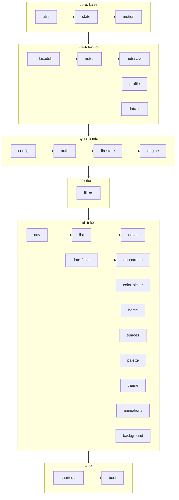
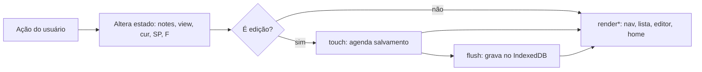
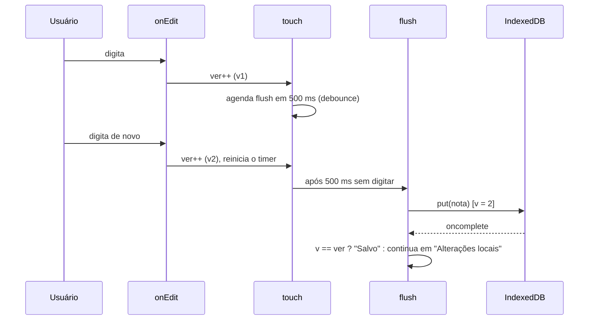
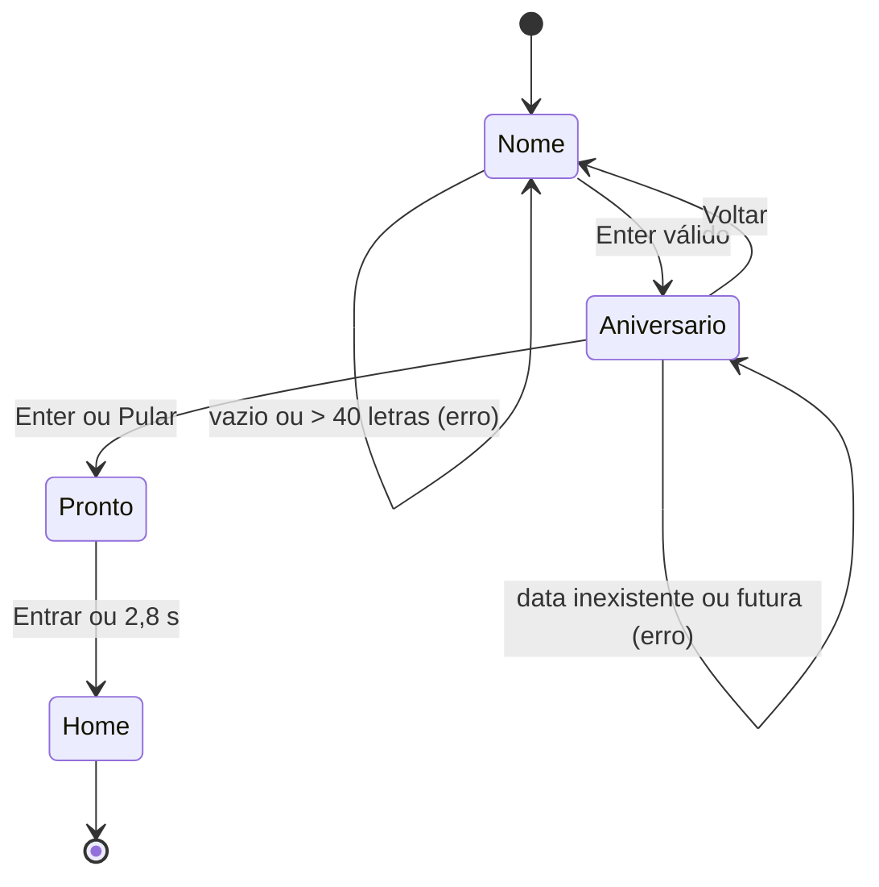
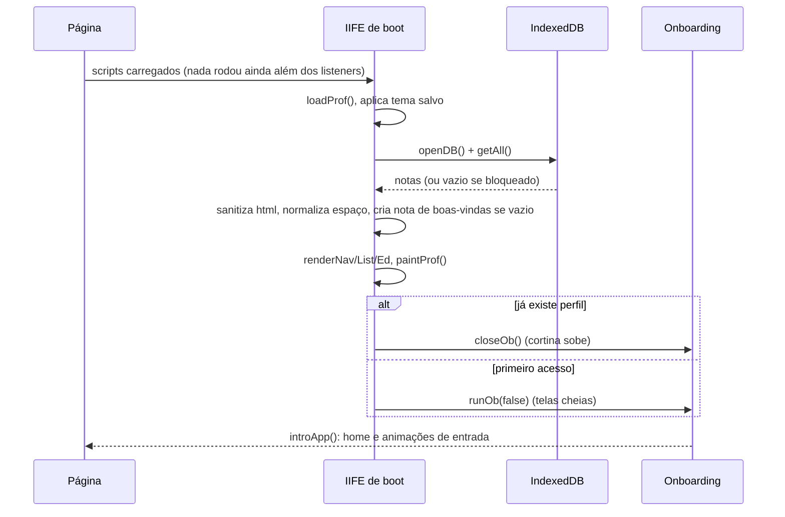
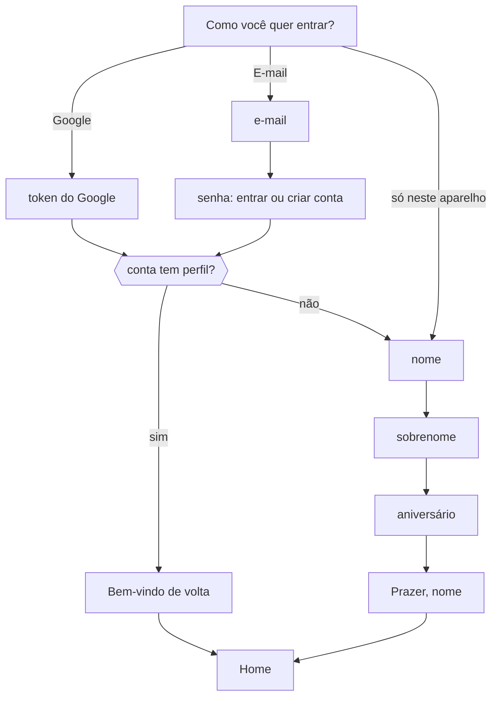

<!-- ARQUIVO GERADO por scripts/docs.mjs. Edite os textos em docs/partes/ e rode: npm run docs -->

# NOEMA: documentação técnica completa

Este documento explica **todo o projeto** e mostra, **literalmente**, cada arquivo de lógica (JavaScript), de design (CSS) e de automação. Os blocos de código abaixo são copiados dos arquivos reais por `scripts/docs.mjs`; por isso nunca ficam desatualizados.

- [Visão geral e como rodar](#visão-geral-e-como-rodar)
- [Arquitetura](#arquitetura)
- [Modelo de dados e persistência](#modelo-de-dados-e-persistência)
- [Salvamento automático](#salvamento-automático)
- [Navegação, lista e filtros](#navegação-lista-e-filtros)
- [Editor rico](#editor-rico)
- [Criação de perfil (onboarding)](#criação-de-perfil-onboarding)
- [Home gráfica e espaços](#home-gráfica-e-espaços)
- [Paleta de comandos, atalhos, tema e backup](#paleta-de-comandos-atalhos-tema-e-backup)
- [Exportar nota: PDF, TXT, JSON e Markdown](#exportar-nota-pdf-txt-json-e-markdown)
- [Movimento e animações](#movimento-e-animações)
- [Fundo de seda (design complexo)](#fundo-de-seda-design-complexo)
- [Inicialização (boot)](#inicialização-boot)
- [Design system (CSS)](#design-system-css)
- [Build, verificação e testes](#build-verificação-e-testes)
- [Conta, login e sincronização](#conta-login-e-sincronização)
- [Aplicativo Android (APK)](#aplicativo-android-apk)
- [Dados](#dados)
- [Interface](#interface)
- [Validação](#validação)
- [Dados](#dados)
- [Interface](#interface)
- [Validação](#validação)
- [Uso](#uso)
- [Uso](#uso)
- [Assistente leve (IA)](#assistente-leve-ia)

## Visão geral e como rodar

NOEMA é um app web de anotações: perfil criado em telas cheias, espaços (Escola, Trabalho, Pessoal...), homepage gráfica, editor com capítulos e formatação, modo Zen, filtros, exportação (PDF, TXT, JSON, Markdown), conta Google/e-mail com sincronização entre aparelhos, configurações em modal, paleta de comandos e fundo animado de seda. Tudo roda no navegador, **sem servidor e sem dependências** (só GSAP, carregado de CDN, para animar).

```bash
# desenvolvimento: abra index.html direto no navegador (arquivos separados)
# produção: um único arquivo
npm run build        # gera dist/noema.html
npm run check        # verifica sintaxe, arquivos órfãos e declarações duplicadas
npm run docs         # regenera este README com o código literal
npm test             # teste de fumaça (Playwright)
npm run test:export  # valida a exportação (Playwright + pypdf)
npm run test:sync    # valida conta e sincronização entre 2 aparelhos (servidor simulado)
```

### Estrutura de pastas

```text
noema/
├─ index.html              entrada de desenvolvimento: lista CSS e JS na ordem de carga
├─ package.json            scripts (check, build, docs, test)
├─ README.md               resumo curto do projeto
├─ src/
│  ├─ css/                 design system em 12 arquivos numerados (a ordem é a cascata)
│  └─ js/
│     ├─ core/             utils, state, motion        (base, sem dependência de tela)
│     ├─ data/             indexeddb, notes, autosave, profile, data-io   (dados e persistência)
│     ├─ sync/             config, auth, firestore, engine   (conta Google/e-mail e sincronização)
│     ├─ features/         filters, pdf, export        (busca e exportação PDF/TXT/JSON)
│     ├─ ui/               nav, list, editor, color-picker, date-fields, onboarding,
│     │                    home, spaces, settings, palette, theme, animations, background
│     └─ app/              shortcuts, boot             (cola e inicialização)
├─ firebase/firestore.rules  regras de segurança do banco (cada pessoa só vê o seu)
├─ capacitor.config.json   ponte para o aplicativo Android (veja a seção Android)
├─ noema.config.example.json  modelo da configuração de conta (copie para noema.config.json)
├─ scripts/                build.mjs, check.mjs, docs.mjs, android.mjs   (automação em Node)
├─ tests/                  smoke.py, export.py, sync.py e mock-firebase.mjs (servidor Firebase de mentira)
├─ docs/
│  ├─ partes/              textos de explicação (editáveis)
│  └─ README.md            ESTE arquivo (gerado)
└─ dist/noema.html         build final em arquivo único
```

---

## Arquitetura

**Scripts clássicos, escopo global compartilhado.** Cada `.js` é carregado por `<script src>` na ordem do `index.html`. Declarações de nível superior (`function`, `const`, `let`) ficam visíveis para os arquivos seguintes. Escolhi isso em vez de ES Modules para que o app abra direto do disco (`file://`) e para que o `build` apenas concatene arquivos. A contrapartida é que **a ordem importa**: `scripts/check.mjs` impede nomes duplicados.



**Regras de dependência.** `core` não conhece ninguém. `data` conhece `core`. `ui` chama `data` e `features`, nunca o contrário (a exceção é o `autosave`, que pede à interface para redesenhar depois de gravar). `app/boot.js` é o último: só ele inicia a execução.

**Fluxo de dados (uma direção).** O estado vive em variáveis globais (`notes`, `view`, `cur`...). Uma ação (clique, tecla) altera o estado, chama `touch()` se for edição, e depois as funções `render*` redesenham a parte afetada a partir do estado. Não há cópia do estado dentro do DOM.



---

## Modelo de dados e persistência

### Onde cada coisa é guardada

| Dado | Onde | Chave / nome |
|---|---|---|
| Notas | IndexedDB, banco `noema`, store `notes` (`keyPath: id`) | uma linha por nota |
| Perfil (nome, aniversário, espaços) | `localStorage` | `noema-profile` |
| Tema | `localStorage` | `noema-theme` (`light` ou ausente = AMOLED) |
| Preferência de animação | `localStorage` | `noema-motion` (`on`, `auto`, `off`) |

Nenhum dado sai do navegador. Se o armazenamento estiver bloqueado, o app avisa (barra do editor: "Só em memória") em vez de fingir que salvou.

### A nota (criada por `mk`)

| Campo | Tipo | Significado |
|---|---|---|
| `id` | string | identificador único (`crypto.randomUUID`) |
| `title` / `body` | string | título e **texto puro** (usado em busca, contagem e links) |
| `html` | string | conteúdo formatado, **sempre sanitizado** por `clean()` |
| `space` | string | nome do espaço (`''` = sem espaço) |
| `tags` | string[] | etiquetas |
| `fav`, `arch`, `trash`, `inbox` | boolean | favorita, arquivada, na lixeira, ainda na Inbox |
| `created`, `updated` | número (ms) | datas de criação e última edição |

### Regra de visibilidade (`inV`)

Uma única função decide se a nota aparece na visão atual; menu, contagens e lista usam a mesma regra, então nunca divergem. Ordem: espaço (se houver um selecionado) → lixeira → arquivo → inbox → favoritas → "Notas" (tudo que não está na inbox).

### Segurança do HTML

O conteúdo do editor é HTML. Antes de ser reinserido na tela (ao abrir uma nota ou importar um JSON), passa por `clean()`: remove `script`, `style`, `iframe`, `object`, `embed`, `link`, `meta`, `form` e todo atributo `on*` ou com `javascript:`. Colar no editor insere **só texto puro**. Todo texto do usuário que entra em `innerHTML` passa por `esc()`.

**`src/js/core/utils.js`** (16 linhas)

```js
/* Funções puras e helpers de DOM: seletor, escape de HTML, sanitização, datas. */
// Atalhos de DOM: $ = querySelector, $$ = querySelectorAll (já como array).
const $=s=>document.querySelector(s),$$=s=>[...document.querySelectorAll(s)];
// Escapa HTML antes de pôr texto do usuário em innerHTML (evita XSS).
const esc=s=>String(s).replace(/[&<>"]/g,c=>({'&':'&amp;','<':'&lt;','>':'&gt;','"':'&quot;'}[c]));
// Id estável e único de cada registro.
const uid=()=>(crypto.randomUUID?crypto.randomUUID():Date.now().toString(36)+Math.random().toString(36).slice(2));
const hm=()=>new Date().toLocaleTimeString('pt-BR',{hour:'2-digit',minute:'2-digit'});
// Sanitizador: remove script/style/iframe e atributos on*/javascript: do HTML salvo ou importado.
function clean(h){const t=document.createElement('template');t.innerHTML=h||'';t.content.querySelectorAll('script,style,iframe,object,embed,link,meta,form').forEach(e=>e.remove());
 t.content.querySelectorAll('*').forEach(e=>[...e.attributes].forEach(a=>{if(/^on/i.test(a.name)||/javascript:/i.test(a.value))e.removeAttribute(a.name)}));return t.innerHTML}
// Data local de hoje em AAAA-MM-DD.
const ymd=()=>{const t=new Date();return t.getFullYear()+'-'+String(t.getMonth()+1).padStart(2,'0')+'-'+String(t.getDate()).padStart(2,'0')};
const isoToBr=s=>s?s.split('-').reverse().join('/'):'';
// Converte dd/mm/aaaa em AAAA-MM-DD validando o calendário (31/02 é recusado).
const brIso=s=>{const m=/^(\d\d)\/(\d\d)\/(\d{4})$/.exec(s);if(!m)return null;const d=new Date(+m[3],+m[2]-1,+m[1]);return d.getFullYear()==+m[3]&&d.getMonth()==+m[2]-1&&d.getDate()==+m[1]?`${m[3]}-${m[2]}-${m[1]}`:null};
```

**`src/js/core/state.js`** (32 linhas)

```js
/* Estado global do app (variáveis de módulo compartilhadas). */
// Estado global: notas em memória, visão atual, nota aberta, busca e controle do autosave (timer, ver, saved).
let db = null,
  notes = [],
  view = "home",
  cur = null,
  q = "",
  tagF = null,
  timer = 0,
  ver = 0,
  saved = 0,
  delArm = false,
  pIdx = 0,
  lastR = null,
  shown = [];
const VIEWS = [
  ["inbox", "Inbox"],
  ["all", "Notas"],
  ["fav", "Favoritas"],
  ["archive", "Arquivo"],
  ["trash", "Lixeira"],
  ["tasks", "Tarefas"],
  ["reminders", "Lembretes"],
  ["calendar", "Calendário"],
  ["graph", "Grafo"],
];
let prof = null,
  obTmp = {},
  obDone = false,
  obEdit = false,
  lastEd = null;
let SP = null;
```

**`src/js/data/indexeddb.js`** (55 linhas)

```js
/* Camada de persistência: IndexedDB com promessas. */
// Abre o banco 'noema' (object store 'notes'). Rejeita se o navegador não oferecer IndexedDB.
const openDB = () =>
  new Promise((res, rej) => {
    try {
      const r = indexedDB.open("noema", 3);
      r.onupgradeneeded = () => {
        if (!r.result.objectStoreNames.contains("notes"))
          r.result.createObjectStore("notes", { keyPath: "id" });
        if (!r.result.objectStoreNames.contains("tasks"))
          r.result.createObjectStore("tasks", { keyPath: "id" });
        if (!r.result.objectStoreNames.contains("reminders"))
          r.result.createObjectStore("reminders", { keyPath: "id" });
      };
      r.onsuccess = () => res(r.result);
      r.onerror = () => rej(r.error);
    } catch (e) {
      rej(e);
    }
  });
// Executa uma operação numa transação; sem banco devolve vazio (modo só memória).
const tx = (m, f, sn = "notes") =>
  db
    ? new Promise((res, rej) => {
        const t = db.transaction(sn, m);
        const r = f(t.objectStore(sn));
        t.oncomplete = () => res(r && r.result);
        t.onerror = t.onabort = () => rej(t.error);
      })
    : Promise.resolve([]);
// Gravar e remover: só resolvem no 'oncomplete' da transação, ou seja, quando realmente persistiu.
// Esvazia o banco local (usado ao sair da conta apagando os dados do aparelho).
const clearAll = () =>
  db
    ? new Promise((res, rej) => {
        const t = db.transaction(["notes", "tasks", "reminders"], "readwrite");
        ["notes", "tasks", "reminders"].forEach((n) =>
          t.objectStore(n).clear(),
        );
        t.oncomplete = () => res(true);
        t.onerror = t.onabort = () => rej(t.error);
      })
    : Promise.resolve(true);
const put = (n) => tx("readwrite", (s) => s.put(n)),
  rm = (id) => tx("readwrite", (s) => s.delete(id)),
  getAll = () => tx("readonly", (s) => s.getAll());
// Salva e devolve true/false; nunca lança erro.
const save = async (n) => {
  try {
    await put(n);
    return true;
  } catch (e) {
    return false;
  }
};
```

**`src/js/data/notes.js`** (6 linhas)

```js
/* Modelo de nota, visibilidade por visão e título de exibição. */
// Fábrica de nota: todo registro nasce com todos os campos.
const mk=o=>({id:uid(),title:'',body:'',html:'',space:'',tags:[],fav:false,arch:false,trash:false,inbox:false,created:Date.now(),updated:Date.now(),dirty:true,...o});
// Regra única de visibilidade: espaço atual + visão (lixeira, arquivo, inbox, favoritas, notas).
function inV(n){if(SP!==null&&n.space!==SP)return false;if(view=='trash')return n.trash;if(n.trash)return false;if(view=='archive')return n.arch;if(n.arch)return false;if(view=='inbox')return n.inbox;if(view=='fav')return n.fav;return !n.inbox}
const ttl=n=>n.title||'Sem título';
```

**`src/js/data/profile.js`** (8 linhas)

```js
/* Perfil do usuário (nome, aniversário, espaços) no localStorage. */
// Lê o perfil; garante a lista padrão de espaços.
function loadProf(){try{prof=JSON.parse(localStorage.getItem('noema-profile'))}catch(e){prof=null}if(prof&&!Array.isArray(prof.spaces))prof.spaces=['Escola','Trabalho','Pessoal']}
function paintProf(){const p=$('#bset');if(p)p.title=prof&&prof.name?'Configurações de '+fullName():'Configurações'}
// Grava o perfil. Sem `keep`, carimba a edição (updated) e marca para envio à conta; com `keep`, só guarda (usado ao receber da nuvem).
const persistProf=keep=>{if(prof&&!keep){prof.updated=Date.now();prof.dirty=true}try{localStorage.setItem('noema-profile',JSON.stringify(prof))}catch(e){}if(!keep&&typeof syncSoon=='function')syncSoon()};
// Nome completo (nome + sobrenome): é o "autor" nas exportações.
const fullName=()=>prof?[prof.name,prof.last].filter(Boolean).join(' '):'';
```

---

## Salvamento automático

O indicador **nunca mente**: "Salvo" só aparece depois que a transação do IndexedDB termina (`oncomplete`). Estados: *Alterações locais…* → *Salvando…* → *Salvo às HH:MM* (ou *Falha ao salvar*). Cada edição incrementa `ver`; ao terminar de gravar, `flush` compara a versão que gravou (`v`) com a atual. Se o usuário continuou digitando, **não** mostra "Salvo".



Ao trocar de nota, `openN` e `newNote` chamam `flush()` antes, e `beforeunload` tenta gravar a pendência.

**`src/js/data/autosave.js`** (10 linhas)

```js
/* Salvamento automático com estados reais (local, salvando, salvo, falha). */
// Mostra o estado de salvamento na barra do editor.
function setS(t,err){const s=$('#st');if(s){s.textContent=t;s.style.color=err?'#c0392b':''}}
// Chamado a cada edição: sobe a versão e agenda o salvamento em 500 ms (debounce).
function touch(){ver++;setS('Alterações locais…');clearTimeout(timer);timer=setTimeout(flush,500)}
// Grava a nota. Só escreve 'Salvo' se nenhuma edição nova chegou durante a gravação (v == ver).
async function flush(){clearTimeout(timer);timer=0;if(!cur||saved==ver)return;const v=ver,n=cur;n.updated=Date.now();n.dirty=true;setS('Salvando…');
 if(!await save(n))return setS('Falha ao salvar: exporte seus dados e tente de novo',1);
 if(v==ver){saved=v;setS(db?'Salvo às '+hm():'Só em memória: nada será mantido ao fechar',!db)}
 renderNav();renderList();renderLinks();syncSoon()}
```

---

## Navegação, lista e filtros

**Menu (`nav.js`).** Mostra *Início*, os **espaços** (cada um com contagem de notas não arquivadas), as **visões** (Inbox, Notas, Favoritas, Arquivo, Lixeira) e as tags. Trocar de espaço filtra tudo; estando na Início, vai para "Notas".

**Lista (`list.js`).** Aplica, nesta ordem: `inV` (visão + espaço) → busca por texto (título, corpo, tags) → `matchF` (filtros) → `sortF` (ordem). Na Inbox há o campo de captura rápida (Enter cria o item).

**Filtros (`filters.js`).** Estado em `F`: tags (a nota precisa ter **todas** as marcadas), sem tags, favoritas, período (Hoje, 7 dias, 30 dias, Este ano ou intervalo `dd/mm/aaaa`), qual data considerar (edição ou criação) e ordenação. A máscara de data digita as barras sozinha e só aplica o filtro quando a data é completa e existe no calendário.

**`src/js/ui/nav.js`** (103 linhas)

```js
/* Navegação: troca de visão, espaços e tags no menu lateral. */
// Troca de visão. A home usa a classe body.home para esconder lista e editor.
function go(v) {
  view = v;
  tagF = null;
  document.body.classList.toggle(
    "home",
    v == "home" ||
      v == "tasks" ||
      v == "reminders" ||
      v == "calendar" ||
      v == "graph",
  );
  document.body.classList.toggle("tasks", v == "tasks");
  document.body.classList.toggle("reminders", v == "reminders");
  document.body.classList.toggle("calendar", v == "calendar");
  document.body.classList.toggle("graph", v == "graph");
  renderNav();
  renderList();
  if (v == "home") renderHome(true);
  else if (v == "tasks") renderTasks();
  else if (v == "reminders") renderReminders();
  else if (v == "calendar") renderCalendar();
  else if (v == "graph") renderGraph();
  else animList();
}
// Desenha o menu: início, espaços (com contagem), visões e tags.
function renderNav() {
  const c = (v) =>
    v == "tasks"
      ? tasks.length
      : v == "reminders"
        ? reminders.filter((r) => r.active).length
        : v == "calendar"
          ? calendarItemsOn(calendarKey(new Date())).length
          : v == "graph"
            ? graphData().nodes.length
            : (() => {
                const o = view;
                view = v;
                const r = notes.filter(inV).length;
                view = o;
                return r;
              })();
  $("#nv").innerHTML =
    navTop() +
    VIEWS.map(
      ([k, l]) =>
        `<button data-v="${k}" aria-current="${view == k}"><span>${l}</span><span class="m">${c(k)}</span></button>`,
    ).join("");
  const t = {};
  notes
    .filter((n) => !n.trash)
    .forEach((n) => n.tags.forEach((x) => (t[x] = (t[x] || 0) + 1)));
  $("#tags").innerHTML =
    Object.keys(t)
      .sort()
      .map(
        (x) =>
          `<button data-t="${esc(x)}" aria-current="${F.tags.includes(x)}"><span>#${esc(x)}</span><span class="m">${t[x]}</span></button>`,
      )
      .join("") || '<div class="m" style="padding:4px 8px">nenhuma</div>';
}
$("#nv").onclick = (e) => {
  const b = e.target.closest("button");
  if (!b) return;
  if (b.dataset.sp !== undefined) {
    const v = b.dataset.sp;
    if (v == "__m") return openSpaces();
    SP = v == "__none" ? "" : v || null;
    go(view == "home" ? "all" : view);
  } else go(b.dataset.v);
};
$("#tags").onclick = (e) => {
  const b = e.target.closest("button");
  if (b) {
    const x = b.dataset.t;
    F.tags = F.tags.includes(x) ? F.tags.filter((y) => y != x) : [...F.tags, x];
    F.un = false;
    renderNav();
    renderList();
  }
};
$("#bsk").onclick = openCanvas;
function navTop() {
  const sp = (prof && prof.spaces) || [],
    cs = (s) =>
      notes.filter((n) => !n.trash && !n.arch && n.space === s).length,
    un = cs("");
  return (
    `<button data-v="home" aria-current="${view == "home"}"><span>Início</span></button><h3>espaços</h3><button data-sp="" aria-current="${SP === null}"><span>Tudo</span></button>` +
    sp
      .map(
        (s) =>
          `<button data-sp="${esc(s)}" aria-current="${SP === s}"><span>${esc(s)}</span><span class="m">${cs(s)}</span></button>`,
      )
      .join("") +
    (un
      ? `<button data-sp="__none" aria-current="${SP === ""}"><span>Sem espaço</span><span class="m">${un}</span></button>`
      : "") +
    `<button data-sp="__m"><span class="m">gerenciar espaços</span></button><h3>notas</h3>`
  );
}
```

**`src/js/ui/list.js`** (12 linhas)

```js
/* Lista de notas e captura rápida. */
// Desenha a lista aplicando visão, espaço, busca, filtros e ordenação.
function renderList(){const L=$('#lp'),qq=q.toLowerCase();
 const rows=notes.filter(inV).filter(n=>matchF(n)&&(!qq||(n.title+' '+n.body+' '+n.tags.join(' ')).toLowerCase().includes(qq))).sort(sortF);
 L.innerHTML=`<h2 class="lh">${esc(SP===null?'Tudo':SP||'Sem espaço')}<span class="m">${esc((VIEWS.find(v=>v[0]==view)||[])[1]||'')}</span></h2><input id="q" type="search" placeholder="Buscar" aria-label="Buscar" value="${esc(q)}">`+`<button class="gh" data-f="open" aria-expanded="${fOpen}">Filtros${fn()?' ('+fn()+')':''}</button>`+(fOpen?fpHTML():'')+
 (view=='inbox'?`<input id="cap" placeholder="Capturar um pensamento (Enter)" aria-label="Captura rápida">`:`<button class="gh" id="nn" style="margin-bottom:8px">Nova nota</button>`)+
 (rows.length?rows.map(n=>`<button class="it" data-id="${n.id}" aria-current="${!!cur&&cur.id==n.id}"><b>${esc(ttl(n))}</b><span class="s">${esc(n.body.replace(/\s+/g,' ').slice(0,90)||'vazia')}</span><span class="m">${new Date(n.updated).toLocaleDateString('pt-BR')}${n.fav?' · favorita':''}</span></button>`).join(''):
 `<div class="empty">${view=='inbox'?'Nada pendente. Escreva o que passou pela cabeça e organize depois.':q||fn()?'Nenhuma nota para esse filtro.':'Esta lista está vazia.'}</div>`);
 $('#q').oninput=e=>{q=e.target.value;const p=e.target.selectionStart;renderList();const n=$('#q');n.focus();n.setSelectionRange(p,p)};
 const c=$('#cap');if(c)c.onkeydown=async e=>{if(e.key=='Enter'&&c.value.trim()){const n=mk({inbox:true,space:SP||'',body:c.value.trim(),html:'<p>'+esc(c.value.trim())+'</p>'});notes.push(n);await save(n)||setS('Falha ao salvar',1);renderNav();renderList();$('#cap').focus()}};
 const b=$('#nn');if(b)b.onclick=newNote}
$('#lp').addEventListener('click',e=>{const b=e.target.closest('.it');if(b)openN(b.dataset.id)});
```

**`src/js/features/filters.js`** (29 linhas)

```js
/* Filtros combináveis: tags, período, favoritas, ordenação. */
// Estado padrão dos filtros.
const F0=()=>({tags:[],range:'any',from:'',to:'',by:'updated',fav:false,un:false,sort:'updated'});
let F=F0(),fOpen=false;
const fn=()=>F.tags.length+(F.range!='any'?1:0)+((F.from||F.to)?1:0)+(F.fav?1:0)+(F.un?1:0);
// Filtro de uma nota: tags (todas), sem tags, favoritas e período (por data de edição ou criação).
function matchF(n){if(F.tags.length&&!F.tags.every(t=>n.tags.includes(t)))return false;if(F.un&&n.tags.length)return false;if(F.fav&&!n.fav)return false;
 const t=n[F.by],d=new Date(),s0=new Date(d.getFullYear(),d.getMonth(),d.getDate()).getTime(),day=864e5;
 const lo={today:s0,'7':s0-6*day,'30':s0-29*day,year:new Date(d.getFullYear(),0,1).getTime()}[F.range];
 if(lo!==undefined&&t<lo)return false;if(F.from&&t<new Date(F.from+'T00:00:00').getTime())return false;
 if(F.to&&t>=new Date(F.to+'T00:00:00').getTime()+day)return false;return true}
const sortF=(a,b)=>F.sort=='old'?a.updated-b.updated:F.sort=='title'?ttl(a).localeCompare(ttl(b),'pt-BR'):F.sort=='created'?b.created-a.created:b.updated-a.updated;
function fpHTML(){const t={};notes.filter(n=>!n.trash).forEach(n=>n.tags.forEach(x=>t[x]=(t[x]||0)+1));
 const c=(k,x,l,on)=>`<button class="fc" data-f="${k}" data-x="${esc(x)}" aria-pressed="${on}">${l}</button>`;
 const tg=Object.keys(t).sort().map(x=>c('tag',x,'#'+esc(x)+' '+t[x],F.tags.includes(x))).join('')||'<span class="m">nenhuma tag ainda</span>';
 return `<div class="fp"><div class="m">tags (todas as marcadas)</div><div class="fr">${tg}</div>
 <div class="m">período</div><div class="fr">${[['any','Tudo'],['today','Hoje'],['7','7 dias'],['30','30 dias'],['year','Este ano']].map(([v,l])=>c('range',v,l,F.range==v&&!F.from&&!F.to)).join('')}</div>
 <div class="fr" style="margin-top:6px"><label class="m">de<input class="fdi" id="fd1" inputmode="numeric" maxlength="10" placeholder="dd/mm/aaaa" aria-label="Data inicial" value="${isoToBr(F.from)}"></label><label class="m">até<input class="fdi" id="fd2" inputmode="numeric" maxlength="10" placeholder="dd/mm/aaaa" aria-label="Data final" value="${isoToBr(F.to)}"></label></div>
 <div class="m">data considerada</div><div class="fr">${c('by','updated','Edição',F.by=='updated')}${c('by','created','Criação',F.by=='created')}</div>
 <div class="m">mostrar</div><div class="fr">${c('fav','','Favoritas',F.fav)}${c('un','','Sem tags',F.un)}</div>
 <div class="m">ordem</div><div class="fr">${[['updated','Recentes'],['old','Antigas'],['created','Criação'],['title','Título']].map(([v,l])=>c('sort',v,l,F.sort==v)).join('')}</div>
 <div class="fr" style="margin-top:12px"><button class="gh" data-f="clear" data-x="">Limpar filtros</button></div></div>`}
$('#lp').addEventListener('click',e=>{const b=e.target.closest('[data-f]');if(!b)return;const k=b.dataset.f,v=b.dataset.x;
 if(k=='open')fOpen=!fOpen;else if(k=='tag'){F.tags=F.tags.includes(v)?F.tags.filter(x=>x!=v):[...F.tags,v];F.un=false}
 else if(k=='range'){F.range=v;F.from=F.to=''}else if(k=='by')F.by=v;else if(k=='fav')F.fav=!F.fav;
 else if(k=='un'){F.un=!F.un;if(F.un)F.tags=[]}else if(k=='sort')F.sort=v;else if(k=='clear')F=F0();
 renderNav();renderList()});
$('#lp').addEventListener('input',e=>{const t=e.target;if(t.id!='fd1'&&t.id!='fd2')return;const d=t.value.replace(/\D/g,'').slice(0,8);t.value=d.length>4?d.slice(0,2)+'/'+d.slice(2,4)+'/'+d.slice(4):d.length>2?d.slice(0,2)+'/'+d.slice(2):d;
 const k=t.id=='fd1'?'from':'to',iso=t.value?brIso(t.value):'';if(iso===null||iso===F[k])return;F[k]=iso;F.range='any';const id=t.id;renderList();const n=$('#'+id);if(n){n.focus();n.setSelectionRange(n.value.length,n.value.length)}});
```

---

## Editor rico

O corpo da nota é um `<div contenteditable>`. A formatação usa `document.execCommand`, antigo mas ainda suportado, porque entrega negrito, itálico, cor e fundo sem escrever um motor de edição.

**Seleção parcial ou texto inteiro.** `fmt(cmd, valor, whole)` restaura a última seleção guardada (`lastR`, atualizada em `selectionchange`) antes de aplicar o comando. Por isso o botão pode ser clicado, ou um diálogo aberto, sem perder o trecho. Com `whole = true` e **sem seleção**, a função seleciona tudo, aplica e recolhe o cursor; é assim que "cor" e "tamanho" valem para o texto todo.

**Tamanho relativo (`size`).** O navegador só oferece 7 tamanhos fixos. A função aplica `fontSize=7` (cria `<font size="7">`) e troca cada `<font>` por um `<span>` cujo `font-size` é o tamanho **atual** do pai × 1,15 (ou × 0,87), limitado entre 10 px e 80 px. Assim, aumentar duas vezes cresce de forma acumulada.

**Capítulos e tópicos.** `h1` = capítulo, `h2` = tópico. A numeração dos capítulos não existe no HTML: é um contador CSS (`counter-increment` em `#bo h1`), então reordenar renumera sozinho. O **sumário** (`outline`) lê os `h1`/`h2` do corpo e cria links que rolam até eles.

**Cor "Padrão".** Não existe `execCommand` para remover só a cor. `setCol(null)` aplica uma cor-marca (`#010203`) e, em seguida, remove essa propriedade dos elementos, devolvendo o texto à cor do tema.

**Links entre notas.** `[[Título]]` no texto cria *referência de saída*; a nota citada mostra a *referência de entrada*. Se o título não existe, o botão vermelho cria a nota.

**Markdown.** `toMd` percorre os blocos do HTML: `h1` → `##`, `h2` → `###`, listas → `-`, o resto vira parágrafo. (O `#` simples é o título da nota.)

**Seletor de cor próprio.** O `<input type="color">` nativo não aceita estilo. O botão **Cor** abre um painel com 9 amostras e um campo hexadecimal (`#a99aef` + Enter), posicionado com `getBoundingClientRect` (abre para cima se faltar espaço) e fechado por clique fora ou Esc.

**`src/js/ui/editor.js`** (77 linhas)

```js
/* Editor rico: formatação, capítulos, sumário, links, Markdown e modo Zen. */
async function newNote(){await flush();const n=mk({space:SP||''});notes.push(n);view='all';document.body.classList.remove('home');await save(n);cur=n;ver=saved=0;document.body.classList.add('ed');renderNav();renderList();renderEd();$('#ti').focus()}
// Abre uma nota: grava a anterior antes, zera o controle de versão e mostra o editor.
async function openN(id){await flush();cur=notes.find(n=>n.id==id);delArm=false;lastEd=null;document.body.classList.remove('home');if(view=='home')view='all';ver=saved=0;document.body.classList.add('ed');renderList();renderEd()}
// Desenha o editor da nota atual (título, tags, espaço, barra, corpo, links). Sem nota, mostra a saudação.
function renderEd(){const E=$('#ed');if(!cur){E.innerHTML=(setTimeout(animHi,0),hiHTML());return}
 const n=cur;
 E.innerHTML=`<div class="meta"><button class="gh back" id="bk">Voltar</button><span class="m" id="st" role="status">${db?'Aberta':'Só em memória: nada será mantido ao fechar'}</span><span class="sp"></span><button class="gh" id="zn" title="Modo Zen (Ctrl+.)">Zen</button></div>
 <input id="ti" placeholder="Título" aria-label="Título"><input id="tg" class="m" placeholder="tags, separadas por vírgula" aria-label="Tags"><div class="fr" id="sps" role="group" aria-label="Espaço da nota" style="margin-bottom:14px"><button class="fc" data-sa="" aria-pressed="${!n.space}">Sem espaço</button>${((prof&&prof.spaces)||[]).map(s=>`<button class="fc" data-sa="${esc(s)}" aria-pressed="${n.space===s}">${esc(s)}</button>`).join('')}</div>
 <div class="tb" role="toolbar" aria-label="Formatação">
 <button data-c="h1" title="Capítulo" aria-label="Capítulo">Capítulo</button><button data-c="h2" title="Tópico" aria-label="Tópico">Tópico</button><button data-c="p" title="Texto normal" aria-label="Texto normal">Texto</button><i class="v"></i>
 <button data-c="b" title="Negrito (Ctrl+B)" aria-label="Negrito"><b>N</b></button><button data-c="i" title="Itálico (Ctrl+I)" aria-label="Itálico"><i>I</i></button><button data-c="u" title="Sublinhado (Ctrl+U)" aria-label="Sublinhado"><u>S</u></button><button data-c="hl" title="Grifar" aria-label="Grifar"><span style="background:rgba(255,200,0,.45);padding:0 4px">Grifar</span></button>
 <button data-c="cor" id="cb" title="Cor do texto (sem seleção, muda o texto todo)" aria-label="Cor do texto" aria-haspopup="true" aria-expanded="false"><span id="cs" style="border-bottom:3px solid var(--acc)">Cor</span></button><i class="v"></i>
 <button data-c="s-" title="Diminuir (sem seleção, o texto todo)" aria-label="Diminuir tamanho">A−</button><button data-c="s+" title="Aumentar (sem seleção, o texto todo)" aria-label="Aumentar tamanho">A+</button><button data-c="ul" title="Lista" aria-label="Lista">Lista</button><button data-c="rf" title="Limpar formatação" aria-label="Limpar formatação">Limpar</button></div>
 <div id="ol"></div><div id="bo" contenteditable="true" role="textbox" aria-multiline="true" aria-label="Conteúdo" data-ph="Escreva. Use [[Nome de outra nota]] para criar um link."></div>
 <div class="meta" style="margin:22px 0 0;flex-wrap:wrap;gap:4px">${n.trash?`<button class="gh" data-a="rest">Restaurar</button><button class="gh d" data-a="del">${delArm?'Confirmar exclusão definitiva':'Excluir definitivamente'}</button>`:
 `${n.inbox?'<button class="gh" data-a="org">Mover para Notas</button>':''}<button class="gh" data-a="fav">${n.fav?'Desfavoritar':'Favoritar'}</button><button class="gh" data-a="arch">${n.arch?'Desarquivar':'Arquivar'}</button><button class="gh" data-a="trash">Lixeira</button>`}<button class="gh" data-a="exp">Exportar</button></div>
 <div id="links"></div><div class="m" id="wc" style="margin-top:14px"></div>`;
 $('#ti').value=n.title;$('#tg').value=n.tags.join(', ');
 $('#bo').innerHTML=clean(n.html||esc(n.body).split('\n').map(l=>'<p>'+(l||'<br>')+'</p>').join(''));
 try{document.execCommand('defaultParagraphSeparator',false,'p')}catch(e){}
 const bo=$('#bo');outline();wc();
 $('#ti').oninput=e=>{n.title=e.target.value;touch()};
 $('#tg').oninput=e=>{n.tags=[...new Set(e.target.value.split(',').map(s=>s.trim().replace(/^#/,'')).filter(Boolean))];touch()};
 bo.oninput=onEdit;
 bo.onpaste=e=>{e.preventDefault();document.execCommand('insertText',false,e.clipboardData.getData('text/plain'))};
 $('#bk').onclick=async()=>{await flush();document.body.classList.remove('ed')};
 $('#zn').onclick=toggleZen;
 animEd();
 renderLinks()}
function wc(){const w=$('#wc');if(w&&cur)w.textContent=(cur.body.trim()?cur.body.trim().split(/\s+/).length:0)+' palavras · criada em '+new Date(cur.created).toLocaleDateString('pt-BR')}
// Toda edição: copia HTML e texto puro, atualiza contagem e sumário e agenda o autosave.
function onEdit(){cur.html=$('#bo').innerHTML;cur.body=$('#bo').innerText;wc();outline();touch()}
// Sumário: capítulos (h1) e tópicos (h2) viram links que rolam até o título.
function outline(){const o=$('#ol');if(!o)return;const hs=$$('#bo h1,#bo h2');let c=0;
 o.innerHTML=hs.length?`<div class="m" style="margin-bottom:4px">sumário</div>`+hs.map((h,i)=>`<button data-h="${i}" class="${h.tagName=='H2'?'l2':''}">${h.tagName=='H1'?++c+'. ':''}${esc(h.textContent.trim()||'sem título')}</button>`).join(''):''}
// Guarda o último trecho selecionado no editor para formatar mesmo depois de clicar num botão.
document.addEventListener('selectionchange',()=>{const s=getSelection(),b=$('#bo');if(b&&s.rangeCount&&b.contains(s.anchorNode))lastR=s.getRangeAt(0).cloneRange()});
// Formata via execCommand. Sem seleção e com whole=true, aplica ao texto inteiro.
function fmt(cmd,val,whole){const b=$('#bo');b.focus();const s=getSelection();if(lastR&&b.contains(lastR.startContainer)){s.removeAllRanges();s.addRange(lastR)}
 let all=false;if(whole&&s.isCollapsed){document.execCommand('selectAll');all=true}
 document.execCommand('styleWithCSS',false,true);document.execCommand(cmd,false,val);if(all)getSelection().collapseToEnd();onEdit()}
// Tamanho relativo: troca <font size=7> por <span> com font-size em px, multiplicando o tamanho atual.
function size(f){const b=$('#bo');b.focus();const s=getSelection();if(lastR&&b.contains(lastR.startContainer)){s.removeAllRanges();s.addRange(lastR)}
 let all=false;if(s.isCollapsed){document.execCommand('selectAll');all=true}
 document.execCommand('styleWithCSS',false,false);document.execCommand('fontSize',false,'7');
 $$('#bo font[size="7"]').forEach(x=>{const px=parseFloat(getComputedStyle(x.parentElement).fontSize)*f,sp=document.createElement('span');sp.style.fontSize=Math.max(10,Math.min(80,px)).toFixed(1)+'px';sp.innerHTML=x.innerHTML;x.replaceWith(sp)});
 if(all)getSelection().collapseToEnd();onEdit()}
// Grifar/desgrifar: alterna a cor de fundo do trecho.
function hl(){const s=getSelection(),e=s.anchorNode&&(s.anchorNode.nodeType==1?s.anchorNode:s.anchorNode.parentElement);
 const on=e&&getComputedStyle(e).backgroundColor!='rgba(0, 0, 0, 0)'&&getComputedStyle(e).backgroundColor!='transparent';fmt('hiliteColor',on?'transparent':'rgba(255,200,0,.42)')}
// Backlinks ([[título]] em outras notas) e links de saída, com atalho para criar a nota inexistente.
function renderLinks(){const L=$('#links');if(!L||!cur)return;const t=cur.title.trim().toLowerCase();
 const inb=t?notes.filter(m=>m.id!=cur.id&&!m.trash&&m.body.toLowerCase().includes('[['+t+']]')):[];
 const out=[...new Set([...cur.body.matchAll(/\[\[([^\]\n]+)\]\]/g)].map(m=>m[1].trim()))];
 L.innerHTML=`<div class="m">referências de entrada</div>`+(inb.length?inb.map(m=>`<button data-open="${m.id}">${esc(ttl(m))}</button>`).join(''):'<div class="m">nenhuma</div>')+
 `<div class="m" style="margin-top:10px">referências de saída</div>`+(out.length?out.map(x=>{const f=notes.find(m=>!m.trash&&m.title.toLowerCase()==x.toLowerCase());return f?`<button data-open="${f.id}">${esc(x)}</button>`:`<button data-mk="${esc(x)}" style="color:#c0392b">${esc(x)} (inexistente: criar)</button>`}).join(''):'<div class="m">nenhuma</div>')}
// Exporta em Markdown: capítulos viram ##, tópicos ###, listas viram '-'.
function toMd(n){const t=document.createElement('template');t.innerHTML=clean(n.html);const o=[];t.content.childNodes.forEach(c=>{const x=c.textContent.trim();if(!x)return;const k=c.nodeName;
 o.push(k=='H1'?'## '+x:k=='H2'?'### '+x:k=='UL'||k=='OL'?[...c.children].map(l=>'- '+l.textContent.trim()).join('\n'):x)});
 return `# ${ttl(n)}\n\n`+(n.tags.length?n.tags.map(x=>'#'+x).join(' ')+'\n\n':'')+(n.html?o.join('\n\n'):n.body)+'\n'}
// Modo Zen: esconde a interface (classe body.zen).
function toggleZen(){if(!cur&&!document.body.classList.contains('zen'))return newNote().then(toggleZen);const z=document.body.classList.toggle('zen');if(z)document.body.classList.add('ed');const b=$('#zn');if(b)b.textContent=z?'Sair do Zen':'Zen';if(z)$('#bo').focus();if(anim())gsap.from('#ed>*:not(.tb)',{opacity:0,y:10,duration:.7,stagger:.06,ease:'power2.out',clearProps:'transform,opacity'})}
$('#ed').addEventListener('mousedown',e=>{if(e.target.closest('.tb button'))e.preventDefault()});
// Ações dos botões do editor, por delegação de eventos.
$('#ed').addEventListener('click',async e=>{const b=e.target.closest('button');if(!b)return;
 if(b.dataset.h!==undefined){const h=$$('#bo h1,#bo h2')[+b.dataset.h];if(h)h.scrollIntoView({block:'center'});return}
 const c=b.dataset.c;if(c){({h1:()=>fmt('formatBlock','<h1>'),h2:()=>fmt('formatBlock','<h2>'),p:()=>fmt('formatBlock','<p>'),b:()=>fmt('bold'),i:()=>fmt('italic'),u:()=>fmt('underline'),ul:()=>fmt('insertUnorderedList'),hl,'s+':()=>size(1.15),'s-':()=>size(.87),rf:()=>fmt('removeFormat',null,true),cor:openCP})[c]();return}
 if(b.dataset.sa!==undefined&&cur){cur.space=b.dataset.sa;ver++;await flush();return renderEd()}
 if(b.dataset.open)return openN(b.dataset.open);
 if(b.dataset.mk){await flush();const n=mk({title:b.dataset.mk});notes.push(n);await save(n);renderNav();return openN(n.id)}
 const a=b.dataset.a;if(!a||!cur)return;const n=cur;
 if(a=='exp'){await flush();return openExport()}
 if(a=='md'){await flush();return openData(toMd(n),'Markdown da nota. Copie o texto.')}
 if(a=='del'){if(!delArm){delArm=true;return renderEd()}await rm(n.id).catch(()=>{});syncTomb(n.id);notes=notes.filter(x=>x.id!=n.id);cur=null;delArm=false;document.body.classList.remove('ed');renderNav();renderList();return renderEd()}
 if(a=='fav')n.fav=!n.fav;if(a=='arch')n.arch=!n.arch;if(a=='trash')n.trash=true;if(a=='rest')n.trash=false;if(a=='org')n.inbox=false;
 ver++;await flush();if(!inV(n)){cur=null;document.body.classList.remove('ed')}renderNav();renderList();renderEd()});
```

**`src/js/ui/color-picker.js`** (14 linhas)

```js
/* Seletor de cor próprio (substitui o input nativo). */
const SW=[['Padrão',null],['Violeta','#8b7be8'],['Azul','#4a86e8'],['Verde','#3fa46f'],['Amarelo','#d4a72c'],['Laranja','#e07a2f'],['Vermelho','#d9463e'],['Rosa','#d65ca3'],['Cinza','#8a8880']];
$('#cp .sw').innerHTML=SW.map(([n,c])=>`<button class="swb${c?'':' def'}" data-col="${c||''}" aria-label="${n}" title="${n}"${c?` style="background:${c}"`:''}></button>`).join('');
function openCP(){const p=$('#cp'),b=$('#cb');if(!p.hidden)return closeCP();p.hidden=false;const r=b.getBoundingClientRect(),h=p.offsetHeight,w=p.offsetWidth;let top=r.bottom+8;if(top+h>innerHeight-8)top=Math.max(8,r.top-h-8);
 p.style.top=top+'px';p.style.left=Math.max(8,Math.min(r.left,innerWidth-w-8))+'px';b.setAttribute('aria-expanded','true');if(anim())gsap.from(p,{opacity:0,y:-6,duration:.25,ease:'power2.out',clearProps:'transform,opacity'})}
function closeCP(){const p=$('#cp');if(p.hidden)return;p.hidden=true;const b=$('#cb');if(b)b.setAttribute('aria-expanded','false')}
// Aplica a cor. 'Padrão' usa uma cor-marca e depois remove a propriedade, voltando à cor do tema.
function setCol(c){const MK='#010203';fmt('foreColor',c||MK,true);if(!c)$$('#bo [style*="color"]').forEach(e=>{if(e.style.color=='rgb(1, 2, 3)'){e.style.removeProperty('color');if(!e.getAttribute('style'))e.removeAttribute('style')}});
 onEdit();const s=$('#cs');if(s)s.style.borderBottomColor=c||'var(--acc)';closeCP()}
$('#cp').addEventListener('mousedown',e=>{if(e.target.id!='hx')e.preventDefault()});
$('#cp').addEventListener('click',e=>{const b=e.target.closest('.swb');if(b)setCol(b.dataset.col||null)});
$('#hx').onkeydown=e=>{if(e.key=='Enter'){e.preventDefault();let v=e.target.value.trim();if(v&&v[0]!='#')v='#'+v;if(/^#[0-9a-f]{6}$/i.test(v)){e.target.removeAttribute('aria-invalid');e.target.value='';setCol(v)}else e.target.setAttribute('aria-invalid','true')}else e.target.removeAttribute('aria-invalid')};
document.addEventListener('mousedown',e=>{const p=$('#cp');if(!p.hidden&&!p.contains(e.target)&&!e.target.closest('#cb'))closeCP()});
addEventListener('keydown',e=>{if(e.key=='Escape'&&!$('#cp').hidden){closeCP();e.stopImmediatePropagation()}},true);
```

---

## Criação de perfil (onboarding)

No primeiro acesso, o overlay `#ob` cobre a tela inteira e faz uma pergunta por vez: **nome** e **aniversário** (opcional). O app por trás fica `visibility:hidden` e `inert` até terminar. O fundo de seda continua visível porque o overlay é transparente.



**Texto que cabe em qualquer tela.** A pergunta usa fonte de até 220 px. `fitOb` mede `scrollWidth` contra `clientWidth` e reduz a fonte em passos de 2 px até a palavra mais longa caber (útil para nomes longos em tela estreita). Também roda ao redimensionar e quando as fontes web terminam de carregar.

**Data em três campos.** Em vez do seletor nativo, `dtHTML` cria dia / mês / ano. `dtInit` aceita só dígitos, avança o foco ao completar, volta com Backspace e só grava no `<input hidden id="oi">` um valor ISO (`AAAA-MM-DD`) se a data **existe** (31/02 não existe). Preencher só parte da data gera erro; deixar vazio é permitido.

**Animação.** Cada palavra da pergunta está dentro de uma máscara (`.ow`, `overflow:hidden`) e sobe de `yPercent:115` para 0; a linha do campo se desenha com `scaleX`; ao concluir, `clip-path` sobe como uma cortina (`closeOb`).

**`src/js/ui/onboarding.js`** (62 linhas)

```js
/* Entrada na conta e criação de perfil, em telas cheias, passo a passo.
   Telas: auth -> email -> pass (conta)  |  name -> last -> bday (perfil)  |  done. */
const OBP={name:{q:'Como devemos te chamar?',h:'Seu primeiro nome.',p:'Nome',ac:'given-name',max:40},
 last:{q:'E o seu sobrenome?',h:'Aparece como autor nas notas que você exporta.',p:'Sobrenome',ac:'family-name',max:60},
 bday:{q:'Quando é o seu aniversário?',h:'Só para te cumprimentar. Pode pular.',opt:1}};
const PSTEPS=['name','last','bday'];
const words=s=>s.split(' ').map(w=>`<span class="ow"><span class="oc">${esc(w)}</span></span>`).join(' ');
let obMode='new',obPw='signin';   // 'new' = primeiro acesso | 'link' = entrar numa conta a partir das Configurações
// Abre o overlay. Com sincronização configurada e sem conta, começa pela escolha de entrada.
function runOb(mode){obMode=mode||'new';obEdit=obMode=='link';obDone=false;obPw='signin';
 obTmp={name:prof&&prof.name||'',last:prof&&prof.last||'',bday:prof&&prof.bday||'',email:''};
 document.body.classList.add('onb');$('#app').inert=true;const o=$('#ob');o.hidden=false;o.style.cssText='';
 if(obEdit&&anim())gsap.fromTo(o,{opacity:0},{opacity:1,duration:.5});$('#ov').innerHTML='';
 obGo(syncOn()&&!SES?'auth':'name')}
// Mostra uma tela: a anterior sai para cima, as palavras da pergunta sobem de uma máscara, a linha do campo se desenha.
function obShow(html,bind){const ov=$('#ov'),old=ov.firstChild;
 const build=()=>{ov.innerHTML=html;if(bind)bind(ov.firstChild);fitOb();document.fonts&&document.fonts.ready.then(fitOb);
  const f=$('#dd1')||$('#oi')||$('#oen')||$('#oem')||$('#ov .obtn');if(f)f.focus({preventScroll:true});
  if(anim())gsap.timeline().from('.oc',{yPercent:115,duration:1,stagger:.07,ease:'power4.out'}).from('.oline',{scaleX:0,duration:1.1,ease:'expo.out'},.25).from('#ov .m,#ov .oin,#ov .oact,#ov .oopts,#ov .oerr',{opacity:0,y:14,duration:.7,stagger:.08,ease:'power3.out',clearProps:'transform,opacity'},.35)};
 if(old&&anim())gsap.to(old,{y:-30,opacity:0,duration:.4,ease:'power2.in',onComplete:build});else build()}
const obErr=t=>{const e=$('#ov .oerr');if(e)e.textContent=t};
const obBusy=(on,label)=>$$('#ov .obtn,#ov .gh').forEach(b=>{b.disabled=on;if(b.classList.contains('obtn')&&label&&on){b.dataset.t=b.textContent;b.textContent=label}else if(b.dataset.t){b.textContent=b.dataset.t}});
// Formulário de uma pergunta com um campo. cfg: { n, total, q, h, type, ph, ac, max, value, extra, back, onSubmit }
function obForm(c){obShow(`<form class="ovw" novalidate><span class="m">${c.n}</span><label class="oq" for="oi">${words(c.q)}</label><div class="oiw">${c.field||`<input id="oi" class="oin" type="${c.type||'text'}" placeholder="${c.ph||''}" autocomplete="${c.ac||'off'}" ${c.max?`maxlength="${c.max}"`:''}>`}<i class="oline"></i></div><p class="m">${esc(c.h)}</p><p class="oerr" role="alert"></p><div class="oact"><button class="obtn" type="submit">${c.ok||'Continuar'}</button>${c.extra||''}${c.back?'<button type="button" class="gh" id="obk">Voltar</button>':''}</div></form>`,f=>{
  const inp=$('#oi');if(c.value!==undefined)inp.value=c.value;if(c.init)c.init(inp);
  f.onsubmit=async e=>{e.preventDefault();obErr('');await c.onSubmit(inp.value,inp)};
  const bk=$('#obk');if(bk)bk.onclick=()=>c.back(inp.value);c.bind&&c.bind(f,inp)})}
// Roteador das telas.
function obGo(sc,opt){
 if(sc=='auth')return obShow(`<div class="ovw"><span class="m">conta</span><h2 class="oq">${words('Como você quer entrar?')}</h2><p class="m">Entre para sincronizar suas notas entre aparelhos.</p><p class="oerr" role="alert"></p><div class="oopts">${googleAvailable()?'<button class="obtn" id="ogo">Continuar com Google</button>':''}<button class="obtn" id="oem">E-mail e senha</button><button class="gh" id="oloc">${obMode=='link'?'Cancelar':'Usar só neste aparelho'}</button></div></div>`,()=>{
  const g=$('#ogo');if(g)g.onclick=async()=>{obErr('');obBusy(true,'Aguarde…');try{await signInGoogle();await obAfter()}catch(e){obBusy(false);obErr(authMsg(e.message))}};
  $('#oem').onclick=()=>obGo('email');$('#oloc').onclick=()=>{if(obMode=='link'){obDone=true;closeOb()}else obGo('name')}});
 if(sc=='email')return obForm({n:'conta',q:'Qual é o seu e-mail?',h:'Usaremos só para entrar na sua conta.',type:'email',ph:'voce@email.com',ac:'email',value:obTmp.email,back:()=>obGo('auth'),
  onSubmit:v=>{v=v.trim();if(!/^\S+@\S+\.\S+$/.test(v))return obErr('Digite um e-mail válido.');obTmp.email=v;obGo('pass')}});
 if(sc=='pass'){const up=obPw=='signup';return obForm({n:'conta',q:up?'Crie uma senha.':'Digite a sua senha.',h:up?'Mínimo de 6 caracteres.':obTmp.email,type:'password',ac:up?'new-password':'current-password',ok:up?'Criar conta':'Entrar',back:()=>obGo('email'),
  extra:`<button type="button" class="gh" id="otg">${up?'Já tenho conta':'Criar conta'}</button>${up?'':'<button type="button" class="gh" id="ofg">Esqueci a senha</button>'}`,
  bind:(f,inp)=>{$('#otg').onclick=()=>{obPw=up?'signin':'signup';obGo('pass')};const fg=$('#ofg');
   if(fg)fg.onclick=async()=>{try{await resetPassword(obTmp.email);obErr('Enviamos um link para redefinir a senha para '+obTmp.email+'.')}catch(e){obErr(authMsg(e.message))}}},
  onSubmit:async pw=>{if(!pw)return obErr('Digite a senha.');if(up&&pw.length<6)return obErr('A senha precisa ter pelo menos 6 caracteres.');
   obBusy(true,'Aguarde…');try{up?await signUpEmail(obTmp.email,pw):await signInEmail(obTmp.email,pw);await obAfter()}catch(e){obBusy(false);obErr(authMsg(e.message))}}})}
 if(PSTEPS.includes(sc)){const i=PSTEPS.indexOf(sc),p=OBP[sc],n=`0${i+1} / 0${PSTEPS.length}`,next=PSTEPS[i+1]||'done',prev=PSTEPS[i-1]||(syncOn()&&!SES&&obMode=='new'?'auth':null);
  const back=prev?v=>{if(sc!='bday')obTmp[sc]=v.trim();obGo(prev)}:null;
  if(sc=='bday')return obForm({n,q:p.q,h:p.h,field:dtHTML(),value:obTmp.bday,init:dtInit,back,extra:'<button type="button" class="gh" id="osk">Pular</button>',
   bind:()=>{$('#osk').onclick=()=>{obTmp.bday='';obGo('done')}},
   onSubmit:v=>{v=v.trim();if(($$('#ov .dtf input:not([type=hidden])').some(x=>x.value)&&!v)||(v&&(v>ymd()||v<'1900-01-01')))return obErr('Informe uma data válida que não seja no futuro.');obTmp.bday=v;obGo('done')}});
  return obForm({n,q:p.q,h:p.h,ph:p.p,ac:p.ac,max:p.max,value:obTmp[sc],back,onSubmit:v=>{v=v.trim();if(!v||v.length>p.max)return obErr(sc=='name'?'Digite como quer ser chamado, com até 40 letras.':'Digite o sobrenome, com até 60 letras.');obTmp[sc]=v;obGo(next)}})}
 if(sc=='done')return obDoneScreen(opt&&opt.back);
}
// Depois de entrar na conta: conta com perfil vai direto ao app; conta nova segue para o perfil.
async function obAfter(){const has=await afterAuth();paintSync();
 if(has||(obMode=='link'&&prof&&prof.name)){paintProf();obGo('done',{back:true})}else obGo('name')}
// Tela final. Perfil novo é gravado aqui; "back" = conta existente que só precisa entrar.
function obDoneScreen(back){if(!back){prof={...(prof||{}),name:obTmp.name,last:obTmp.last,bday:obTmp.bday,spaces:(prof&&prof.spaces)||defaultSpaces()};persistProf();paintProf();if(!notes.length)seedWelcome()}
 const ok=!!lsGet('noema-profile',null);
 obShow(`<div class="ovw"><span class="m">pronto</span><h2 class="oq" style="margin-block:18px 38px">${words((back?'Bem-vindo de volta, ':'Prazer, ')+prof.name+'.')}</h2><p class="m">${esc(!ok?'Seu navegador bloqueou o armazenamento: o perfil vale só nesta sessão.':SES?'Sincronizando com '+(SES.email||'sua conta')+'.':'Seu espaço está pronto.')}</p><div class="oact"><button class="obtn" id="oen">Entrar</button></div></div>`,()=>{
  $('#oen').onclick=()=>{obDone=true;closeOb()};if(ok)setTimeout(()=>{if(!obDone){obDone=true;closeOb()}},2800)})}
// Cortina: o clip-path sobe e revela o app por baixo.
function closeOb(){const o=$('#ob'),fin=()=>{o.hidden=true;o.style.cssText='';$('#ov').innerHTML='';document.body.classList.remove('onb');$('#app').inert=false;paintProf();renderNav();renderList();introApp()};
 if(anim())gsap.fromTo(o,{clipPath:'inset(0% 0 0% 0)'},{clipPath:'inset(0% 0 100% 0)',duration:.9,ease:'power4.inOut',onComplete:fin});else fin()}
$('#ob').addEventListener('keydown',e=>{if(e.key=='Escape'&&obEdit&&!obDone){obDone=true;closeOb()}});
// Reduz a fonte da pergunta até a maior palavra caber na largura da tela.
function fitOb(){const q=$('#ov .oq');if(!q)return;q.style.fontSize='';let s=parseFloat(getComputedStyle(q).fontSize);while(q.scrollWidth>q.clientWidth+1&&s>22){s-=2;q.style.fontSize=s+'px'}}
```

**`src/js/ui/date-fields.js`** (7 linhas)

```js
/* Campo de data em três partes (dia, mês, ano) para o aniversário. */
// Marcação dos três campos (dia, mês, ano) e de um input oculto #oi com o valor ISO.
const dtHTML=()=>`<div class="dtf" role="group" aria-label="Data de nascimento"><input type="hidden" id="oi"><input id="dd1" class="oin" inputmode="numeric" maxlength="2" placeholder="dd" aria-label="Dia" autocomplete="bday-day"><b>/</b><input id="dd2" class="oin" inputmode="numeric" maxlength="2" placeholder="mm" aria-label="Mês" autocomplete="bday-month"><b>/</b><input id="dd3" class="oin y" inputmode="numeric" maxlength="4" placeholder="aaaa" aria-label="Ano" autocomplete="bday-year"></div>`;
// Liga os campos: só dígitos, foco avança ao completar, Backspace volta, e só gera ISO se a data existe.
function dtInit(h){const f=[...h.parentElement.querySelectorAll('input:not([type=hidden])')],[y0,m0,d0]=(h.value||'').split('-');if(y0){f[0].value=d0;f[1].value=m0;f[2].value=y0}
 const sync=()=>{const d=+f[0].value,m=+f[1].value,y=+f[2].value,t=new Date(y,m-1,d),ok=f[0].value&&f[1].value&&f[2].value.length==4&&t.getFullYear()==y&&t.getMonth()==m-1&&t.getDate()==d;h.value=ok?`${String(y).padStart(4,'0')}-${String(m).padStart(2,'0')}-${String(d).padStart(2,'0')}`:''};
 f.forEach((x,i)=>{x.oninput=()=>{x.value=x.value.replace(/\D/g,'');if(x.value.length==x.maxLength&&f[i+1])f[i+1].focus();sync()};x.onkeydown=e=>{if(e.key=='Backspace'&&!x.value&&f[i-1]){f[i-1].focus();e.preventDefault()}}});sync()}
```

---

## Home gráfica e espaços

**Espaços** são contextos dentro do mesmo perfil (Escola, Trabalho, Pessoal, ou os seus). Ficam em `prof.spaces`; cada nota guarda o **nome** do espaço em `note.space`. Renomear atualiza todas as notas do espaço; remover **não apaga** notas (elas voltam para "Sem espaço"). A remoção pede um segundo clique ("Confirmar remoção").

**Home (`renderHome`)** é calculada só dos dados reais:

- **Blocos por espaço:** total de notas e 14 barras com a atividade dos últimos 14 dias. A altura de cada barra é `4 + round(v / máximo × 26)` px.
- **Mapa de calor:** 98 dias (14 semanas) em colunas de 7 linhas. Preenche-se com células invisíveis até o primeiro dia cair no dia da semana certo (`getDay()`); a opacidade é `0,28 + 0,72 × v / máximo` (ou `0,08` se não houve edição).
- **Atenção:** só existe a data da **última edição** de cada nota, então o mapa subestima a atividade passada. O rótulo da tela diz "notas editadas por dia".
- **Recentes:** 5 últimas notas fora de arquivo/inbox, respeitando o espaço escolhido.
- **Saudação (`hiHTML`):** "Bom dia/tarde/noite" por horário, mais os dias que faltam para o aniversário (ou parabéns no dia).

**`src/js/ui/home.js`** (24 linhas)

```js
/* Homepage gráfica: saudação, blocos por espaço, mapa de calor, recentes. */
// Saudação por horário e contagem regressiva do aniversário.
function hiHTML(){const n=prof&&prof.name||'',t=new Date(),h=t.getHours(),g=h<5?'Boa madrugada':h<12?'Bom dia':h<18?'Boa tarde':'Boa noite';let b='';
 if(prof&&prof.bday){const [y,m,d]=prof.bday.split('-').map(Number),y0=t.getFullYear(),td=new Date(y0,t.getMonth(),t.getDate());
  if(m-1==t.getMonth()&&d==t.getDate())b=`Hoje é seu aniversário. Feliz ${y0-y} anos.`;else{let nx=new Date(y0,m-1,d);if(nx<td)nx=new Date(y0+1,m-1,d);b=Math.round((nx-td)/864e5)+' dias até o seu aniversário'}}
 return `<div class="hi"><div class="m">${esc(t.toLocaleDateString('pt-BR',{weekday:'long',day:'numeric',month:'long'}))}</div><h1>${esc(g)}${n?',<br>'+esc(n)+'.':'.'}</h1><p class="m">${b}</p><p class="hk m">Alt+N nova nota · Ctrl+K comandos · Ctrl+. Zen</p></div>`}
// Home: tudo calculado dos dados reais (atividade por dia, blocos por espaço, recentes).
function renderHome(a){const H=$('#hm'),live=notes.filter(n=>!n.trash),sp=(prof&&prof.spaces)||[],t0=new Date();t0.setHours(0,0,0,0);
 const days=[];for(let i=97;i>=0;i--){const d=new Date(t0);d.setDate(d.getDate()-i);days.push(d)}
 const dk=t=>{const d=new Date(t);return d.getFullYear()*372+d.getMonth()*31+d.getDate()};
 const cnt=arr=>{const m={};arr.forEach(n=>{const k=dk(n.updated);m[k]=(m[k]||0)+1});return days.map(d=>m[dk(d)]||0)};
 const all=cnt(live),mx=Math.max(1,...all),pad=days[0].getDay();
 const tile=(key,label,arr)=>{const c=cnt(arr).slice(-14),m=Math.max(1,...c);return `<button class="tile hx" data-sp="${esc(key)}"><span class="tn">${arr.length}</span><span class="tl">${esc(label)}</span><span class="bars">${c.map(v=>`<i style="height:${4+Math.round(v/m*26)}px;opacity:${v?1:.22}"></i>`).join('')}</span></button>`};
 const un=live.filter(n=>!n.space);
 const rec=live.filter(n=>!n.arch&&!n.inbox&&(SP===null||n.space===SP)).sort((x,y)=>y.updated-x.updated).slice(0,5);
 H.innerHTML=`<div class="hx">${hiHTML()}</div><input id="hcap" class="hx" placeholder="Capturar um pensamento (Enter)" aria-label="Captura rápida">
 <div class="tiles">${sp.map(s=>tile(s,s,live.filter(n=>n.space===s))).join('')}${un.length?tile('__none','Sem espaço',un):''}</div>
 <div class="hg hx"><div><div class="m">notas editadas por dia, últimas 14 semanas</div><div class="heat">${Array.from({length:pad},()=>'<i style="visibility:hidden"></i>').join('')}${all.map((v,i)=>`<i title="${days[i].toLocaleDateString('pt-BR')}: ${v}" style="opacity:${v?(.28+.72*v/mx).toFixed(2):.08}"></i>`).join('')}</div></div>
 <div><div class="m" style="margin-bottom:6px">recentes</div>${rec.map(n=>`<button class="it" data-open="${n.id}"><b>${esc(ttl(n))}</b><span class="s">${esc(n.space||'Sem espaço')}</span></button>`).join('')||'<div class="empty">Nenhuma nota ainda.</div>'}</div></div>`;
 if(a&&anim())gsap.from('#hm .hx',{y:24,opacity:0,duration:.8,stagger:.08,ease:'power3.out',clearProps:'transform,opacity'})}
$('#hm').addEventListener('click',e=>{const b=e.target.closest('button');if(!b)return;
 if(b.dataset.sp!==undefined){const v=b.dataset.sp;SP=v=='__none'?'':v;go('all')}
 else if(b.dataset.open){const n=notes.find(x=>x.id==b.dataset.open);if(!n)return;view=n.inbox?'inbox':'all';renderNav();openN(n.id)}});
$('#hm').addEventListener('keydown',async e=>{if(e.target.id!='hcap'||e.key!='Enter'||!e.target.value.trim())return;const v=e.target.value.trim(),n=mk({inbox:true,space:SP||'',body:v,html:'<p>'+esc(v)+'</p>'});notes.push(n);await save(n);renderNav();renderHome();$('#hcap').focus()});
```

**`src/js/ui/spaces.js`** (10 linhas)

```js
/* Gerenciador de espaços (Escola, Trabalho...). */
function openSpaces(){if(!prof)return;renderSL();$('#sd').showModal()}
function renderSL(){$('#sl').innerHTML=prof.spaces.map((s,i)=>`<div class="sr"><input value="${esc(s)}" data-i="${i}" maxlength="24" aria-label="Nome do espaço"><button class="gh d" data-rm="${i}">Remover</button></div>`).join('')||'<p class="m">Nenhum espaço ainda.</p>'}
$('#sl').addEventListener('change',async e=>{const i=+e.target.dataset.i,old=prof.spaces[i],nv=e.target.value.trim();
 if(!nv||prof.spaces.some((s,j)=>j!=i&&s.toLowerCase()==nv.toLowerCase())){e.target.value=old;return}
 prof.spaces[i]=nv;await Promise.all(notes.filter(n=>n.space===old).map(n=>{n.space=nv;n.updated=Date.now();n.dirty=true;return save(n)}));if(SP===old)SP=nv;persistProf();renderNav();renderList();if(view=='home')renderHome()});
$('#sl').addEventListener('click',async e=>{const b=e.target.closest('[data-rm]');if(!b)return;if(!b.dataset.arm){b.dataset.arm=1;b.textContent='Confirmar remoção';return}
 const old=prof.spaces[+b.dataset.rm];prof.spaces.splice(+b.dataset.rm,1);await Promise.all(notes.filter(n=>n.space===old).map(n=>{n.space='';n.updated=Date.now();n.dirty=true;return save(n)}));if(SP===old)SP=null;persistProf();renderSL();renderNav();renderList();if(view=='home')renderHome()});
$('#sn').addEventListener('keydown',e=>{if(e.key!='Enter')return;e.preventDefault();const v=e.target.value.trim();if(!v||prof.spaces.some(s=>s.toLowerCase()==v.toLowerCase()))return;prof.spaces.push(v);e.target.value='';persistProf();renderSL();renderNav();if(view=='home')renderHome()});
$('#sx').onclick=()=>$('#sd').close();
```

---

## Paleta de comandos, atalhos, tema e backup

**Paleta (Ctrl+K).** `cmds()` monta, a cada abertura, os comandos fixos (ir para Início, espaços, nova nota, Zen, tema, animações, dados) **mais uma entrada por nota**; assim a paleta também é a busca universal. Setas navegam, Enter executa, Esc fecha.

**Atalhos globais (`shortcuts.js`).** Ctrl/Cmd+K paleta · Alt+N nova nota · Ctrl/Cmd+. modo Zen · Esc sai do Zen. Todos são ignorados enquanto a criação de perfil está aberta (`body.onb`).

**Tema.** O padrão é **AMOLED** (preto `#000`). O tema claro vive em `:root` e o escuro em `:root:not([data-theme="light"])`; alternar só muda o atributo `data-theme` e guarda em `localStorage`.

**Backup.** Páginas publicadas não podem baixar arquivos por script, então exportar mostra o JSON numa caixa para copiar. Importar valida cada item (`id` string, `body` string, `tags` array), sanitiza o HTML, **nunca apaga nada** (só adiciona ou atualiza pelo `id`) e informa quantos entraram e quantos falharam.

**`src/js/ui/palette.js`** (11 linhas)

```js
/* Paleta de comandos (Ctrl+K) com busca incremental. */
// Comandos da paleta; as notas existentes também entram como comandos.
const cmds=()=>[['Ir para Início','',()=>go('home')],...((prof&&prof.spaces)||[]).map(s=>['Espaço: '+s,'',()=>{SP=s;go(view=='home'?'all':view)}]),['Todos os espaços','',()=>{SP=null;go(view=='home'?'all':view)}],['Gerenciar espaços','',openSpaces],['Nova nota','Alt+N',newNote],['Exportar nota (PDF, TXT, JSON)','',()=>{if(cur)openExport()}],['Modo Zen','Ctrl+.',toggleZen],['Nova captura','',()=>{go('inbox');setTimeout(()=>$('#cap').focus(),0)}],...VIEWS.map(([k,l])=>['Ir para '+l,'',()=>go(k)]),['Configurações','',openSettings],['Alternar animações','',cycleMotion],['Alternar tema','',toggleTheme],['Backup (exportar ou importar JSON)','',()=>openData('','Cole um JSON aqui para importar, ou gere o backup.')],['Sincronizar agora','',()=>syncNow()],
['Resumo com IA','',()=>{view='ai';renderNav();renderAi()}],
 ...notes.filter(n=>!n.trash).map(n=>['Abrir: '+ttl(n),'',()=>{view=n.arch?'archive':n.inbox?'inbox':'all';renderNav();openN(n.id)}])];
function renderPal(){const t=$('#pi').value.toLowerCase();shown=cmds().filter(c=>c[0].toLowerCase().includes(t)).slice(0,9);pIdx=Math.min(pIdx,Math.max(shown.length-1,0));
 $('#pl').innerHTML=shown.map((c,i)=>`<button role="option" data-i="${i}" aria-selected="${i==pIdx}"><span>${esc(c[0])}</span><span class="m">${c[1]}</span></button>`).join('')||'<div class="empty">Nenhum resultado.</div>'}
function runP(i){const c=shown[i];$('#pal').close();if(c)c[2]()}
$('#pi').oninput=()=>{pIdx=0;renderPal()};
$('#pi').onkeydown=e=>{if(e.key=='ArrowDown'){pIdx=Math.min(pIdx+1,shown.length-1);e.preventDefault()}else if(e.key=='ArrowUp'){pIdx=Math.max(pIdx-1,0);e.preventDefault()}else if(e.key=='Enter'){runP(pIdx);return}else return;renderPal()};
$('#pl').onclick=e=>{const b=e.target.closest('button');if(b)runP(+b.dataset.i)};
```

**`src/js/app/shortcuts.js`** (7 linhas)

```js
/* Atalhos globais de teclado. */
// Atalhos globais: Ctrl+K, Alt+N, Ctrl+. e Esc (ignorados durante a criação de perfil).
addEventListener('keydown',e=>{if(document.body.classList.contains('onb'))return;const k=e.key.toLowerCase();
 if((e.ctrlKey||e.metaKey)&&k=='k'){e.preventDefault();$('#pi').value='';pIdx=0;renderPal();$('#pal').showModal()}
 else if(e.altKey&&k=='n'){e.preventDefault();newNote()}
 else if((e.ctrlKey||e.metaKey)&&k=='.'){e.preventDefault();toggleZen()}
 else if(k=='escape'&&document.body.classList.contains('zen')&&!$('#pal').open&&!$('#dd').open)toggleZen()});
```

**`src/js/ui/theme.js`** (5 linhas)

```js
/* Alternância de tema claro / AMOLED. */
// Aplica o tema (data-theme na raiz) e guarda a escolha. O canvas do fundo observa esse atributo.
function setTheme(t){document.documentElement.dataset.theme=t;try{localStorage.setItem('noema-theme',t)}catch(e){}}
// Alterna entre o tema AMOLED (padrão) e o claro.
function toggleTheme(){setTheme(document.documentElement.dataset.theme!='light'?'light':'dark');if(typeof renderSettings=='function'&&$('#sg').open)renderSettings()}
```

**`src/js/data/data-io.js`** (7 linhas)

```js
/* Backup: exportar e importar JSON com validação. */
function openData(txt,msg){$('#dt').value=txt;$('#dm').textContent=msg||'';$('#dd').showModal();$('#dt').select()}
$('#xj').onclick=()=>{$('#dt').value=JSON.stringify({app:'noema',v:2,notes},null,1);$('#dm').textContent=notes.length+' notas. Copie e guarde em um arquivo.';$('#dt').select()};
$('#xc').onclick=()=>$('#dd').close();
$('#ij').onclick=async()=>{let ok=0,bad=0;try{const j=JSON.parse($('#dt').value);if(!j||j.app!='noema'||!Array.isArray(j.notes))throw 0;
 for(const r of j.notes){if(!r||typeof r.id!='string'||typeof r.body!='string'||!Array.isArray(r.tags)){bad++;continue}const n=mk({...r,html:clean(r.html),dirty:true});const i=notes.findIndex(x=>x.id==n.id);if(i>=0)notes[i]=n;else notes.push(n);if(await save(n))ok++;else bad++}
 $('#dm').textContent=`Importadas: ${ok}. Com erro: ${bad}. Nada foi apagado.`;renderNav();renderList()}catch(e){$('#dm').textContent='JSON inválido: use um arquivo gerado pelo NOEMA.'}};
```

---

## Exportar nota: PDF, TXT, JSON e Markdown

No editor, o botão **Exportar** (ou a paleta, Ctrl+K → "Exportar nota") abre um diálogo com quatro formatos. **Todos preservam a formatação**: negrito, itálico, sublinhado, tachado, cor do texto, grifo (cor de fundo), tamanho, capítulos, tópicos e listas.

### Passo 1: do HTML da nota para "blocos com trechos" (`noteBlocks`)

O HTML do editor é sanitizado (`clean`) e percorrido. Cada bloco (`h1`, `h2`, `h3`, `p`, item de lista) vira uma lista de **trechos** (*runs*), e cada trecho carrega o texto e o estilo acumulado dos elementos pelos quais passou: `<b>`/`<strong>` → `bold`; `<i>`/`<em>` → `italic`; `<u>` → `underline`; `<s>` → `strike`; e, no atributo `style`, `color`, `background-color` (grifo), `font-weight`, `font-style`, `text-decoration` e `font-size`. As cores são lidas exatamente de `rgb()`/`rgba()` (o navegador normaliza o atributo) e guardadas como `hex` + alfa. Capítulos recebem numeração (`1.`, `2.`...), como o contador CSS do editor.

### Os formatos

| Formato | O que contém |
|---|---|
| **JSON** | metadados da nota, autor, crédito `@dev-kauams`, e para cada trecho: `text`, `bold`, `italic`, `underline`, `strike`, `color`, `background`, `backgroundAlpha`, `fontSizePx`; também o texto puro e o HTML original |
| **TXT** | texto legível com marcas: `**negrito**`, `_itálico_`, `__sublinhado__`, `~~tachado~~`, `==grifado==`, `{cor:#d9463e}…{/cor}`, `{tam:27px}…{/tam}`, com legenda no topo |
| **PDF** | página A4; **cabeçalho em todas as páginas** com o nome da aplicação (NOEMA) e a data; **rodapé em todas as páginas** com `@dev-kauams`, `Autor: <nome do perfil>` e `Página i de N`; corpo com todas as formatações |
| **Markdown** | capítulos `##`, tópicos `###`, listas `-` (o Markdown não tem cor nem grifo) |

### O gerador de PDF próprio (`pdf.js`)

Para não depender de biblioteca externa, o PDF é escrito à mão (PDF 1.4):

1. **Quebra de linha.** O texto vira *tokens* (palavras e espaços, cada um com seu estilo). A largura de cada token é medida num `canvas` com Arial a 100 px e escalada pelo tamanho; Arial e Helvetica têm as mesmas métricas, então o PDF (que usa a Helvetica do leitor) fica alinhado. Palavra maior que a linha é quebrada por caracteres.
2. **Desenho.** Cada trecho vira `BT /F<n> <tam> Tf <r g b> rg x y Td (texto) Tj ET`. A fonte é escolhida entre Helvetica, Bold, Oblique e BoldOblique conforme negrito/itálico. O grifo é um retângulo preenchido atrás do texto (o alfa já é misturado com o branco do papel); sublinhado e tachado são linhas finas.
3. **Páginas.** Antes de cada linha, se não couber acima da margem inferior, abre-se outra página.
4. **Cabeçalho e rodapé em 2 passadas.** Só depois de paginar tudo se sabe o total de páginas; então cada página recebe cabeçalho, rodapé e "Página i de N".
5. **Estrutura do arquivo.** Catálogo, árvore de páginas, 4 fontes, dicionário de informações (título, **autor**, criador) e, por página, um objeto página e um *stream*. A tabela `xref` guarda o deslocamento em bytes de cada objeto.
6. **Alfabeto.** Usa a codificação WinAnsi (todo o português, aspas, travessão, euro). Emoji e alfabetos não latinos viram `?`, e o diálogo avisa quantos caracteres foram trocados.

### Como o arquivo chega até você

`xSave` tenta, nesta ordem: (1) o recurso **downloads** do claude.ai quando a página está publicada (você confirma o salvamento); (2) o download normal do navegador, quando o `noema.html` é aberto no computador. Se a visualização não permitir download, TXT/JSON/Markdown são mostrados numa caixa para copiar e o PDF informa que precisa abrir o arquivo no computador.

### Verificação automática

`tests/export.py` cria uma nota com todas as formatações, gera os três arquivos e confere: o PDF tem várias páginas, **cada página** contém `NOEMA`, `@dev-kauams`, `Autor: <nome>` e `Página i de N`, o autor está nos metadados; o JSON marca corretamente negrito, itálico, sublinhado, cor `#d9463e`, grifo `#ffc800` e tamanho 27 px; o TXT contém todas as marcas.

**`src/js/features/pdf.js`** (86 linhas)

```js
/* Gerador de PDF próprio, sem bibliotecas: PDF 1.4, fontes padrão Helvetica (4 estilos), codificação WinAnsi.
   Entrada: { app, author, handle, title, meta[], blocks[] } (blocos vêm de noteBlocks em export.js). Saída: Uint8Array. */
const PDF_W=595.28,PDF_H=841.89,PDF_M=60;
const PDF_WIN={'€':128,'‚':130,'ƒ':131,'„':132,'…':133,'†':134,'‡':135,'ˆ':136,'‰':137,'Š':138,'‹':139,'Œ':140,'Ž':142,'‘':145,'’':146,'“':147,'”':148,'•':149,'–':150,'—':151,'˜':152,'™':153,'š':154,'›':155,'œ':156,'ž':158,'Ÿ':159};
let pdfLost=0,pdfCtx=null;
// números curtos no PDF (2 casas) e escape de texto
const pdfF=n=>String(Math.round(n*100)/100);
const pdfEsc=s=>s.replace(/[\\()]/g,'\\$&');
const pdfRG=c=>c.map(v=>pdfF(v/255)).join(' ');
// converte para WinAnsi; o que não existe nessa tabela (emoji, CJK...) vira '?' e é contado em pdfLost
function pdfLatin(s){let o='';for(const ch of s){const c=ch.codePointAt(0);
 if(c==160)o+=' ';else if(c==9)o+='    ';else if(c==10||c==13)continue;else if(c>=32&&c<127||c>=161&&c<=255)o+=ch;else if(PDF_WIN[ch])o+=String.fromCharCode(PDF_WIN[ch]);else{o+='?';pdfLost++}}return o}
// largura de texto: Arial/Helvetica têm as mesmas métricas; mede-se num canvas a 100px e escala-se
function pdfMeasure(t,size,b,i){if(!pdfCtx)pdfCtx=document.createElement('canvas').getContext('2d');
 pdfCtx.font=(i?'italic ':'')+(b?'bold ':'')+'100px Arial, Helvetica, sans-serif';return pdfCtx.measureText(t).width*size/100}
// quebra de linha: transforma runs (trechos com estilo) em linhas que cabem em `avail` pontos
function pdfLines(runs,base,avail,boldAll,col0){
 const tk=[];
 for(const r of runs){const size=base*(r.fontSize&&!boldAll?r.fontSize/18:1),b=boldAll||r.bold,it=!!r.italic;
  for(const p of String(r.text).split(/(\n|\s+)/)){if(p==='')continue;
   if(p=='\n'){tk.push({br:1});continue}
   const sp=/^\s+$/.test(p),t=sp?' ':pdfLatin(p);
   tk.push({t,sp,size,b,i:it,u:r.underline,s:r.strike,col:r.color||col0,bg:r.background,w:pdfMeasure(t,size,b,it)})}}
 const lines=[];let L={tk:[],w:0};
 const push=()=>{while(L.tk.length&&L.tk[L.tk.length-1].sp)L.w-=L.tk.pop().w;lines.push(L);L={tk:[],w:0}};
 for(const k of tk){if(k.br){push();continue}
  if(k.sp&&!L.tk.length)continue;
  if(!k.sp&&L.w+k.w>avail&&L.tk.length)push();
  if(!k.sp&&k.w>avail){let s=[...k.t];   // palavra maior que a linha: quebra por caracteres
   while(s.length){let n=s.length;while(n>1&&pdfMeasure(s.slice(0,n).join(''),k.size,k.b,k.i)>avail-L.w)n--;
    const part=s.splice(0,n).join(''),w=pdfMeasure(part,k.size,k.b,k.i);L.tk.push({...k,t:part,w});L.w+=w;if(s.length)push()}continue}
  L.tk.push(k);L.w+=k.w}
 push();return lines}
// desenha uma linha: fundo (grifo), texto, sublinhado e tachado, trecho a trecho
function pdfDrawLine(L,x,base){let o='';
 for(const k of L.tk){
  if(k.bg)o+=`${pdfRG(k.bg)} rg ${pdfF(x)} ${pdfF(base-k.size*.25)} ${pdfF(k.w)} ${pdfF(k.size*1.2)} re f\n`;
  if(!k.sp&&k.t)o+=`BT /F${1+(k.b?1:0)+(k.i?2:0)} ${pdfF(k.size)} Tf ${pdfRG(k.col)} rg ${pdfF(x)} ${pdfF(base)} Td (${pdfEsc(k.t)}) Tj ET\n`;
  for(const [on,dy] of [[k.u,-k.size*.12],[k.s,k.size*.3]])if(on&&!k.sp)o+=`${pdfRG(k.col)} RG ${pdfF(k.size*.06)} w ${pdfF(x)} ${pdfF(base+dy)} m ${pdfF(x+k.w)} ${pdfF(base+dy)} l S\n`;
  x+=k.w}
 return o}
function pdfBuild(d){
 pdfLost=0;const TXT=[26,26,26],GRY=[120,120,120],pages=[],top=PDF_H-96,bot=86,W=PDF_W-2*PDF_M;let y=top;
 const np=()=>{pages.push('');y=top};np();
 // um bloco = vários parágrafos visuais; `ind` recuo, `before/after` espaços, `lead` marcador (• ou 1.)
 const block=(runs,o)=>{const base=o.size,ind=o.ind||0,lines=pdfLines(runs,base,W-ind,o.bold,o.col||TXT);
  if(!lines.length)lines.push({tk:[],w:0});
  y-=o.before||0;
  lines.forEach((L,n)=>{const ms=Math.max(base,...L.tk.map(k=>k.size)),lh=ms*1.4;
   if(y-lh<bot){np()}
   const bl=y-ms*.95;
   if(n==0&&o.lead)pages[pages.length-1]+=pdfDrawLine({tk:[{t:pdfLatin(o.lead),size:base,b:o.bold,i:false,col:o.col||TXT,w:0}]},PDF_M+ind-16,bl);
   pages[pages.length-1]+=pdfDrawLine(L,PDF_M+ind,bl);y-=lh});
  y-=o.after||0};
 block([{text:d.title||'Sem título'}],{size:26,bold:true,after:4});
 for(const m of d.meta)block([{text:m,color:GRY}],{size:9.5,after:1});
 pages[0]+=`0.5 w 0.8 G ${pdfF(PDF_M)} ${pdfF(y-6)} m ${pdfF(PDF_W-PDF_M)} ${pdfF(y-6)} l S\n`;y-=14;
 for(const b of d.blocks){
  if(b.type=='h1')block([{text:b.num+'. '},...b.runs],{size:20,bold:true,before:16,after:6});
  else if(b.type=='h2')block(b.runs,{size:15,bold:true,before:10,after:4});
  else if(b.type=='h3')block(b.runs,{size:12.5,bold:true,before:8,after:3});
  else if(b.type=='li')block(b.runs,{size:11,ind:20,lead:b.ordered?b.n+'.':'•',after:3});
  else block(b.runs,{size:11,after:6})}
 // 2ª passada: cabeçalho e rodapé em todas as páginas (só agora se sabe o total)
 const N=pages.length,when=new Date().toLocaleDateString('pt-BR'),author='Autor: '+pdfLatin(d.author||'—'),handle=pdfLatin(d.handle),right=x=>PDF_W-PDF_M-x;
 const hf=i=>{const w1=pdfMeasure('Exportado em '+when,9,0,0),w2=pdfMeasure(author,9,0,0),pg=`Página ${i} de ${N}`,w3=pdfMeasure(pg,9,0,0);
  return `BT /F2 12 Tf 0.1 0.1 0.1 rg 3 Tc ${pdfF(PDF_M)} ${pdfF(PDF_H-50)} Td (${pdfEsc(pdfLatin(d.app))}) Tj 0 Tc ET\n`
  +`BT /F1 9 Tf 0.47 0.47 0.47 rg ${pdfF(right(w1))} ${pdfF(PDF_H-49)} Td (Exportado em ${when}) Tj ET\n`
  +`0.7 w 0.1 G ${pdfF(PDF_M)} ${pdfF(PDF_H-62)} m ${pdfF(PDF_W-PDF_M)} ${pdfF(PDF_H-62)} l S\n0.5 w 0.8 G ${pdfF(PDF_M)} 64 m ${pdfF(PDF_W-PDF_M)} 64 l S\n`
  +`BT /F2 9 Tf 0.1 0.1 0.1 rg ${pdfF(PDF_M)} 46 Td (${pdfEsc(handle)}) Tj ET\n`
  +`BT /F1 9 Tf 0.1 0.1 0.1 rg ${pdfF((PDF_W-w2)/2)} 46 Td (${pdfEsc(author)}) Tj ET\n`
  +`BT /F1 9 Tf 0.47 0.47 0.47 rg ${pdfF(right(w3))} 46 Td (${pdfEsc(pdfLatin(pg))}) Tj ET\n`};
 // objetos do arquivo: 1 catálogo, 2 páginas, 3-6 fontes, 7 informações, depois (página, conteúdo) por página
 const o=['%PDF-1.4\n%\xe2\xe3\xcf\xd3\n'],off=[];let len=o[0].length;
 const add=(id,body)=>{off[id]=len;const s=`${id} 0 obj\n${body}\nendobj\n`;o.push(s);len+=s.length};
 add(1,'<< /Type /Catalog /Pages 2 0 R >>');
 add(2,`<< /Type /Pages /Count ${N} /Kids [${pages.map((_,k)=>`${8+2*k} 0 R`).join(' ')}] >>`);
 ['Helvetica','Helvetica-Bold','Helvetica-Oblique','Helvetica-BoldOblique'].forEach((f,k)=>add(3+k,`<< /Type /Font /Subtype /Type1 /BaseFont /${f} /Encoding /WinAnsiEncoding >>`));
 const t=new Date(),p2=v=>String(v).padStart(2,'0');
 add(7,`<< /Title (${pdfEsc(pdfLatin(d.title||''))}) /Author (${pdfEsc(pdfLatin(d.author||''))}) /Creator (${pdfEsc(pdfLatin(d.app))}) /Producer (${pdfEsc(pdfLatin(d.app))}) /CreationDate (D:${t.getFullYear()}${p2(t.getMonth()+1)}${p2(t.getDate())}${p2(t.getHours())}${p2(t.getMinutes())}${p2(t.getSeconds())}) >>`);
 pages.forEach((c,k)=>{const s=c+hf(k+1);
  add(8+2*k,`<< /Type /Page /Parent 2 0 R /MediaBox [0 0 ${PDF_W} ${PDF_H}] /Resources << /Font << /F1 3 0 R /F2 4 0 R /F3 5 0 R /F4 6 0 R >> >> /Contents ${9+2*k} 0 R >>`);
  add(9+2*k,`<< /Length ${s.length} >>\nstream\n${s}\nendstream`)});
 let x=`xref\n0 ${8+2*N}\n0000000000 65535 f \n`;for(let i=1;i<8+2*N;i++)x+=String(off[i]).padStart(10,'0')+' 00000 n \n';
 x+=`trailer\n<< /Size ${8+2*N} /Root 1 0 R /Info 7 0 R >>\nstartxref\n${len}\n%%EOF\n`;
 const all=o.join('')+x,u=new Uint8Array(all.length);for(let i=0;i<all.length;i++)u[i]=all.charCodeAt(i)&255;return u}
```

**`src/js/features/export.js`** (91 linhas)

```js
/* Exportar a nota atual em PDF, TXT, JSON ou Markdown, preservando TODA a formatação
   (negrito, itálico, sublinhado, tachado, cor, grifo, tamanho, capítulos, tópicos, listas). */

// converte qualquer cor CSS (rgb, rgba, hex, nome) em { hex, rgb:[r,g,b], a }
let xcCtx=null;
function xColor(c){const m=/^rgba?\(([^)]+)\)$/.exec(c.trim());   // caminho exato: o navegador normaliza style.color para rgb()/rgba()
 if(m){const p=m[1].split(/[ ,\/]+/).filter(Boolean).map(Number),rgb=p.slice(0,3).map(v=>Math.round(v)),a=p.length>3?p[3]:1;
  return{hex:'#'+rgb.map(v=>v.toString(16).padStart(2,'0')).join(''),rgb,a:Math.round(a*100)/100}}
 if(!xcCtx){const k=document.createElement('canvas');k.width=k.height=1;xcCtx=k.getContext('2d',{willReadFrequently:true})}
 xcCtx.clearRect(0,0,1,1);xcCtx.fillStyle='#000';xcCtx.fillStyle=c;xcCtx.fillRect(0,0,1,1);const d=xcCtx.getImageData(0,0,1,1).data,a=d[3]/255;
 // getImageData devolve o pixel já multiplicado pelo alfa; desfaz para recuperar a cor pura
 const rgb=a?[0,1,2].map(i=>Math.min(255,Math.round(d[i]/a))):[0,0,0];
 return{hex:'#'+rgb.map(v=>v.toString(16).padStart(2,'0')).join(''),rgb,a:Math.round(a*100)/100}}
// mistura a cor com o branco do papel (o PDF usa o grifo já "pré-misturado")
const xOnWhite=c=>c.rgb.map(v=>Math.round(v*c.a+255*(1-c.a)));

// HTML da nota -> blocos [{type, num?, n?, ordered?, runs:[{text, bold, italic, underline, strike, color, background, fontSize}]}]
function noteBlocks(n){
 const t=document.createElement('template');
 t.innerHTML=clean(n.html||esc(n.body).split('\n').map(l=>'<p>'+l+'</p>').join(''));
 const blocks=[];let h1=0;
 const inline=(node,st,out)=>{
  if(node.nodeType==3){const tx=node.textContent.replace(/\u00a0/g,' ');if(tx)out.push({...st,text:tx});return}
  if(node.nodeType!=1)return;
  const tg=node.tagName;if(tg=='BR'){out.push({...st,text:'\n'});return}
  const s={...st},c=node.style;
  if(tg=='B'||tg=='STRONG')s.bold=true;if(tg=='I'||tg=='EM')s.italic=true;if(tg=='U')s.underline=true;if(tg=='S'||tg=='STRIKE'||tg=='DEL')s.strike=true;
  if(c){if(c.color)s.color=xColor(c.color);if(c.backgroundColor&&c.backgroundColor!='transparent')s.background=xColor(c.backgroundColor);
   if(c.fontWeight=='bold'||+c.fontWeight>=600)s.bold=true;if(c.fontStyle=='italic')s.italic=true;
   const td=c.textDecorationLine||c.textDecoration||'';if(/underline/.test(td))s.underline=true;if(/line-through/.test(td))s.strike=true;
   if(/px$/.test(c.fontSize))s.fontSize=parseFloat(c.fontSize)}
  node.childNodes.forEach(k=>inline(k,s,out))};
 const runs=node=>{const out=[];node.childNodes.forEach(k=>inline(k,{},out));return out};
 t.content.childNodes.forEach(node=>{
  if(node.nodeType==3){if(node.textContent.trim())blocks.push({type:'p',runs:[{text:node.textContent}]});return}
  const tg=node.tagName;
  if(tg=='H1')blocks.push({type:'h1',num:++h1,runs:runs(node)});
  else if(tg=='H2')blocks.push({type:'h2',runs:runs(node)});
  else if(tg=='H3')blocks.push({type:'h3',runs:runs(node)});
  else if(tg=='UL'||tg=='OL')[...node.children].forEach((li,i)=>blocks.push({type:'li',ordered:tg=='OL',n:i+1,runs:runs(li)}));
  else blocks.push({type:'p',runs:runs(node)})});
 return blocks}

// ---------- JSON: cada trecho com todas as suas propriedades de formatação ----------
const xRun=r=>({text:r.text,bold:!!r.bold,italic:!!r.italic,underline:!!r.underline,strike:!!r.strike,
 color:r.color?r.color.hex:null,background:r.background?r.background.hex:null,backgroundAlpha:r.background?r.background.a:null,fontSizePx:r.fontSize||null});
function exportJSON(n){return JSON.stringify({app:'NOEMA',format:'noema-note',version:1,exportedAt:new Date().toISOString(),author:fullName()||null,credit:'@dev-kauams',
 note:{id:n.id,title:n.title,space:n.space,tags:n.tags,favorite:n.fav,archived:n.arch,trashed:n.trash,inbox:n.inbox,createdAt:new Date(n.created).toISOString(),updatedAt:new Date(n.updated).toISOString()},
 blocks:noteBlocks(n).map(b=>({type:{h1:'chapter',h2:'topic',h3:'subtopic',li:'list-item',p:'paragraph'}[b.type],...(b.num?{number:b.num}:{}),...(b.type=='li'?{ordered:b.ordered,index:b.n}:{}),runs:b.runs.map(xRun)})),
 text:n.body,html:n.html},null,2)}

// ---------- TXT: texto legível com marcas inline para a formatação ----------
function xMark(r){let t=r.text;
 if(r.bold)t='**'+t+'**';if(r.italic)t='_'+t+'_';if(r.strike)t='~~'+t+'~~';if(r.underline)t='__'+t+'__';
 if(r.background)t='=='+t+'==';if(r.fontSize)t='{tam:'+r.fontSize+'px}'+t+'{/tam}';if(r.color)t='{cor:'+r.color.hex+'}'+t+'{/cor}';return t}
function exportTXT(n){const meta=xMeta(n),L=[];
 L.push('NOEMA · nota exportada','Autor: '+(fullName()||'—')+' · @dev-kauams','',ttl(n).toUpperCase(),...meta,'',
  'Legenda: **negrito** _itálico_ __sublinhado__ ~~tachado~~ ==grifado== {cor:#hex}texto{/cor} {tam:Npx}texto{/tam}','-'.repeat(60),'');
 for(const b of noteBlocks(n)){const s=b.runs.map(xMark).join('');
  if(b.type=='h1')L.push('','CAPÍTULO '+b.num+'. '+s,'');else if(b.type=='h2')L.push('','TÓPICO: '+s);else if(b.type=='h3')L.push('','SUBTÓPICO: '+s);
  else if(b.type=='li')L.push((b.ordered?b.n+'. ':'- ')+s);else L.push(s)}
 return L.join('\n')+'\n'}
const xDate=t=>new Date(t).toLocaleDateString('pt-BR');
function xMeta(n){return[n.space?'Espaço: '+n.space:'',n.tags.length?'Tags: '+n.tags.map(t=>'#'+t).join(' '):'','Criada em '+xDate(n.created)+' · editada em '+xDate(n.updated)].filter(Boolean)}

// ---------- PDF ----------
function exportPDF(n){
 const blocks=noteBlocks(n).map(b=>({...b,runs:b.runs.map(r=>({...r,color:r.color&&r.color.rgb,background:r.background&&xOnWhite(r.background)}))}));
 return pdfBuild({app:'NOEMA',author:fullName(),handle:'@dev-kauams',title:ttl(n),meta:xMeta(n),blocks})}

// ---------- entrega do arquivo ----------
const xSlug=s=>(s||'nota').normalize('NFD').replace(/[\u0300-\u036f]/g,'').toLowerCase().replace(/[^a-z0-9]+/g,'-').replace(/^-|-$/g,'').slice(0,60)||'nota';
const X_FMT={pdf:{ext:'pdf',mime:'application/pdf',make:exportPDF},txt:{ext:'txt',mime:'text/plain',make:exportTXT},json:{ext:'json',mime:'application/json',make:exportJSON},md:{ext:'md',mime:'text/markdown',make:n=>toMd(n)}};
// 1) recurso "downloads" do claude.ai (página publicada); 2) download normal do navegador (arquivo aberto no computador)
// Base64 de texto (UTF-8) ou de bytes: o Android precisa disso para gravar o arquivo.
const xB64=d=>{if(typeof d=='string')return btoa(unescape(encodeURIComponent(d)));let s='';for(let i=0;i<d.length;i+=8192)s+=String.fromCharCode(...d.subarray(i,i+8192));return btoa(s)};
async function xSave(filename,data,mime){
 const nat=window.Capacitor&&Capacitor.isNativePlatform&&Capacitor.isNativePlatform()&&Capacitor.Plugins;   // app Android (Capacitor)
 if(nat&&nat.Filesystem&&nat.Share){const f=await nat.Filesystem.writeFile({path:filename,data:xB64(data),directory:'CACHE'});await nat.Share.share({title:filename,url:f.uri,dialogTitle:'Salvar ou compartilhar'});return 'compartilhado'}
 let dl=null;try{dl=window.claude&&claude.use?await claude.use('downloads'):null}catch(e){}
 if(dl){await dl.save({filename,data});return 'salvo'}
 if(window.claude&&claude.use)return 'indisponivel';
 const url=URL.createObjectURL(new Blob([data],{type:mime})),a=document.createElement('a');a.href=url;a.download=filename;document.body.appendChild(a);a.click();a.remove();setTimeout(()=>URL.revokeObjectURL(url),4000);return 'baixado'}
async function openExport(){if(!cur)return;await flush();$('#xs').textContent='';$('#xd').showModal()}
async function doExport(fmt){const f=X_FMT[fmt],n=cur,st=$('#xs');if(!f||!n)return;
 try{st.textContent='Gerando '+f.ext.toUpperCase()+'…';const data=f.make(n),name=xSlug(n.title)+'.'+f.ext;
  const r=await xSave(name,data,f.mime);
  if(r=='indisponivel'){if(fmt=='pdf'){st.textContent='O download de PDF não está disponível dentro desta visualização. Abra o arquivo noema.html no computador.'}else{$('#xd').close();openData(data,'Texto exportado. Copie e salve como '+name)}return}
  st.textContent=(r=='salvo'?'Arquivo salvo: ':r=='compartilhado'?'Menu de compartilhar aberto: ':'Download iniciado: ')+name+(fmt=='pdf'&&pdfLost?` (${pdfLost} caractere(s) fora do alfabeto latino viraram "?")`:'')}
 catch(e){st.textContent=e&&e.code=='declined'?'Você cancelou o salvamento.':'Não foi possível exportar: '+((e&&e.message)||e)}}
$('#xd').addEventListener('click',e=>{const b=e.target.closest('[data-fmt]');if(b)doExport(b.dataset.fmt);if(e.target.id=='xcl')$('#xd').close()});
```

**`tests/export.py`** (38 linhas)

```python
"""Valida a exportação (PDF, TXT, JSON) com uma nota cheia de formatação. Uso: python3 tests/export.py
Requer: playwright (Chromium) e pypdf."""
import base64, json, pathlib, subprocess, sys, tempfile
from playwright.sync_api import sync_playwright
from pypdf import PdfReader

pagina = (pathlib.Path(__file__).parent.parent / "dist/noema.html").resolve().as_uri()
HTML = ('<h1>Mecânica</h1><p>Texto normal, <b>negrito</b>, <i>itálico</i>, <u>sublinhado</u>, '
        '<span style="color: rgb(217, 70, 62);">vermelho</span>, <span style="background-color: rgba(255, 200, 0, 0.42);">grifado</span> e '
        '<span style="font-size: 27px;">grande</span>.</p><ul><li>item um</li><li>item <b>dois</b></li></ul><h2>Tópico</h2>'
        + ''.join(f'<p>Parágrafo {i} com bastante texto para forçar a quebra de linha e a mudança de página no PDF exportado.</p>' for i in range(60)))
out = pathlib.Path(tempfile.mkdtemp())
with sync_playwright() as p:
    b = p.chromium.launch(); pg = b.new_context(viewport={"width": 1280, "height": 800}).new_page(); erros = []
    pg.on("pageerror", lambda e: erros.append(str(e))); pg.goto(pagina)
    pg.fill("#oi", "Ana"); pg.press("#oi", "Enter"); pg.fill("#oi", "Souza"); pg.press("#oi", "Enter"); pg.press("#dd1", "Enter"); pg.click("#oen"); pg.wait_for_selector("#hm .tile")
    pg.keyboard.press("Alt+n"); pg.fill("#ti", "Prova de Física")
    pg.evaluate("h=>{cur.html=h;cur.body=h.replace(/<[^>]+>/g,' ');cur.tags=['escola','prova'];cur.space='Escola'}", HTML)
    pdf = pg.evaluate("()=>btoa(String.fromCharCode(...exportPDF(cur)))")
    js = pg.evaluate("()=>exportJSON(cur)"); txt = pg.evaluate("()=>exportTXT(cur)")
    pg.click("#bo"); pg.click("[data-a=exp]"); pg.wait_for_selector("#xd[open]"); b.close()
(out / "nota.pdf").write_bytes(base64.b64decode(pdf)); r = PdfReader(out / "nota.pdf")
assert len(r.pages) >= 2, "deveria paginar"
for i, pgn in enumerate(r.pages):
    t = pgn.extract_text()
    assert "NOEMA" in t and "@dev-kauams" in t and "Autor: Ana Souza" in t, f"cabeçalho/rodapé ausentes na página {i+1}"
    assert f"Página {i+1} de {len(r.pages)}" in t
assert "Mecânica" in r.pages[0].extract_text() and r.metadata.author == "Ana Souza"
d = json.loads(js); runs = [x for b in d["blocks"] for x in b["runs"]]
get = lambda s: next(x for x in runs if x["text"].strip(" ,.") == s)
assert get("negrito")["bold"] and get("itálico")["italic"] and get("sublinhado")["underline"]
assert get("vermelho")["color"] == "#d9463e" and get("grifado")["background"] == "#ffc800" and get("grande")["fontSizePx"] == 27
assert d["author"] == "Ana Souza" and d["credit"] == "@dev-kauams" and d["blocks"][0]["type"] == "chapter"
for m in ("**negrito**", "_itálico_", "__sublinhado__", "{cor:#d9463e}vermelho{/cor}", "==grifado==", "CAPÍTULO 1."):
    assert m in txt, m
subprocess.run(["pdftoppm", "-png", "-r", "70", "-f", "1", "-l", "1", str(out / "nota.pdf"), str(out / "pagina")], check=True)
print("ok:", len(r.pages), "páginas;", "JSON e TXT com toda a formatação;", "PNG em", out)
if erros: print("erros JS:", erros); sys.exit(1)
```

---

## Movimento e animações

Há **três modos**, escolhidos no botão "Animações" do menu (ou pela paleta) e guardados em `noema-motion`:

| Modo | Efeito |
|---|---|
| **sim** (padrão) | sempre anima, mesmo que o sistema peça "reduzir movimento" |
| **auto** | segue `prefers-reduced-motion` do sistema |
| **não** | tudo estático: GSAP, fundo e transições (`html[data-motion=off] *{transition:none}`) |

`anim()` é a porta única: só devolve `true` se o GSAP carregou **e** `motionOn()`. Todas as animações de entrada passam por ela, então desligar o movimento é imediato. Se o GSAP falhar no endereço principal (cdnjs), o `<script>` tenta o jsDelivr.

As animações usam `gsap.from` com `clearProps`, para não deixar estilos inline que atrapalhem o CSS: a lista entra com atraso escalonado, o editor sobe em cascata, a home entra por blocos e o modo Zen faz fade.

**`src/js/core/motion.js`** (12 linhas)

```js
/* Preferência de movimento: sim / auto / não. Decide se GSAP e o fundo animam. */
// Preferência de movimento: 'on' | 'auto' | 'off'.
let motionPref='on';try{motionPref=localStorage.getItem('noema-motion')||'on'}catch(e){}
// Movimento ligado? 'auto' respeita prefers-reduced-motion do sistema.
const motionOn=()=>motionPref=='on'||(motionPref=='auto'&&!matchMedia('(prefers-reduced-motion:reduce)').matches);
// GSAP só anima se carregou E o movimento está ligado.
const anim=()=>!!window.gsap&&motionOn();
function applyMotion(){document.documentElement.dataset.motion=motionOn()?'on':'off';}
function setMotion(v){motionPref=v;try{localStorage.setItem('noema-motion',v)}catch(e){}applyMotion()}
// Alterna sim -> auto -> não (usado pela paleta).
const cycleMotion=()=>{setMotion(motionPref=='on'?'auto':motionPref=='auto'?'off':'on');if(typeof renderSettings=='function'&&$('#sg').open)renderSettings()};
matchMedia('(prefers-reduced-motion:reduce)').addEventListener('change',applyMotion);applyMotion();
```

**`src/js/ui/animations.js`** (5 linhas)

```js
/* Animações GSAP de entrada de telas, listas e editor. */
function introApp(){if(view=='home')renderHome(true);if(!cur)renderEd();if(!anim())return;gsap.from('nav .logo,#nv button,nav h3,#tags button,nav>button',{y:10,opacity:0,duration:.6,stagger:.03,ease:'power3.out',clearProps:'transform,opacity'});animList()}
function animList(){if(anim())gsap.from('#lp .it',{y:10,opacity:0,duration:.45,stagger:.035,ease:'power2.out',clearProps:'transform,opacity'})}
function animEd(){if(!cur||lastEd==cur.id||!anim())return;lastEd=cur.id;gsap.from('#ed>*:not(.tb)',{y:14,opacity:0,duration:.55,stagger:.05,ease:'power3.out',clearProps:'transform,opacity'})}
function animHi(){if(anim())gsap.from('.hi>*',{y:24,opacity:0,duration:.9,stagger:.1,ease:'power3.out',clearProps:'transform,opacity'})}
```

---

## Fundo de seda (design complexo)

Inspirado numa referência de tecido preto dobrado com fio de luz nas bordas. É desenhado em `<canvas id="sk">` fixo atrás de tudo (`z-index:0`), gerado por código (não é imagem).

**Por que é infinito.** O desenho acontece num sistema de coordenadas **rotacionado em −0,42 rad** e centrado na tela. A área desenhada é um quadrado de meia-aresta `L = hypot(w, h)/2 + 70`, maior que a diagonal da tela; qualquer viewport, de 320×568 a 3840×1080, cabe dentro dele (verificado numericamente nos quatro cantos). As pontas das curvas ficam sempre fora da vista e a animação é periódica (senos), sem reinício.

**Camadas.** São `N = max(8, ceil(2L/130))` faixas de espaçamento `sp = 2L/N`, pintadas de cima para baixo. A crista da faixa `i` é

`y(x) = Y_i + A_i·sin(f1·x + p1) + 0,42·A_i·sin(f2·x + p2)`

com `Y_i = −L + i·sp`, amplitude `A_i = sp·(0,6 + 0,4·sin(0,83i + 1,3))`, fases que deslizam com o tempo (`p1 = 0,34i + 0,21t`, `p2 = −0,52i + 0,16t`) e frequências levemente diferentes por camada. Faixas vizinhas quase paralelas, mas não idênticas, imitam as dobras do tecido.

**Pintura.** Cada faixa preenche só uma banda (a crista e a mesma curva deslocada `4,2·sp` para baixo), com degradê do cinza até o preto; as faixas seguintes cobrem o resto. Isso evita pintar a tela inteira dezenas de vezes (era o que travava). O **brilho da borda** é um traço fino por cima da crista, com um degradê horizontal de 25 paradas cuja opacidade é `sin(...)⁶ × rim`, o que faz a luz aparecer e sumir ao longo da curva.

**Sem inconsistências de arredondamento.** O tamanho do canvas vem de `getBoundingClientRect` e a escala é `canvas.width / w` (a razão real, não a densidade nominal), então não há desencontro por pixels fracionários. As curvas usam pontos médios com `quadraticCurveTo` (sem facetas). A resolução é limitada a 1,25× e o quadro a ~30 fps. Um `ResizeObserver` e o evento `orientationchange` redesenham; o canvas usa `100lvh` para não "pular" quando a barra do navegador móvel aparece.

**`src/js/ui/background.js`** (21 linhas)

```js
/* Fundo infinito de dobras de seda desenhado em canvas. */
// Fundo infinito: dobras de seda desenhadas numa área rotacionada maior que a tela (sem pontas visíveis).
(function(){const c=$('#sk'),x=c.getContext('2d'),RMq={get matches(){return !motionOn()}};let w=1,h=1,last=0,k=0,P=null;
 const PD={hi:[48,48,53],lo:[2,2,3],rim:.66,rc:'255,255,255'},PL={hi:[218,216,210],lo:[247,246,243],rim:.34,rc:'110,106,98'};
 function draw(ts){if(!P||!(k++%30))P=document.documentElement.dataset.theme=='light'?PL:PD;
  const T=ts/1000,L=Math.hypot(w,h)/2+70,N=Math.max(8,Math.ceil(2*L/130)),sp=2*L/N,st=14;
  x.setTransform(c.width/w,0,0,c.height/h,0,0);x.clearRect(0,0,w,h);x.translate(w/2,h/2);x.rotate(-.42);
  for(let i=-2;i<=N;i++){
   const Y=-L+i*sp,A=sp*(.6+.4*Math.sin(i*.83+1.3)),f1=.0019*(1+.22*Math.sin(i*.61)),f2=.0043*(1+.18*Math.cos(i*.47)),p1=i*.34+T*.21,p2=-i*.52+T*.16,pts=[];
   for(let px=-L;px<=L+st;px+=st)pts.push(px,Y+A*Math.sin(px*f1+p1)+A*.42*Math.sin(px*f2+p2));
   const trace=()=>{x.beginPath();x.moveTo(pts[0],pts[1]);for(let j=2;j<pts.length-2;j+=2)x.quadraticCurveTo(pts[j],pts[j+1],(pts[j]+pts[j+2])/2,(pts[j+1]+pts[j+3])/2);x.lineTo(pts[pts.length-2],pts[pts.length-1])};
   const b=.5+.5*Math.sin(i*.9+.4),cl=P.lo.map((v,n)=>Math.round(v+(P.hi[n]-v)*(.5+.5*b)));
   const g=x.createLinearGradient(0,Y-A,0,Y+A+sp*1.5);g.addColorStop(0,'rgb('+cl+')');g.addColorStop(1,'rgb('+P.lo+')');
   trace();for(let j=pts.length-2;j>=0;j-=2)x.lineTo(pts[j],pts[j+1]+sp*4.2);x.closePath();x.fillStyle=g;x.fill();
   const sg=x.createLinearGradient(-L,0,L,0);for(let s=0;s<=24;s++){const px=-L+s/24*2*L;sg.addColorStop(s/24,'rgba('+P.rc+','+(Math.pow(.5+.5*Math.sin(px*.0026+i*1.1+T*.12),6)*P.rim).toFixed(3)+')')}
   trace();x.strokeStyle=sg;x.lineWidth=1.25;x.stroke()}}
 function rs(){const r=c.getBoundingClientRect(),d=Math.min(devicePixelRatio||1,1.25);w=r.width||innerWidth;h=r.height||innerHeight;c.width=Math.max(1,Math.round(w*d));c.height=Math.max(1,Math.round(h*d));draw(performance.now())}
 const frame=ts=>{if(!document.hidden&&!RMq.matches&&ts-last>=33){last=ts;draw(ts)}requestAnimationFrame(frame)};
 new ResizeObserver(rs).observe(c);addEventListener('resize',rs);addEventListener('orientationchange',()=>setTimeout(rs,200));
 new MutationObserver(()=>{P=null;if(RMq.matches)draw(performance.now())}).observe(document.documentElement,{attributes:true,attributeFilter:['data-theme']});
 rs();requestAnimationFrame(frame)})();
```

---

## Inicialização (boot)



Os `<script>` rodam em ordem; quase tudo que executa ao carregar é apenas registrar *listeners*. Só o último arquivo (`boot.js`) inicia o fluxo, quando todas as funções já existem.

**`src/js/app/boot.js`** (66 linhas)

```js
/* Inicialização: carrega dados, perfil, abre a primeira tela. */
function boot() {
  if (prof && prof.name) closeOb();
  else runOb(false);
}
addEventListener("resize", () => {
  if (!$("#ob").hidden) fitOb();
  closeCP();
});
addEventListener("beforeunload", () => {
  if (cur && saved != ver) save(cur);
});
// Nota de boas-vindas (só quando não há nenhuma nota).
async function seedWelcome() {
  if (!db) return;
  const n = mk({
    title: "Bem-vindo ao Noema",
    body: "Capture na Inbox, organize aqui e ligue ideias com [[Nome de outra nota]].",
    html: "<h1>Escreva</h1><p>Capture na Inbox, organize aqui e ligue ideias com [[Nome de outra nota]].</p><h2>Formate</h2><p>Selecione um trecho e use a barra: <b>negrito</b>, <i>itálico</i>, cor e grifo. Sem seleção, cor e tamanho valem para o texto todo.</p>",
  });
  notes.push(n);
  await save(n);
}
// Boot: perfil, tema, banco e notas; depois abre a primeira tela.
(async () => {
  loadProf();
  try {
    const t = localStorage.getItem("noema-theme");
    if (t) document.documentElement.dataset.theme = t;
  } catch (e) {}
  try {
    db = await openDB();
    notes = await getAll();
    await loadTasks();
    await loadReminders();
  } catch (e) {
    db = null;
    tasks = [];
    reminders = [];
  }
  notes.forEach((n) => {
    n.html = clean(n.html || "");
    n.space = n.space || "";
    if (n.dirty === undefined) n.dirty = true;
    if (n.space && prof && prof.spaces && !prof.spaces.includes(n.space))
      prof.spaces.push(n.space);
  });
  if (!notes.length && db && (!syncOn() || (prof && prof.name)))
    await seedWelcome();
  loadSession();
  if (SES) {
    startSync();
    if (prof && prof.name) syncSoon(800);
    else {
      try {
        await afterAuth();
      } catch (e) {}
    }
  }
  renderNav();
  renderList();
  renderEd();
  paintProf();
  paintSync();
  boot();
})();
```

---

## Design system (CSS)

### Princípios

Minimalista e editorial: preto **AMOLED** (`#000`), texto branco quente, um único destaque violeta, linhas finas em vez de caixas, **hover = texto em itálico** (nunca fundo colorido), sem setas ou ícones genéricos, fonte Plus Jakarta Sans (pesos 600/700 nos títulos) e uma tela de perfil que ocupa 100% da viewport.

### A ordem dos arquivos é a cascata

Os 12 arquivos são carregados em ordem numérica e **regras posteriores vencem as anteriores quando têm a mesma especificidade**:

| Arquivo | Papel |
|---|---|
| `00-tokens` | variáveis de cor (claro em `:root`, AMOLED em `:root:not([data-theme="light"])`) e `--d` (fonte) |
| `01-base` | reset, tipografia, foco, seleção, rolagem fina, botão fantasma `.gh` |
| `02-layout` | grade `#app`, painéis, `z-index`, escrims translúcidos sobre o fundo |
| `03-nav-list` | menu lateral, lista e painel de filtros |
| `04-editor` | título, barra de formatação, corpo, contador de capítulos |
| `05-zen` | modo Zen (inclui `body.zen #hm{display:none}`) |
| `06-overlays` | diálogos, paleta, seletor de cor, espaços |
| `07-home` | homepage gráfica |
| `08-onboarding` | criação de perfil em tela cheia e campos de data |
| `09-states` | estados transversais (hover em itálico, item atual); **depois** dos componentes, para vencê-los |
| `10-motion` | transições e a chave `[data-motion=off]` |
| `11-responsive` | todas as media queries, **por último** |

### Camadas (z-index) e o esqueleto

```text
 z=100  #ob        criação de perfil (transparente: deixa ver o fundo)
 z=60   #cp        painel do seletor de cor
 z=9    #ed (Zen)  editor em tela cheia
 z=1    #app       a interface
 z=0    #sk        canvas do fundo (pointer-events: none)
 base   body       fundo preto

 Desktop (>= 801 px), colunas 176 | 290 | 1fr   (210 | 360 | 1fr a partir de 1500 px)
 +----------+-------------+-----------------------------------+
 | nav      | #lp lista   | #ed editor                        |
 | espaços  | busca       | meta · título · tags · espaço     |
 | visões   | filtros     | barra de formatação (sticky)      |
 | tags     | notas       | sumário · corpo · links           |
 +----------+-------------+-----------------------------------+
 Início:  #hm ocupa as colunas 2 e 3 (lista e editor somem).
 Celular (<= 800 px): nav vira barra horizontal; lista em tela cheia;
 o editor abre por cima (position: fixed, fundo opaco).
```

Painéis (`nav`, `#lp`, `#ed`, `#hm`) e blocos da home têm fundo `color-mix(in srgb, var(--bg) 40–62%, transparent)`: o desenho de seda fica **abaixo** de tudo, mas o texto continua legível.

### Breakpoints (`11-responsive.css`)

| Condição | O que muda |
|---|---|
| `min-width: 1500px` | colunas maiores; conteúdo do editor centralizado |
| `max-width: 1100px` | colunas 150 / 250 e menos padding |
| `801px–920px` | colunas 132 / 224 |
| `max-width: 800px` | layout de celular (flex em coluna, editor sobreposto) |
| `max-width: 380px` | blocos da home em 1 coluna, barra mais compacta |
| `max-height: 520px` | celular deitado: letras do perfil proporcionais à altura |
| `pointer: coarse` | alvos de toque de 44 px; campos com 16 px (evita zoom do iOS) |

### Código literal de todos os arquivos CSS

**`src/css/00-tokens.css`** (23 linhas)

```css
/* Tokens do design system: cores (claro e AMOLED), fonte de exibição. */
:root{
  --bg:#F6F5F2;
  --bg2:#EDEBE6;
  --fg:#17171a;
  --mut:#8a8880;
  --line:#e2dfd8;
  --acc:#5b45c9;
  color-scheme:light;
  box-sizing:border-box;
  padding-top:env(safe-area-inset-top,0px);
  padding-bottom:env(safe-area-inset-bottom,0px);
  --d:'Plus Jakarta Sans',ui-sans-serif,system-ui,sans-serif;
}
:root:not([data-theme="light"]){
  --bg:#000;
  --bg2:#0b0b0d;
  --fg:#f1efea;
  --mut:#8b8993;
  --line:#1c1c20;
  --acc:#b3a6ff;
  color-scheme:dark;
}
```

**`src/css/01-base.css`** (71 linhas)

```css
/* Reset, tipografia base, foco, seleção, rolagem, botões fantasmas. */
html,body{
  height:100%;
  margin:0;
}
button,input{
  font:inherit;
  color:inherit;
}
button{
  cursor:pointer;
}
:focus-visible{
  outline:2px solid var(--acc);
  outline-offset:2px;
}
.m{
  font:11px ui-monospace,Menlo,Consolas,monospace;
  color:var(--mut);
}
.gh{
  background:none;
  border:0;
  color:var(--mut);
  padding:5px 8px;
  border-radius:6px;
}
.gh:hover{
  color:var(--fg);
  background:var(--bg2);
}
.gh.d{
  color:#c0392b;
}
.gh.d:hover{
  color:#c0392b;
}
*{
  box-sizing:border-box;
  scrollbar-width:thin;
  scrollbar-color:var(--line) transparent;
}
::selection{
  background:var(--acc);
  color:var(--bg);
}
input,textarea,[contenteditable]{
  caret-color:var(--acc);
}
input[type=search]::-webkit-search-cancel-button{
  display:none;
}
html{
  -webkit-text-size-adjust:100%;
  text-size-adjust:100%;
}
@supports(height:100dvh){
  html{
    height:100dvh;
  }
}
body{
  background:var(--bg);
  color:var(--fg);
  font:14px/1.5 ui-sans-serif,"SF Pro Text",system-ui,sans-serif;
  -webkit-font-smoothing:antialiased;
  font-family:var(--d);
  font-weight:450;
  overflow:hidden;
  overscroll-behavior:none;
}
```

**`src/css/02-layout.css`** (54 linhas)

```css
/* Esqueleto: grade #app, painéis, camadas (z-index), escrims sobre o fundo. */
nav,#lp,#ed{
  overflow:auto;
  min-height:0;
}
#lp{
  padding:26px 16px;
  border-left:1px solid var(--line);
  border-right:1px solid var(--line);
}
#ed{
  padding:26px clamp(18px,6vw,80px) 90px;
}
#ed>*{
  max-width:680px;
}
.back{
  display:none;
}
#app{
  display:grid;
  height:100%;
  position:relative;
  z-index:1;
  grid-template-columns:176px 290px 1fr;
}
body.onb #app{
  visibility:hidden;
}
body.home #hm{
  display:block;
}
body.home #lp,body.home #ed{
  display:none;
}
nav,#lp{
  background:color-mix(in srgb,var(--bg) 62%,transparent);
}
#ed,#hm{
  background:color-mix(in srgb,var(--bg) 40%,transparent);
}
#sk{
  position:fixed;
  left:0;
  top:0;
  width:100%;
  height:100lvh;
  z-index:0;
  pointer-events:none;
}
nav{
  padding:26px 10px;
  scrollbar-width:none;
}
```

**`src/css/03-nav-list.css`** (127 linhas)

```css
/* Menu lateral, lista de notas e painel de filtros. */
nav button{
  display:flex;
  justify-content:space-between;
  width:100%;
  background:none;
  border:0;
  padding:6px 8px;
  text-align:left;
  color:var(--mut);
  border-radius:6px;
}
nav button:hover,nav button[aria-current=true]{
  color:var(--fg);
}
nav button[aria-current=true]{
  background:var(--bg2);
}
nav h3{
  font:500 11px ui-monospace,monospace;
  color:var(--mut);
  margin:24px 8px 4px;
  opacity:.7;
}
#q,#cap{
  width:100%;
  background:none;
  border:0;
  border-bottom:1px solid var(--line);
  padding:8px 0;
  margin-bottom:14px;
  outline-offset:4px;
}
.it:hover,.it[aria-current=true]{
  background:var(--bg2);
}
.it .s{
  display:block;
  color:var(--mut);
  white-space:nowrap;
  overflow:hidden;
  text-overflow:ellipsis;
}
.empty{
  color:var(--mut);
  padding:24px 8px;
  line-height:1.6;
}
.it{
  display:block;
  width:100%;
  text-align:left;
  background:none;
  border:0;
  padding:10px 8px;
  border-radius:12px;
}
.fp{
  margin:6px 0 16px;
  padding:10px 0 14px;
  border-top:1px solid var(--line);
  border-bottom:1px solid var(--line);
}
.fp .m{
  margin:12px 0 4px;
}
.fr{
  display:flex;
  flex-wrap:wrap;
  gap:2px 14px;
}
.fc{
  background:none;
  border:0;
  padding:3px 0;
  color:var(--mut);
}
.fc[aria-pressed=true]{
  color:var(--fg);
  font-weight:700;
  text-decoration:underline;
  text-underline-offset:4px;
}
.fp input[type=date]{
  background:none;
  border:0;
  border-bottom:1px solid var(--line);
  color:var(--fg);
  padding:2px 0;
}
.logo{
  margin:0 8px 26px;
  font:700 15px var(--d);
  letter-spacing:.24em;
}
.it b{
  display:block;
  white-space:nowrap;
  overflow:hidden;
  text-overflow:ellipsis;
  font-weight:600;
}
.fdi{
  width:10ch;
  background:none;
  border:0;
  border-bottom:1px solid var(--line);
  color:var(--fg);
  font:12px ui-monospace,monospace;
  padding:3px 0;
  margin-left:6px;
  outline:none;
}
.fdi:focus{
  border-color:var(--acc);
}
.lh{
  font:700 24px var(--d);
  letter-spacing:-.025em;
  margin:0 0 14px;
}
.lh .m{
  margin-left:6px;
}
.it,.gh,.fc,.tile,nav button,.tb button,.swb,#pl button{
  transition:color .2s ease,background-color .2s ease,border-color .2s ease,opacity .2s ease;
}
```

**`src/css/04-editor.css`** (128 linhas)

```css
/* Editor rico: título, tags, barra de formatação, sumário, corpo e links. */
.meta{
  display:flex;
  align-items:center;
  gap:12px;
  margin-bottom:22px;
}
.meta .sp{
  flex:1;
}
#tg{
  width:100%;
  border:0;
  background:none;
  padding:2px 0;
  margin-bottom:14px;
  outline:none;
}
.tb button{
  min-width:40px;
  height:36px;
  background:none;
  border:0;
  border-radius:6px;
  color:var(--mut);
  white-space:nowrap;
  padding:0 9px;
  display:inline-flex;
  align-items:center;
  justify-content:center;
  position:relative;
}
.tb button:hover{
  background:var(--bg2);
  color:var(--fg);
}
.tb i.v{
  width:1px;
  background:var(--line);
  margin:6px 4px;
}
#ol{
  margin-bottom:16px;
}
#ol button{
  display:block;
  background:none;
  border:0;
  color:var(--mut);
  padding:2px 0;
  text-align:left;
}
#ol button:hover{
  color:var(--acc);
}
#ol .l2{
  padding-left:18px;
}
#bo:empty::before{
  content:attr(data-ph);
  color:var(--mut);
}
#bo h1::before{
  content:counter(cap) ". ";
  color:var(--mut);
  font-weight:400;
}
#bo p{
  margin:0 0 .8em;
}
#links{
  margin-top:40px;
  padding-top:12px;
  border-top:1px solid var(--line);
}
#links button{
  background:none;
  border:0;
  color:var(--acc);
  display:block;
  padding:2px 0;
  text-align:left;
}
.tb,.meta,.it,.gh{
  transition:opacity .2s,background .15s,color .15s;
}
#bo{
  outline:none;
  min-height:50vh;
  line-height:1.75;
  counter-reset:cap;
  overflow-wrap:anywhere;
  font-size:18px;
}
#ti{
  width:100%;
  border:0;
  background:none;
  padding:0;
  margin:0 0 8px;
  outline:none;
  font:700 clamp(40px,6.4vw,76px)/1.05 var(--d);
  letter-spacing:-.035em;
}
#bo h1{
  margin:1.8em 0 .4em;
  counter-increment:cap;
  font:700 1.9em/1.15 var(--d);
  letter-spacing:-.025em;
}
#bo h2{
  margin:1.4em 0 .3em;
  font:600 1.2em/1.3 var(--d);
}
.tb{
  display:flex;
  gap:2px;
  overflow-x:auto;
  position:sticky;
  top:0;
  z-index:2;
  border-bottom:1px solid var(--line);
  margin-bottom:18px;
  border:1px solid var(--line);
  border-radius:12px;
  padding:4px 6px;
  background:color-mix(in srgb,var(--bg) 84%,transparent);
}
```

**`src/css/05-zen.css`** (57 linhas)

```css
/* Modo Zen: esconde a interface e centraliza o texto. */
body.zen nav,body.zen #lp,body.zen #links,body.zen #ol,body.zen #wc,body.zen #tg,body.zen .back{
  display:none;
}
body.zen #app{
  display:block;
}
body.zen #ed{
  position:fixed;
  inset:0;
  display:block;
  padding:12vh 24px 120px;
  background:var(--bg);
  z-index:9;
}
body.zen #ed>*{
  margin-inline:auto;
}
body.zen .meta{
  position:fixed;
  top:calc(env(safe-area-inset-top,0px) + 10px);
  right:14px;
  margin:0;
  max-width:none;
  opacity:.35;
}
body.zen .meta:hover{
  opacity:1;
}
body.zen .meta>:not(#zn):not(#st){
  display:none;
}
body.zen .tb{
  position:fixed;
  bottom:calc(env(safe-area-inset-bottom,0px) + 14px);
  left:50%;
  transform:translateX(-50%);
  max-width:94vw;
  width:max-content;
  border:1px solid var(--line);
  border-radius:10px;
  opacity:.2;
  margin:0;
  padding:4px;
}
body.zen .tb:hover,body.zen .tb:focus-within{
  opacity:1;
}
body.zen #ti{
  text-align:center;
}
body.zen #sps{
  display:none;
}
body.zen #hm{
  display:none;
}
```

**`src/css/06-overlays.css`** (156 linhas)

```css
/* Diálogos, paleta de comandos, seletor de cor e gerenciador de espaços. */
#pl button{
  display:flex;
  justify-content:space-between;
  width:100%;
  background:none;
  border:0;
  padding:9px 12px;
  text-align:left;
  border-radius:8px;
}
#pl button[aria-selected=true]{
  background:none;
  font-style:italic;
  color:var(--acc);
}
dialog::backdrop{
  background:#0006;
  backdrop-filter:blur(8px);
}
#pi{
  width:100%;
  border:0;
  border-bottom:1px solid var(--line);
  background:none;
  outline:none;
  font-size:18px;
  padding:20px;
}
#dt{
  display:block;
  width:calc(100% - 32px);
  margin:0 16px;
  height:230px;
  background:var(--bg2);
  border:0;
  padding:10px;
  font:12px ui-monospace,monospace;
  color:var(--fg);
  border-radius:12px;
}
.pop{
  position:fixed;
  z-index:60;
  background:var(--bg);
  border:1px solid var(--line);
  border-radius:18px;
  padding:16px;
  width:min(240px,calc(100vw - 16px));
}
.pop[hidden]{
  display:none;
}
.sw{
  display:grid;
  grid-template-columns:repeat(5,1fr);
  gap:12px;
  margin-bottom:14px;
}
.swb{
  width:100%;
  aspect-ratio:1;
  border-radius:50%;
  border:0;
  padding:0;
  background:var(--fg);
}
.swb.def{
  background:none;
  border:2px solid var(--fg);
}
.swb:hover,.swb:focus-visible{
  box-shadow:0 0 0 2px var(--bg),0 0 0 3.5px var(--fg);
  outline:none;
}
#hx{
  width:100%;
  background:none;
  border:0;
  border-bottom:1px solid var(--line);
  color:var(--fg);
  padding:6px 0;
  font:12px ui-monospace,monospace;
  outline:none;
}
#hx:focus{
  border-color:var(--acc);
}
#hx[aria-invalid=true]{
  border-color:#c0392b;
}
.dh{
  font:700 28px var(--d);
  letter-spacing:-.03em;
  margin:0 0 6px;
}
.sr{
  display:flex;
  gap:8px;
  align-items:center;
  margin:6px 0;
}
.sr input,.sni{
  background:none;
  border:0;
  border-bottom:1px solid var(--line);
  color:var(--fg);
  font:600 17px var(--d);
  padding:7px 0;
  outline:none;
}
.sr input{
  flex:1;
}
.sni{
  width:100%;
  margin-top:12px;
  font-weight:500;
}
.sr input:focus,.sni:focus{
  border-color:var(--acc);
}
dialog{
  background:var(--bg);
  color:var(--fg);
  border:1px solid var(--line);
  padding:0;
  width:min(560px,94vw);
  border-radius:20px;
  max-height:calc(100dvh - 24px);
  overflow:auto;
}
#pl{
  overflow:auto;
  padding:6px;
  max-height:50dvh;
}
.xl{display:grid;grid-template-columns:1fr 1fr;gap:10px}
.xo{display:flex;flex-direction:column;gap:4px;text-align:left;background:none;border:1px solid var(--line);border-radius:16px;padding:14px;color:var(--fg)}
.xo b{font:700 20px var(--d);letter-spacing:-.02em}
.xo span{color:var(--mut);font-size:12.5px;line-height:1.35}
.xo:hover{border-color:var(--fg);font-style:italic}
#sg{width:min(560px,94vw)}
.sgw{padding:24px}
.sgh{display:flex;justify-content:space-between;align-items:center;margin-bottom:4px}
.sgt{font:500 11px ui-monospace,monospace;color:var(--mut);margin:24px 0 8px}
.sgr{display:flex;justify-content:space-between;align-items:center;gap:12px;padding:8px 0;border-bottom:1px solid var(--line)}
.sgp{margin:6px 0}
.sgf{display:grid;grid-template-columns:1fr 1fr;gap:12px}
.sgf input{display:block;width:100%;background:none;border:0;border-bottom:1px solid var(--line);color:var(--fg);font:600 17px var(--d);padding:6px 0;outline:none}
.sgf input:focus{border-color:var(--acc)}
.sgd.dtf{font-size:22px;margin-bottom:6px}
.sgd.dtf .oin{width:2.9ch}
.sgd.dtf .oin.y{width:4.9ch}
.sgx{margin-top:10px;padding:12px;border:1px solid var(--line);border-radius:14px}
#sy{padding:14px 8px 0}
```

**`src/css/07-home.css`** (111 linhas)

```css
/* Homepage gráfica: saudação, blocos de espaços, mapa de calor. */
.hi{
  padding-top:12vh;
}
.hk{
  color:var(--mut);
  margin-top:40px;
}
.hi h1{
  margin:16px 0;
  font:700 clamp(48px,8vw,104px)/1 var(--d);
  letter-spacing:-.04em;
}
#hm{
  display:none;
  overflow:auto;
  min-height:0;
  padding:clamp(20px,5vw,64px);
  grid-column:2/4;
}
#hm .hi{
  padding-top:0;
}
#hm .hi h1{
  font-size:clamp(44px,7vw,88px);
}
#hcap{
  width:100%;
  background:none;
  border:0;
  border-bottom:1px solid var(--line);
  color:var(--fg);
  font:500 20px var(--d);
  padding:14px 0;
  margin-top:26px;
  outline:none;
}
#hcap:focus{
  border-color:var(--acc);
}
.tiles{
  display:grid;
  grid-template-columns:repeat(auto-fit,minmax(190px,1fr));
  gap:14px;
  margin:34px 0;
}
.tile{
  display:flex;
  flex-direction:column;
  text-align:left;
  background:none;
  border:1px solid var(--line);
  border-radius:22px;
  padding:20px 20px 16px;
  min-height:210px;
}
.tile:hover{
  border-color:var(--fg);
  background:none;
}
.tl{
  margin-top:6px;
  font:600 17px var(--d);
  color:var(--mut);
}
.tile:hover .tl{
  font-style:italic;
  color:var(--fg);
}
.bars{
  display:flex;
  align-items:flex-end;
  gap:3px;
  margin-top:auto;
  height:30px;
}
.bars i{
  flex:1;
  background:var(--acc);
  border-radius:2px;
}
.hg{
  display:grid;
  grid-template-columns:auto 1fr;
  gap:clamp(24px,5vw,72px);
  align-items:start;
}
.heat{
  display:grid;
  grid-auto-flow:column;
  grid-template-rows:repeat(7,13px);
  grid-auto-columns:13px;
  gap:4px;
  margin-top:10px;
}
.heat i{
  border-radius:3px;
  background:var(--acc);
}
.tile,.tile:hover{
  background:color-mix(in srgb,var(--bg) 62%,transparent);
}
#hm>*{
  max-width:1180px;
  margin-inline:auto;
}
.tn{
  font:700 76px/1 var(--d);
  letter-spacing:-.05em;
  font-size:clamp(48px,6vw,76px);
}
```

**`src/css/08-onboarding.css`** (131 linhas)

```css
/* Criação de perfil em tela cheia e campos de data. */
#ob[hidden]{
  display:none;
}
.oc{
  display:inline-block;
}
.oiw{
  position:relative;
}
.oin::placeholder{
  color:var(--mut);
  opacity:.5;
}
.oline{
  position:absolute;
  left:0;
  right:0;
  bottom:0;
  height:1px;
  background:var(--fg);
  transform-origin:left;
}
.oin:focus-visible~.oline{
  height:2px;
  background:var(--acc);
}
.oerr{
  color:#c0392b;
  min-height:1.5em;
  margin:12px 0 0;
}
#ov{
  flex:1;
  display:flex;
  min-height:0;
}
.ovw{
  width:100%;
  flex:1;
  max-width:none;
  margin:0;
  height:100%;
  display:flex;
  flex-direction:column;
  justify-content:flex-start;
}
.ow{
  display:inline-block;
  overflow:hidden;
  vertical-align:top;
  padding-bottom:.14em;
  margin-bottom:-.14em;
  padding:.08em 0 .2em;
  margin:-.08em 0 -.2em;
}
.oact{
  display:flex;
  align-items:center;
  flex-wrap:wrap;
  margin-top:28px;
  gap:32px;
}
.oin{
  width:100%;
  background:none;
  border:0;
  outline:none;
  border-radius:0;
  padding:8px 0 14px;
  font:600 clamp(32px,8vw,120px)/1.1 var(--d);
  letter-spacing:-.03em;
}
.oopts{display:flex;flex-direction:column;align-items:flex-start;gap:18px;margin-top:8px}
.obtn[disabled]{opacity:.5}
.obtn{
  background:none;
  color:var(--fg);
  border:0;
  border-bottom:3px solid currentColor;
  border-radius:0;
  padding:0 0 2px;
  font:600 clamp(22px,3vw,34px) var(--d);
}
.oact .gh{
  color:var(--mut);
  font:500 clamp(18px,2.2vw,26px) var(--d);
}
.dtf{
  display:flex;
  align-items:baseline;
  gap:.12em;
  font:600 clamp(32px,8vw,120px)/1.1 var(--d);
  letter-spacing:-.03em;
}
.dtf b{
  font-weight:300;
  color:var(--mut);
}
.dtf .oin{
  width:2.4ch;
  font:inherit;
  letter-spacing:inherit;
  padding:8px 0 14px;
}
.dtf .oin.y{
  width:4.4ch;
}
.dtf:focus-within~.oline{
  height:2px;
  background:var(--acc);
}
.oq{
  display:block;
  margin:auto 0!important;
  padding:3vh 0;
  font:700 clamp(34px,12.5vw,220px)/.95 var(--d);
  letter-spacing:-.045em;
}
#ob{
  position:fixed;
  inset:0;
  z-index:100;
  display:flex;
  flex-direction:column;
  justify-content:stretch;
  background:transparent;
  width:auto;
  height:auto;
  padding:max(clamp(20px,4vw,56px),env(safe-area-inset-top)) max(clamp(20px,4vw,56px),env(safe-area-inset-right)) max(clamp(20px,4vw,56px),env(safe-area-inset-bottom)) max(clamp(20px,4vw,56px),env(safe-area-inset-left));
}
```

**`src/css/09-states.css`** (336 linhas)

```css
/* Estados interativos transversais: hover em itálico e item atual (valem para vários componentes, por isso carregam depois deles). */
nav button:hover,
.it:hover,
.gh:hover,
.tb button:hover,
#pl button:hover,
.fc:hover,
#links button:hover,
#ol button:hover,
.obtn:hover {
  background: none;
  font-style: italic;
  color: var(--fg);
}
nav button[aria-current="true"],
.it[aria-current="true"] {
  background: none;
  color: var(--acc);
  font-weight: 700;
}
.tasks-panel {
  max-width: 760px;
  margin: 0 auto;
  padding: clamp(22px, 6vw, 72px) clamp(18px, 5vw, 64px) 90px;
}
.tasks-head {
  display: flex;
  align-items: end;
  justify-content: space-between;
  border-bottom: 1px solid var(--line);
  padding-bottom: 18px;
  margin-bottom: 18px;
}
.tasks-head h1 {
  font-size: clamp(32px, 5vw, 58px);
  line-height: 1;
  margin: 7px 0 0;
}
.task-form {
  border: 1px solid var(--line);
  padding: 14px;
  margin-bottom: 14px;
  background: color-mix(in srgb, var(--bg) 72%, transparent);
}
.task-form input,
.task-form textarea,
.task-tools input,
.task-tools select,
.task-fields select,
.task-fields input {
  box-sizing: border-box;
  width: 100%;
  border: 0;
  border-bottom: 1px solid var(--line);
  background: transparent;
  color: var(--fg);
  font: inherit;
  padding: 9px 2px;
  outline: 0;
}
.task-form textarea {
  min-height: 54px;
  resize: vertical;
  margin-top: 8px;
}
.task-fields,
.task-tools {
  display: flex;
  gap: 8px;
  align-items: center;
  margin-top: 10px;
}
.task-fields select,
.task-fields input {
  width: auto;
  min-width: 130px;
}
.task-fields .gh {
  margin-left: auto;
}
.task-tools {
  margin-bottom: 10px;
}
.task-tools input {
  flex: 1;
}
.task-tools select {
  width: auto;
}
.task-list {
  display: grid;
  gap: 2px;
}
.task-row {
  display: flex;
  align-items: flex-start;
  gap: 10px;
  padding: 13px 4px;
  border-bottom: 1px solid var(--line);
}
.task-check,
.task-fav,
.task-remove {
  border: 1px solid var(--line);
  background: transparent;
  color: var(--fg);
  width: 28px;
  height: 28px;
  flex: none;
  padding: 0;
  cursor: pointer;
}
.task-check[aria-pressed="true"] {
  background: var(--acc);
  border-color: var(--acc);
  color: var(--bg);
}
.task-copy {
  flex: 1;
  min-width: 0;
}
.task-title {
  border: 0;
  background: transparent;
  color: var(--fg);
  font: inherit;
  font-weight: 700;
  padding: 3px 0;
  text-align: left;
  cursor: pointer;
}
.task-copy p {
  margin: 5px 0;
  color: var(--muted);
  white-space: pre-wrap;
  overflow-wrap: anywhere;
}
.task-row.is-done .task-title {
  text-decoration: line-through;
  color: var(--muted);
}
.task-fav,
.task-remove {
  border: 0;
  font-size: 20px;
}
.task-remove {
  font-size: 25px;
  color: var(--muted);
}
.reminders-panel {
  max-width: 760px;
  margin: 0 auto;
  padding: clamp(22px, 6vw, 72px) clamp(18px, 5vw, 64px) 90px;
}
.reminders-head {
  display: flex;
  align-items: end;
  justify-content: space-between;
  border-bottom: 1px solid var(--line);
  padding-bottom: 18px;
  margin-bottom: 18px;
}
.reminders-head h1 {
  font-size: clamp(32px, 5vw, 58px);
  line-height: 1;
  margin: 7px 0 0;
}
.reminder-form {
  border: 1px solid var(--line);
  padding: 14px;
  margin-bottom: 14px;
  background: color-mix(in srgb, var(--bg) 72%, transparent);
}
.reminder-form input,
.reminder-form textarea,
.reminder-tools input,
.reminder-tools select,
.reminder-fields select,
.reminder-fields input {
  box-sizing: border-box;
  width: 100%;
  border: 0;
  border-bottom: 1px solid var(--line);
  background: transparent;
  color: var(--fg);
  font: inherit;
  padding: 9px 2px;
  outline: 0;
}
.reminder-form textarea {
  min-height: 54px;
  resize: vertical;
  margin-top: 8px;
}
.reminder-fields,
.reminder-tools {
  display: flex;
  gap: 8px;
  align-items: center;
  margin-top: 10px;
}
.reminder-fields input,
.reminder-fields select {
  width: auto;
  min-width: 130px;
}
.reminder-fields .gh {
  margin-left: auto;
}
.reminder-tools {
  margin-bottom: 18px;
}
.reminder-tools input {
  flex: 1;
}
.reminder-tools select {
  width: auto;
}
.reminder-toggle {
  display: flex;
  gap: 5px;
  align-items: center;
  white-space: nowrap;
}
.reminder-day h2 {
  font-size: 14px;
  text-transform: capitalize;
  color: var(--muted);
  font-weight: 500;
  margin: 20px 0 5px;
}
.reminder-row {
  display: flex;
  align-items: flex-start;
  gap: 10px;
  padding: 13px 4px;
  border-bottom: 1px solid var(--line);
}
.reminder-priority {
  width: 9px;
  height: 9px;
  border-radius: 50%;
  margin: 8px 3px 0;
  flex: none;
  background: var(--muted);
}
.priority-high {
  background: #c0392b;
}
.priority-normal {
  background: var(--acc);
}
.priority-low {
  background: #4f8a69;
}
.reminder-copy {
  flex: 1;
  min-width: 0;
}
.reminder-title {
  border: 0;
  background: transparent;
  color: var(--fg);
  font: inherit;
  font-weight: 700;
  padding: 3px 0;
  text-align: left;
  cursor: pointer;
}
.reminder-copy p {
  margin: 5px 0;
  color: var(--muted);
  white-space: pre-wrap;
  overflow-wrap: anywhere;
}
.is-discarded .reminder-title {
  text-decoration: line-through;
  color: var(--muted);
}
.ai-panel {
  max-width: 880px;
  margin: 0 auto;
  padding: clamp(22px, 6vw, 72px) clamp(18px, 5vw, 64px) 90px;
}
.ai-head h1 {
  font-size: clamp(32px, 5vw, 58px);
  line-height: 1;
  margin: 7px 0 0;
}
.ai-grid {
  display: grid;
  gap: 1px;
  margin-top: 18px;
}
.ai-card {
  border: 1px solid var(--line);
  padding: 14px 16px;
  background: color-mix(in srgb, var(--bg) 72%, transparent);
  display: flex;
  flex-direction: column;
  gap: 6px;
}
.ai-card h2 {
  border: 0;
  background: transparent;
  color: var(--fg);
  font: inherit;
  font-weight: 700;
  padding: 3px 0;
}
.ai-summary {
  margin: 0;
  color: var(--fg);
  font-style: italic;
}
.ai-meta {
  color: var(--muted);
  font-size: 12px;
}
.ai-tags {
  display: flex;
  gap: 6px;
  flex-wrap: wrap;
  margin-top: 4px;
}
.ai-tag {
  border: 1px solid var(--line);
  background: transparent;
  color: var(--acc);
  padding: 2px 8px;
  font-size: 12px;
}
.ai-actions {
  margin-top: 18px;
}
```

**`src/css/10-motion.css`** (4 linhas)

```css
/* Transições de interface e chave global de animações. */
[data-motion=off] *,[data-motion=off] *::before{
  transition:none!important;
}
```

**`src/css/11-responsive.css`** (192 linhas)

```css
/* Responsividade: todas as media queries, da mais genérica à mais específica. Vem por último de propósito. */
@media (max-width: 800px) {
  #app {
    display: flex;
    flex-direction: column;
  }
  nav {
    display: flex;
    overflow-x: auto;
    gap: 2px;
    padding: 8px;
    flex: none;
    border-bottom: 1px solid var(--line);
  }
  nav .logo,
  nav h3,
  #tags {
    display: none;
  }
  nav button {
    width: auto;
    white-space: nowrap;
    gap: 8px;
  }
  #lp {
    flex: 1;
    border: 0;
    padding: 16px 12px;
  }
  body.ed #ed {
    display: block;
  }
  .back {
    display: inline-block;
  }
  .hg {
    grid-template-columns: 1fr;
  }
  #hm {
    grid-column: auto;
    flex: 1;
  }
  #ed {
    display: none;
    position: fixed;
    inset: 0;
    z-index: 5;
    padding-top: calc(env(safe-area-inset-top, 0px) + 14px);
    padding-bottom: calc(env(safe-area-inset-bottom, 0px) + 80px);
    background: var(--bg);
  }
}
@media (min-width: 801px) {
  body.zen #ed {
    background: transparent;
  }
}
@media (min-width: 1500px) {
  #app {
    grid-template-columns: 210px 360px 1fr;
  }
  #ed > * {
    margin-inline: auto;
  }
}
@media (max-width: 1100px) {
  #app {
    grid-template-columns: 150px 250px 1fr;
  }
  #ed {
    padding-inline: clamp(18px, 3vw, 40px);
  }
}
@media (min-width: 801px) and (max-width: 920px) {
  #app {
    grid-template-columns: 132px 224px 1fr;
  }
  nav {
    padding-inline: 6px;
  }
  #lp {
    padding-inline: 12px;
  }
}
@media (max-height: 520px) {
  .oq {
    font-size: clamp(28px, 15vh, 96px);
    padding: 1vh 0;
  }
  .oin,
  .dtf {
    font-size: clamp(24px, 11vh, 64px);
  }
  .oact {
    margin-top: 12px;
  }
  .hi {
    padding-top: 2vh;
  }
}
@media (max-width: 380px) {
  .oact {
    gap: 18px;
  }
  .tiles {
    grid-template-columns: 1fr;
  }
  .tb button {
    min-width: 36px;
    padding: 0 6px;
  }
}
@media (pointer: coarse) {
  .tb button {
    min-width: 44px;
    height: 44px;
  }
  nav button {
    padding: 11px 10px;
  }
  .it {
    padding: 14px 8px;
  }
  .fc {
    padding: 9px 0;
  }
  .gh {
    padding: 10px 12px;
  }
  .swb {
    min-height: 34px;
  }
  #hx,
  .fdi,
  #tg,
  #q,
  #cap,
  #pi,
  #hcap,
  .sni,
  .sr input,
  .sgf input {
    font-size: 16px !important;
  }
}
@media (max-width: 480px) {
  .xl {
    grid-template-columns: 1fr;
  }
}
@media (max-width: 600px) {
  .tasks-panel,
  .reminders-panel {
    padding-inline: 14px;
  }
  .task-fields,
  .reminder-fields {
    flex-wrap: wrap;
  }
  .task-fields .gh,
  .reminder-fields .gh {
    margin-left: 0;
  }
  .task-fields select,
  .task-fields input,
  .reminder-fields select,
  .reminder-fields input {
    flex: 1;
    min-width: 120px;
  }
  .task-tools,
  .reminder-tools {
    align-items: stretch;
    flex-direction: column;
  }
  .task-tools select,
  .reminder-tools select {
    width: 100%;
  }
  .reminder-toggle {
    align-self: flex-start;
  }
}
@media (max-width: 480px) {
  .sgf {
    grid-template-columns: 1fr;
  }
  .sgr {
    flex-direction: column;
    align-items: flex-start;
  }
}
```

---

## Build, verificação e testes

**`index.html`** é a entrada de desenvolvimento: carrega os 12 CSS e os 23 JS na ordem certa. **`npm run build`** lê esse arquivo e embute cada `<link>`/`<script>` local, gerando **um único arquivo** (`dist/noema.html`) que funciona sem servidor e é o que se publica.

**`npm run check`** garante, sem dependências: todo arquivo citado existe, nenhum arquivo de `src/` está órfão, cada `.js` compila e **nenhuma função/const de nível superior é declarada duas vezes** (em scripts clássicos isso sobrescreveria em silêncio).

**Como a refatoração foi validada.** O projeto nasceu de um arquivo único. Para provar que dividir e consolidar o CSS não mudou nada, um navegador real (Chromium) abriu o original e o projeto, percorreu o app (perfil, home, nota, formatação, seletor de cor, dados, paleta, filtros, espaços, Zen, hover) em telas de 390 a 1600 px nos dois temas, e comparou **todas as propriedades computadas de todos os elementos**. Única diferença: o modo Zen aberto a partir da Início, que antes mostrava tela em branco (um conflito de ordem na cascata) e agora mostra o editor.

**`tests/sync.py`** (com `tests/mock-firebase.mjs`) valida conta e sincronização; **`tests/smoke.py`** repete o fluxo principal e confere a persistência: cria perfil, cria nota, formata, espera o indicador mostrar "Salvo" (de verdade), recarrega a página e confirma que perfil e nota continuam lá.

### Limitações conhecidas

- A conta e a sincronização dependem de um projeto Firebase que **você** cria (veja a seção Conta); sem ele, os dados ficam só neste aparelho. O backup em JSON leva as notas, mas não o perfil nem a lista de espaços.
- Calendário, grafo, canvas e IA do plano original ainda não existem. As visões de tarefas
  e lembretes foram adicionadas nas Fases 1 e 2; sua validação comportamental depende do
  Playwright disponível no ambiente de testes.
- O editor usa `execCommand` (obsoleto, mas funcional); trocar por um editor de blocos seria o próximo passo natural.
- O mapa de calor usa só a data da última edição.
- Dependência externa: GSAP (CDN) e Google Fonts; sem eles o app funciona, só sem animação e com fonte do sistema.

### Código literal da automação e do teste

**`index.html`** (208 linhas)

```html
<!doctype html>
<html lang="pt-BR">
  <head>
    <meta charset="utf-8" />
    <meta
      name="viewport"
      content="width=device-width, initial-scale=1, viewport-fit=cover, interactive-widget=resizes-content"
    />
    <title>NOEMA</title>
    <link rel="preconnect" href="https://fonts.googleapis.com" />
    <link rel="preconnect" href="https://fonts.gstatic.com" crossorigin />
    <link
      rel="stylesheet"
      href="https://fonts.googleapis.com/css2?family=Plus+Jakarta+Sans:ital,wght@0,400..800;1,400..800&display=swap"
    />
    <script
      src="https://cdnjs.cloudflare.com/ajax/libs/gsap/3.12.5/gsap.min.js"
      onerror="
        var s = document.createElement('script');
        s.src = 'https://cdn.jsdelivr.net/npm/gsap@3.12.5/dist/gsap.min.js';
        document.head.appendChild(s);
      "
    ></script>
    <link rel="stylesheet" href="src/css/00-tokens.css" />
    <link rel="stylesheet" href="src/css/01-base.css" />
    <link rel="stylesheet" href="src/css/02-layout.css" />
    <link rel="stylesheet" href="src/css/03-nav-list.css" />
    <link rel="stylesheet" href="src/css/04-editor.css" />
    <link rel="stylesheet" href="src/css/05-zen.css" />
    <link rel="stylesheet" href="src/css/06-overlays.css" />
    <link rel="stylesheet" href="src/css/07-home.css" />
    <link rel="stylesheet" href="src/css/08-onboarding.css" />
    <link rel="stylesheet" href="src/css/09-states.css" />
    <link rel="stylesheet" href="src/css/10-motion.css" />
    <link rel="stylesheet" href="src/css/11-responsive.css" />
    <link rel="stylesheet" href="src/css/12-calendar.css" />
    <link rel="stylesheet" href="src/css/13-graph.css" />
    <link rel="stylesheet" href="src/css/14-canvas.css" />
  </head>
  <body class="onb home">
    <dialog id="sg" aria-label="Configurações">
      <div class="sgw">
        <div class="sgh">
          <h2 class="dh">Configurações</h2>
          <button class="gh" id="sgx">Fechar</button>
        </div>
        <div id="sgb"></div>
      </div>
    </dialog>
    <dialog id="xd" aria-label="Exportar nota">
      <div style="padding: 24px">
        <h2 class="dh">Exportar nota</h2>
        <p class="m" style="margin: 0 0 14px">
          Todos os formatos guardam cor, negrito, itálico, sublinhado, grifo,
          tamanho, capítulos e listas.
        </p>
        <div class="xl">
          <button class="xo" data-fmt="pdf">
            <b>PDF</b
            ><span
              >Cabeçalho NOEMA, rodapé com @dev-kauams e o autor do
              perfil.</span
            >
          </button>
          <button class="xo" data-fmt="txt">
            <b>TXT</b
            ><span
              >Texto com marcas: **negrito**, _itálico_, {cor:#hex}...</span
            >
          </button>
          <button class="xo" data-fmt="json">
            <b>JSON</b
            ><span>Cada trecho com todas as propriedades de formatação.</span>
          </button>
          <button class="xo" data-fmt="md">
            <b>Markdown</b><span>Capítulos como ##, tópicos como ###.</span>
          </button>
        </div>
        <div
          id="xs"
          class="m"
          role="status"
          aria-live="polite"
          style="margin-top: 12px; min-height: 1.5em"
        ></div>
        <div style="margin-top: 8px">
          <button class="gh" id="xcl">Fechar</button>
        </div>
      </div>
    </dialog>
    <dialog id="sd" aria-label="Espaços">
      <div style="padding: 24px">
        <h2 class="dh">Espaços</h2>
        <p class="m" style="margin: 0 0 14px">
          Separe suas notas por contexto. Remover um espaço não apaga as notas.
        </p>
        <div id="sl"></div>
        <input
          id="sn"
          class="sni"
          placeholder="Novo espaço e Enter"
          maxlength="24"
          aria-label="Novo espaço"
        />
        <div style="margin-top: 14px">
          <button class="gh" id="sx">Fechar</button>
        </div>
      </div>
    </dialog>
    <div id="cp" class="pop" role="dialog" aria-label="Cor do texto" hidden>
      <div class="sw"></div>
      <input
        id="hx"
        placeholder="#a99aef e Enter"
        maxlength="7"
        spellcheck="false"
        aria-label="Cor em hexadecimal"
      />
    </div>
    <div id="ob" role="dialog" aria-modal="true" aria-label="Criar perfil">
      <div id="ov"></div>
    </div>
    <canvas id="sk" aria-hidden="true"></canvas>
    <div id="app">
      <nav aria-label="Navegação">
        <div class="logo">NOEMA</div>
        <div id="nv"></div>
        <h3>tags</h3>
        <div id="tags"></div>
        <h3>geral</h3>
        <button id="bsk"><span>Rascunho</span></button>
        <button id="bset"><span>Configurações</span></button>
        <div id="sy" class="m" role="status"></div>
      </nav>
      <section id="lp" aria-label="Lista"></section>
      <main id="ed" aria-label="Editor"></main>
      <main id="hm" aria-label="Início"></main>
    </div>
    <dialog id="pal" aria-label="Comandos">
      <input
        id="pi"
        placeholder="Buscar notas ou comandos…"
        aria-label="Comando"
      />
      <div id="pl" role="listbox"></div>
    </dialog>
    <dialog id="dd">
      <p style="margin: 16px">
        Copie o conteúdo gerado ou cole um JSON do NOEMA para importar. A
        importação só adiciona ou atualiza notas pelo id; nada é apagado.
      </p>
      <textarea id="dt" aria-label="Dados"></textarea>
      <div style="display: flex; gap: 6px; padding: 10px 16px">
        <button class="gh" id="xj">Gerar JSON de tudo</button
        ><button class="gh" id="ij">Importar JSON colado</button
        ><span style="flex: 1"></span><button class="gh" id="xc">Fechar</button>
      </div>
      <div
        id="dm"
        class="m"
        style="padding: 0 16px 14px"
        aria-live="polite"
      ></div>
    </dialog>
    <script src="src/js/core/utils.js"></script>
    <script src="src/js/core/state.js"></script>
    <script src="src/js/core/motion.js"></script>
    <script src="src/js/data/indexeddb.js"></script>
    <script src="src/js/data/tasks.js"></script>
    <script src="src/js/data/reminders.js"></script>
    <script src="src/js/data/calendar.js"></script>
    <script src="src/js/data/graph.js"></script>
    <script src="src/js/data/notes.js"></script>
    <script src="src/js/data/autosave.js"></script>
    <script src="src/js/data/profile.js"></script>
    <script src="src/js/data/data-io.js"></script>
    <!-- noema:config -->
    <script src="src/js/sync/config.js"></script>
    <script src="src/js/sync/auth.js"></script>
    <script src="src/js/sync/firestore.js"></script>
    <script src="src/js/sync/engine.js"></script>
    <script src="src/js/features/filters.js"></script>
    <script src="src/js/features/pdf.js"></script>
    <script src="src/js/features/export.js"></script>
    <script src="src/js/features/ai.js"></script>
    <script src="src/js/ui/nav.js"></script>
    <script src="src/js/ui/list.js"></script>
    <script src="src/js/ui/editor.js"></script>
    <script src="src/js/ui/color-picker.js"></script>
    <script src="src/js/ui/date-fields.js"></script>
    <script src="src/js/ui/onboarding.js"></script>
    <script src="src/js/ui/home.js"></script>
    <script src="src/js/ui/ai.js"></script>
    <script src="src/js/ui/calendar.js"></script>
    <script src="src/js/ui/graph.js"></script>
    <script src="src/js/ui/canvas.js"></script>
    <script src="src/js/ui/tasks.js"></script>
    <script src="src/js/ui/reminders.js"></script>
    <script src="src/js/ui/spaces.js"></script>
    <script src="src/js/ui/settings.js"></script>
    <script src="src/js/ui/palette.js"></script>
    <script src="src/js/ui/theme.js"></script>
    <script src="src/js/ui/animations.js"></script>
    <script src="src/js/ui/background.js"></script>
    <script src="src/js/app/shortcuts.js"></script>
    <script src="src/js/app/boot.js"></script>
  </body>
</html>
```

**`scripts/build.mjs`** (22 linhas)

```js
// Empacota o projeto em UM arquivo HTML autocontido (dist/noema.html).
// Zero dependências: só Node. Lê index.html e embute os <link>/<script> locais, na ordem em que aparecem.
import { readFileSync, writeFileSync, mkdirSync, existsSync } from 'node:fs';
import { dirname, join } from 'node:path';
import { fileURLToPath } from 'node:url';

const raiz = join(dirname(fileURLToPath(import.meta.url)), '..');
const ler = (p) => readFileSync(join(raiz, p), 'utf8');

let html = ler('index.html');
html = html.replace(/<link rel="stylesheet" href="(src\/[^"]+)">\n?/g, (_, p) => `<style>\n${ler(p)}</style>\n`);
html = html.replace(/<script src="(src\/[^"]+)"><\/script>\n?/g, (_, p) => `<script>\n${ler(p)}</script>\n`);

// Configuração de conta/sincronização: noema.config.json (veja o .example). Sem o arquivo, o app fica 100% local.
const cfgPath = process.env.NOEMA_CONFIG || join(raiz, 'noema.config.json');
const cfg = existsSync(cfgPath) ? JSON.stringify(JSON.parse(readFileSync(cfgPath, 'utf8'))) : null;
html = html.replace('<!-- noema:config -->', cfg ? `<script>window.NOEMA_CONFIG=${cfg.replace(/</g, '\\u003c')}</script>` : '');
console.log(cfg ? 'conta/sincronização: CONFIGURADA' : 'conta/sincronização: não configurada (app local)');

mkdirSync(join(raiz, 'dist'), { recursive: true });
writeFileSync(join(raiz, 'dist/noema.html'), html);
console.log(`dist/noema.html gerado (${(html.length / 1024).toFixed(1)} KB)`);
```

**`scripts/check.mjs`** (37 linhas)

```js
// Verificações estáticas, sem dependências:
//  1. todo arquivo referenciado em index.html existe;
//  2. todo arquivo de src/ é referenciado (nada órfão);
//  3. cada .js compila (sintaxe);
//  4. nenhuma função/const de nível superior é declarada duas vezes (scripts clássicos compartilham escopo).
import { readFileSync, readdirSync, statSync } from 'node:fs';
import { dirname, join, relative } from 'node:path';
import { fileURLToPath } from 'node:url';
import vm from 'node:vm';

const raiz = join(dirname(fileURLToPath(import.meta.url)), '..');
const html = readFileSync(join(raiz, 'index.html'), 'utf8');
const refs = [...html.matchAll(/(?:href|src)="(src\/[^"]+)"/g)].map((m) => m[1]);
const erros = [];

const listar = (d) => readdirSync(d).flatMap((n) => {
  const p = join(d, n);
  return statSync(p).isDirectory() ? listar(p) : [relative(raiz, p).replaceAll('\\', '/')];
});
const todos = listar(join(raiz, 'src'));

for (const r of refs) if (!todos.includes(r)) erros.push(`referenciado mas inexistente: ${r}`);
for (const t of todos) if (!refs.includes(t)) erros.push(`arquivo órfão (não está no index.html): ${t}`);

const decl = new Map();
for (const r of refs.filter((x) => x.endsWith('.js'))) {
  const src = readFileSync(join(raiz, r), 'utf8');
  try { new vm.Script(src, { filename: r }); } catch (e) { erros.push(`sintaxe em ${r}: ${e.message}`); }
  for (const m of src.matchAll(/^(?:async\s+)?(?:function\s+(\w+)|(?:const|let)\s+(\w+))/gm)) {
    const nome = m[1] || m[2];
    if (decl.has(nome)) erros.push(`'${nome}' declarado em ${decl.get(nome)} e em ${r}`);
    else decl.set(nome, r);
  }
}

if (erros.length) { console.error('FALHOU:\n- ' + erros.join('\n- ')); process.exit(1); }
console.log(`ok: ${refs.length} arquivos referenciados, ${decl.size} declarações de nível superior, sem duplicatas.`);
```

**`scripts/docs.mjs`** (26 linhas)

```js
// Gera docs/README.md juntando os textos de docs/partes/*.md com o CÓDIGO LITERAL dos arquivos.
// Marcador:  <!-- codigo: src/js/ui/editor.js -->   ->  bloco de código com o arquivo inteiro.
// Assim a documentação nunca se afasta do código: rode `npm run docs` depois de qualquer mudança.
import { readFileSync, readdirSync, writeFileSync } from 'node:fs';
import { dirname, extname, join } from 'node:path';
import { fileURLToPath } from 'node:url';

const raiz = join(dirname(fileURLToPath(import.meta.url)), '..');
const lang = { '.js': 'js', '.css': 'css', '.html': 'html', '.mjs': 'js', '.py': 'python' };
const partes = readdirSync(join(raiz, 'docs/partes')).filter((n) => n.endsWith('.md')).sort();

let corpo = partes.map((n) => readFileSync(join(raiz, 'docs/partes', n), 'utf8').trim()).join('\n\n---\n\n');
let blocos = 0, linhas = 0;
corpo = corpo.replace(/<!-- codigo: (\S+) -->/g, (_, caminho) => {
  const src = readFileSync(join(raiz, caminho), 'utf8').replace(/\n+$/, '');
  blocos++; linhas += src.split('\n').length;
  return `**\`${caminho}\`** (${src.split('\n').length} linhas)\n\n\`\`\`${lang[extname(caminho)] || ''}\n${src}\n\`\`\``;
});

const titulos = [...corpo.matchAll(/^## (.+)$/gm)].map((m) => m[1]);
const ancora = (t) => t.toLowerCase().replace(/[^\p{L}\p{N}\s-]/gu, '').trim().replace(/\s+/g, '-');
const indice = titulos.map((t) => `- [${t}](#${ancora(t)})`).join('\n');

const saida = `<!-- ARQUIVO GERADO por scripts/docs.mjs. Edite os textos em docs/partes/ e rode: npm run docs -->\n\n${corpo.replace('<!-- indice -->', indice)}\n`;
writeFileSync(join(raiz, 'docs/README.md'), saida);
console.log(`docs/README.md gerado: ${blocos} blocos de código, ${linhas} linhas de código embutidas.`);
```

**`tests/smoke.py`** (30 linhas)

```python
"""Teste de fumaça (Playwright + Chromium). Uso:  python3 tests/smoke.py
Percorre: criação de perfil -> home -> nota nova -> formatação -> recarregar -> persistência."""
import pathlib, sys
from playwright.sync_api import sync_playwright

pagina = (pathlib.Path(__file__).parent.parent / "dist/noema.html").resolve().as_uri()
erros = []
with sync_playwright() as p:
    nav = p.chromium.launch()
    pg = nav.new_context(viewport={"width": 1280, "height": 800}).new_page()
    pg.on("pageerror", lambda e: erros.append(str(e)))
    pg.goto(pagina)
    pg.fill("#oi", "Ana"); pg.press("#oi", "Enter")                       # passo 1: nome
    pg.fill("#oi", "Souza"); pg.press("#oi", "Enter")                     # passo 2: sobrenome
    pg.fill("#dd1", "07"); pg.fill("#dd2", "03"); pg.fill("#dd3", "1999"); pg.press("#dd3", "Enter")  # passo 3: data
    pg.click("#oen"); pg.wait_for_selector("#hm .tile")                   # entra na home
    pg.keyboard.press("Alt+n"); pg.fill("#ti", "Prova de física")         # nota nova
    pg.click("#bo"); pg.keyboard.type("Cinemática"); pg.click(".tb [data-c=h1]")
    pg.wait_for_function("document.querySelector('#st').textContent.startsWith('Salvo')")  # salvo de verdade
    pg.reload(); pg.wait_for_timeout(600)
    assert pg.is_hidden("#ob"), "perfil deveria persistir após recarregar"
    pg.click("#nv [data-v=all]")
    assert "Prova de física" in pg.inner_text("#lp"), "a nota deveria persistir (IndexedDB)"
    pg.click("#bset"); pg.wait_for_selector("#sg[open]")                  # configurações em modal
    pg.click("[data-st=theme][data-x=light]"); assert pg.evaluate("document.documentElement.dataset.theme")=="light"
    pg.click("[data-st=motion][data-x=off]"); assert pg.evaluate("document.documentElement.dataset.motion")=="off"
    assert pg.input_value("#sgl")=="Souza"
    nav.close()
if erros: print("FALHOU:", erros); sys.exit(1)
print("ok: perfil (nome e sobrenome), nota, formatação, persistência e configurações funcionando.")
```

**`package.json`** (32 linhas)

```
{
  "name": "noema",
  "version": "0.4.0",
  "private": true,
  "description": "NOEMA: sistema de pensamento, organização e memória digital (anotações, espaços, perfil, modo Zen).",
  "type": "module",
  "scripts": {
    "check": "node scripts/check.mjs",
    "build": "node scripts/build.mjs",
    "docs": "node scripts/docs.mjs",
    "test": "python3 tests/smoke.py",
    "test:export": "python3 tests/export.py",
    "tudo": "npm run check && npm run build && npm run docs",
    "android:prepare": "node scripts/android.mjs",
    "android:add": "npx cap add android",
    "android:sync": "npm run android:prepare && npx cap sync android",
    "android:open": "npx cap open android",
    "android:apk": "cd android && ./gradlew assembleDebug",
    "test:sync": "python3 tests/sync.py"
  },
  "dependencies": {
    "@capacitor/core": "^7.0.0",
    "@capacitor/android": "^7.0.0",
    "@capacitor/filesystem": "^7.0.0",
    "@capacitor/share": "^7.0.0",
    "@capacitor-firebase/authentication": "^7.0.0",
    "firebase": "^11.0.0"
  },
  "devDependencies": {
    "@capacitor/cli": "^7.0.0"
  }
}
```

---

## Conta, login e sincronização

### O que é

Quem quiser pode **entrar com uma conta** (Google ou e-mail e senha) e ter as notas **sincronizadas entre aparelhos** (celular, computador). Sem conta, tudo continua funcionando só no aparelho, como antes. A conta é opcional e só existe se você configurar um projeto Firebase; sem configuração o app não mostra login e diz isso nas Configurações. Não há sincronização de mentira.

Usei **Firebase Authentication + Cloud Firestore** por RESTs simples (`fetch`), **sem o SDK**: menos código para carregar, funciona igual no navegador e no Android, e dá para testar com um servidor de mentira.

### Ativar (uma vez)

1. No [Console do Firebase](https://console.firebase.google.com) crie um projeto.
2. **Authentication → Método de login:** ative **E-mail/senha** e **Google**.
3. **Firestore Database:** crie o banco e publique as regras de `firebase/firestore.rules` (cada pessoa só lê e escreve `users/<seu uid>`).
4. Copie `noema.config.example.json` para `noema.config.json` e preencha `apiKey` e `projectId` (Configurações do projeto). A `apiKey` do Firebase **não é segredo**: a proteção são as regras do passo 3.
5. **Google no navegador:** no Google Cloud (APIs e serviços → Credenciais) crie um *ID do cliente OAuth* do tipo **Web**, registre os endereços do app em *Origens JavaScript autorizadas* e coloque o ID em `googleWebClientId`.
6. `npm run build`. O build injeta a configuração; sem o arquivo, o app fica local. (Para Android veja a seção própria.)

### Telas de entrada

No primeiro acesso, com a conta configurada, a primeira tela pergunta **"Como você quer entrar?"**: *Continuar com Google*, *E-mail e senha* ou *Usar só neste aparelho*. Depois vêm nome, **sobrenome** e aniversário (só quando a conta ainda não tem perfil). Quem já tem conta pula direto para o app ("Bem-vindo de volta").



**Login Google.** No Android, o plugin nativo `@capacitor-firebase/authentication` devolve o `idToken`; no navegador usa-se o *Google Identity Services* (popup) e o `accessToken`. Em ambos os casos o app troca a credencial por uma sessão do Firebase com `accounts:signInWithIdp`. Se nenhum dos dois estiver disponível, o botão do Google nem aparece e o e-mail continua funcionando.

**Sessão.** `idToken` (1 hora) e `refreshToken` ficam no `localStorage`; `freshToken()` renova o `idToken` um minuto antes de vencer. Se o Firebase recusar a renovação (conta desativada, token revogado), a sessão é descartada.

### Como a sincronização funciona

- **Onde fica:** `users/{uid}/notes/{id}` (uma nota por documento) e `users/{uid}/meta/profile` (nome, sobrenome, aniversário, espaços).
- **`dirty`:** toda nota editada fica marcada como "ainda não enviada". Importações e espaços renomeados também marcam. Notas antigas, de antes da conta existir, são tratadas como sujas e **sobem no primeiro login**.
- **Um ciclo (`syncNow`) = trazer, depois enviar.** Trazer: consulta as notas com `updated` maior que o último cursor guardado. Enviar: grava em lotes de 100 as notas sujas, as exclusões e o perfil. Roda 2,5 s depois de cada edição salva, ao voltar a conexão, ao voltar para a aba, a cada 60 s e ao tocar em "Sincronizar agora". Nunca duas ao mesmo tempo.
- **Conflitos.** Vale a edição **mais recente** de cada nota. Se a nota mudou nos dois lados, a versão local não é jogada fora: vira uma nota nova "(cópia local)". Uma nota que você está digitando agora nunca é sobrescrita no meio da digitação.
- **Exclusão definitiva.** Vira uma "lápide" (`deleted: true`) na nuvem para os outros aparelhos também apagarem.
- **Offline.** Tudo funciona; as alterações ficam pendentes e o menu mostra "nuvem: offline". Ao voltar a conexão elas sobem sozinhas.
- **Contas diferentes no mesmo aparelho nunca se misturam.** O app guarda de quem são os dados locais (`noema-owner`); ao entrar com **outra** conta, os dados locais são apagados antes de baixar os da nova.

```mermaid
sequenceDiagram
  participant L as Aparelho (IndexedDB)
  participant S as syncNow
  participant F as Firestore
  S->>F: runQuery: notas com updated > cursor
  F-->>S: notas novas ou alteradas
  S->>L: aplica (mais recente vence; conflito vira cópia local)
  S->>F: commit em lotes: notas sujas, lápides, perfil
  F-->>S: ok
  S->>L: limpa dirty (se a nota não mudou durante o envio)
```

### Sair (logout)

Em Configurações → Conta → **Sair** o app pergunta: *Sair e apagar dados deste aparelho* (útil em aparelho emprestado; as notas continuam na nuvem) ou *Sair e manter dados aqui*. Antes de sair, tenta enviar o que está pendente; se for apagar e não conseguir enviar tudo, **recusa** e avisa.

### Configurações (modal)

Um único modal com: **Tema** (AMOLED/Claro), **Animações** (Sim/Auto/Não), **Conta** (e-mail, status, sincronizar agora, sair), **Perfil** (nome, sobrenome e aniversário editáveis), espaços e backup. Abre pelo botão "Configurações" do menu ou pela paleta (Ctrl+K).

### Testes

`tests/mock-firebase.mjs` é um servidor de mentira com as mesmas respostas do Firebase Auth e do Firestore (inclusive a regra de que só o dono acessa seus dados). `tests/sync.py` abre **dois aparelhos** e confere: criar conta (senha fraca recusada), perfil com sobrenome na conta, segundo aparelho recebendo tudo, edição que viaja, **offline**, **conflito sem perda**, exclusão que se propaga, configurações, logout apagando, login Google (plugin simulado) e **troca de conta sem misturar dados**.

### Limitações

- "Vence a mais recente" usa o relógio do aparelho; relógios muito errados podem decidir mal (a cópia local reduz o risco).
- As lápides de exclusão não são limpas automaticamente.
- Não há verificação de e-mail, nem exclusão de conta pelo app (apague pelo Console do Firebase).
- O login Google no navegador exige endereço HTTPS registrado no OAuth. Na página publicada no claude.ai a rede para outros sites é bloqueada, então lá o app roda sempre em modo local.
- Não consegui testar com um projeto Firebase real nem com o login Google real (sem internet neste ambiente): os testes usam o servidor de mentira e um plugin simulado.

**`src/js/sync/config.js`** (14 linhas)

```js
/* Configuração de conta e sincronização (Firebase). Vazio = app 100% local.
   Preencha noema.config.json (modelo: noema.config.example.json); o build injeta window.NOEMA_CONFIG antes deste arquivo. */
const NOEMA_CFG=Object.assign({
 firebase:{apiKey:'',projectId:''},     // Console Firebase > Configurações do projeto (a apiKey do Firebase não é segredo)
 googleWebClientId:'',                  // ID de cliente OAuth do tipo "Web" (login Google no navegador)
 authBase:'https://identitytoolkit.googleapis.com/v1',
 tokenBase:'https://securetoken.googleapis.com/v1',
 firestoreBase:'https://firestore.googleapis.com/v1'   // troque por http://localhost:8080/v1 para usar o emulador
},window.NOEMA_CONFIG||{});
// Há conta e sincronização configuradas nesta versão?
const syncOn=()=>!!(NOEMA_CFG.firebase&&NOEMA_CFG.firebase.apiKey&&NOEMA_CFG.firebase.projectId);
// Leitura/escrita de JSON no localStorage sem lançar erro.
const lsGet=(k,d)=>{try{const v=localStorage.getItem(k);return v==null?d:JSON.parse(v)}catch(e){return d}};
const lsSet=(k,v)=>{try{localStorage.setItem(k,JSON.stringify(v))}catch(e){}};
```

**`src/js/sync/auth.js`** (35 linhas)

```js
/* Autenticação via REST do Firebase Authentication (Identity Toolkit). Sem SDK: só fetch.
   E-mail e senha funcionam em qualquer lugar; Google usa o plugin nativo no Android ou o Google Identity Services no navegador. */
let SES=null;   // sessão: { uid, email, refresh, id, exp, provider }
const AUTH_ERR={EMAIL_EXISTS:'Já existe uma conta com este e-mail. Toque em "Já tenho conta".',INVALID_LOGIN_CREDENTIALS:'E-mail ou senha incorretos.',INVALID_PASSWORD:'E-mail ou senha incorretos.',EMAIL_NOT_FOUND:'E-mail ou senha incorretos.',USER_DISABLED:'Esta conta foi desativada.',TOO_MANY_ATTEMPTS_TRY_LATER:'Muitas tentativas. Tente de novo em alguns minutos.',INVALID_EMAIL:'E-mail inválido.',MISSING_PASSWORD:'Digite a senha.',OPERATION_NOT_ALLOWED:'Este método de login não está ativado no Firebase.',GOOGLE_CANCELLED:'Login com Google cancelado.',GOOGLE_NO_TOKEN:'O Google não devolveu a credencial.'};
// Mensagem em português para um erro técnico.
function authMsg(m){m=String(m||'');if(m.startsWith('WEAK_PASSWORD'))return 'A senha precisa ter pelo menos 6 caracteres.';
 if(/Failed to fetch|NetworkError|Load failed/i.test(m)||!navigator.onLine)return 'Sem conexão com a internet.';
 return AUTH_ERR[m]||AUTH_ERR[m.split(' ')[0]]||'Não foi possível entrar ('+m+').'}
async function authPost(path,body){const r=await fetch(`${NOEMA_CFG.authBase}/${path}?key=${encodeURIComponent(NOEMA_CFG.firebase.apiKey)}`,{method:'POST',headers:{'Content-Type':'application/json'},body:JSON.stringify(body)});
 const j=await r.json().catch(()=>({}));if(!r.ok)throw new Error((j.error&&j.error.message)||'HTTP '+r.status);return j}
// Guarda a sessão (no localStorage) com a hora em que o idToken expira.
function setSession(j,provider){SES={uid:j.localId,email:j.email||(SES&&SES.email)||'',refresh:j.refreshToken,id:j.idToken,exp:Date.now()+(+j.expiresIn||3600)*1000,provider};lsSet('noema-session',SES);return SES}
const loadSession=()=>{SES=lsGet('noema-session',null);if(SES&&!SES.uid)SES=null};
function dropSession(){SES=null;try{localStorage.removeItem('noema-session')}catch(e){}}
const signUpEmail=(email,pw)=>authPost('accounts:signUp',{email,password:pw,returnSecureToken:true}).then(j=>setSession(j,'password'));
const signInEmail=(email,pw)=>authPost('accounts:signInWithPassword',{email,password:pw,returnSecureToken:true}).then(j=>setSession(j,'password'));
const resetPassword=email=>authPost('accounts:sendOobCode',{requestType:'PASSWORD_RESET',email});
// Troca a credencial do Google (idToken ou accessToken) por uma sessão do Firebase.
const signInGoogleToken=t=>authPost('accounts:signInWithIdp',{postBody:(t.id?'id_token='+t.id:'access_token='+t.access)+'&providerId=google.com',requestUri:/^https?:/.test(location.origin)?location.origin:'http://localhost',returnIdpCredential:true,returnSecureToken:true}).then(j=>setSession(j,'google'));
// idToken válido: renova com o refreshToken um minuto antes de vencer.
async function freshToken(){if(!SES)throw new Error('SEM_SESSAO');if(Date.now()<SES.exp-60000)return SES.id;
 const r=await fetch(`${NOEMA_CFG.tokenBase}/token?key=${encodeURIComponent(NOEMA_CFG.firebase.apiKey)}`,{method:'POST',headers:{'Content-Type':'application/x-www-form-urlencoded'},body:'grant_type=refresh_token&refresh_token='+encodeURIComponent(SES.refresh)});
 const j=await r.json().catch(()=>({}));
 if(!r.ok){const m=(j.error&&j.error.message)||'HTTP '+r.status;if(/TOKEN_EXPIRED|USER_DISABLED|USER_NOT_FOUND|INVALID_REFRESH_TOKEN/.test(m))dropSession();throw new Error(m)}
 SES={...SES,id:j.id_token,refresh:j.refresh_token||SES.refresh,exp:Date.now()+(+j.expires_in||3600)*1000};lsSet('noema-session',SES);return SES.id}
// ---- Google ----
const nativeGoogle=()=>window.Capacitor&&Capacitor.Plugins&&Capacitor.Plugins.FirebaseAuthentication;
const googleAvailable=()=>syncOn()&&!!(nativeGoogle()||NOEMA_CFG.googleWebClientId);
const loadGsi=()=>window.google&&google.accounts?Promise.resolve():new Promise((ok,no)=>{const s=document.createElement('script');s.src='https://accounts.google.com/gsi/client';s.async=true;s.onload=ok;s.onerror=()=>no(new Error('Failed to fetch'));document.head.appendChild(s)});
async function googleToken(){const P=nativeGoogle();
 if(P){const r=await P.signInWithGoogle({skipNativeAuth:true}),c=r&&r.credential;if(!c||!(c.idToken||c.accessToken))throw new Error('GOOGLE_NO_TOKEN');return c.idToken?{id:c.idToken}:{access:c.accessToken}}
 await loadGsi();
 return new Promise((res,rej)=>google.accounts.oauth2.initTokenClient({client_id:NOEMA_CFG.googleWebClientId,scope:'openid email profile',
  callback:r=>r.access_token?res({access:r.access_token}):rej(new Error('GOOGLE_CANCELLED')),error_callback:()=>rej(new Error('GOOGLE_CANCELLED'))}).requestAccessToken({prompt:'select_account'}))}
const signInGoogle=async()=>signInGoogleToken(await googleToken());
```

**`src/js/sync/firestore.js`** (20 linhas)

```js
/* Cliente REST do Cloud Firestore: codifica/decodifica valores e faz gravação em lote e consulta incremental.
   Estrutura no banco:  users/{uid}/notes/{noteId}   e   users/{uid}/meta/profile   (regras em firebase/firestore.rules). */
const fsDocs=()=>`projects/${NOEMA_CFG.firebase.projectId}/databases/(default)/documents`;
// JS -> valor tipado do Firestore
const fsEnc=v=>v===null||v===undefined?{nullValue:null}:typeof v=='boolean'?{booleanValue:v}:typeof v=='number'?{integerValue:String(Math.round(v))}:Array.isArray(v)?{arrayValue:{values:v.map(fsEnc)}}:{stringValue:String(v)};
// valor tipado -> JS
const fsDec=f=>f.stringValue!==undefined?f.stringValue:f.integerValue!==undefined?+f.integerValue:f.doubleValue!==undefined?f.doubleValue:f.booleanValue!==undefined?f.booleanValue:f.arrayValue?(f.arrayValue.values||[]).map(fsDec):null;
const fsFields=o=>Object.fromEntries(Object.entries(o).map(([k,v])=>[k,fsEnc(v)]));
const fsObj=d=>Object.fromEntries(Object.entries(d.fields||{}).map(([k,v])=>[k,fsDec(v)]));
async function fsCall(path,opt){const tok=await freshToken();
 const r=await fetch(`${NOEMA_CFG.firestoreBase}/${fsDocs()}${path}`,{...opt,headers:{'Authorization':'Bearer '+tok,'Content-Type':'application/json'}});
 const j=await r.json().catch(()=>({}));if(!r.ok){const e=new Error((j.error&&(j.error.status||j.error.message))||'HTTP '+r.status);e.status=r.status;throw e}return j}
// Grava (substitui) vários documentos de uma vez: items = [[coleção, id, objeto]].
const fsCommit=(uid,items)=>fsCall(':commit',{method:'POST',body:JSON.stringify({writes:items.map(([col,id,obj])=>({update:{name:`${fsDocs()}/users/${uid}/${col}/${id}`,fields:fsFields(obj)}}))})});
// Notas alteradas depois de `since` (campo updated), em ordem crescente, de 200 em 200.
async function fsChanged(uid,since){const out=[];let s=since;
 for(;;){const j=await fsCall(`/users/${uid}:runQuery`,{method:'POST',body:JSON.stringify({structuredQuery:{from:[{collectionId:'notes'}],where:{fieldFilter:{field:{fieldPath:'updated'},op:'GREATER_THAN',value:{integerValue:String(s)}}},orderBy:[{field:{fieldPath:'updated'},direction:'ASCENDING'}],limit:200}})});
  const docs=j.filter(x=>x.document).map(x=>fsObj(x.document));out.push(...docs);if(docs.length<200)return out;s=docs[docs.length-1].updated}}
// Perfil da conta (ou null se ainda não existe).
async function fsGetProfile(uid){try{return fsObj(await fsCall(`/users/${uid}/meta/profile`,{method:'GET'}))}catch(e){if(e.status==404)return null;throw e}}
```

**`src/js/sync/engine.js`** (63 linhas)

```js
/* Motor de sincronização. Regra: ganha a edição mais recente de cada nota (campo updated).
   Para não perder trabalho, se a nota mudou nos dois lados, a versão local vira uma "(cópia local)".
   Local: IndexedDB (fonte da verdade offline). Nuvem: Firestore. Cada nota tem `dirty` = ainda não enviada. */
const SYNC={state:'off',last:0,err:'',busy:false,timer:0,soon:0};
const skey=k=>'noema-'+k+'-'+(SES?SES.uid:'');       // chaves por conta: cursor de leitura e exclusões pendentes
const defaultSpaces=()=>['Escola','Trabalho','Pessoal'];
// Quantas alterações ainda não chegaram à nuvem (notas, exclusões e perfil).
const pendingCount=()=>SES?notes.filter(n=>n.dirty).length+lsGet(skey('tombs'),[]).length+(prof&&prof.dirty?1:0):0;
function syncStatus(st,err){SYNC.state=st;SYNC.err=err||'';paintSync();if(typeof renderSettings=='function'&&$('#sg')&&$('#sg').open)renderSettings()}
const hhmm=t=>new Date(t).toLocaleTimeString('pt-BR',{hour:'2-digit',minute:'2-digit'});
const syncText=()=>({off:'Conectando…',idle:'Sincronizado'+(SYNC.last?' às '+hhmm(SYNC.last):'')+'.',busy:'Sincronizando…',offline:'Offline: '+pendingCount()+' alteração(ões) aguardando envio.',error:'Erro ao sincronizar: '+SYNC.err})[SYNC.state];
function paintSync(){const t=$('#sy');if(t)t.textContent=!SES?'só neste aparelho':({idle:'nuvem: sincronizado',busy:'nuvem: sincronizando…',offline:'nuvem: offline',error:'nuvem: erro',off:'nuvem: conectando…'})[SYNC.state]}
// Agenda uma sincronização (debounce); chamado após cada edição salva.
function syncSoon(ms){if(!SES)return;clearTimeout(SYNC.soon);SYNC.soon=setTimeout(syncNow,ms===undefined?2500:ms)}
const noteDoc=n=>({id:n.id,title:n.title,body:n.body,html:n.html,space:n.space,tags:n.tags,fav:n.fav,arch:n.arch,trash:n.trash,inbox:n.inbox,created:n.created,updated:n.updated,deleted:false});
// Exclusão definitiva vira "lápide" na nuvem, para os outros aparelhos também apagarem.
function syncTomb(id){if(!SES)return;const k=skey('tombs');lsSet(k,[...lsGet(k,[]),{id,t:Date.now()}]);syncSoon()}
// Traz da nuvem o que mudou desde o último cursor.
async function syncPull(){let changed=false;const since=lsGet(skey('pull'),0),rem=await fsChanged(SES.uid,since);let mx=since;
 for(const r of rem){mx=Math.max(mx,r.updated||0);const i=notes.findIndex(n=>n.id==r.id),l=notes[i];
  if(r.deleted){if(l&&!l.dirty){notes.splice(i,1);await rm(l.id).catch(()=>{});if(cur&&cur.id==l.id){cur=null;document.body.classList.remove('ed')}changed=true}continue}
  if(l&&(l.updated>=r.updated||(cur&&cur.id==l.id&&ver!=saved)))continue;     // local mais novo, ou o usuário está digitando nela
  if(l&&l.dirty&&(l.html!==r.html||l.title!==r.title)){const c=mk({...l,id:uid(),title:ttl(l)+' (cópia local)',updated:Date.now()});notes.push(c);await save(c)}
  const n=mk({...r,html:clean(r.html||''),dirty:false});delete n.deleted;if(i>=0)notes[i]=n;else notes.push(n);await save(n);if(cur&&cur.id==n.id){cur=n;renderEd()}changed=true}
 lsSet(skey('pull'),mx);
 const rp=await fsGetProfile(SES.uid);
 if(rp&&rp.name&&(rp.updated||0)>((prof&&prof.updated)||0)&&!(prof&&prof.dirty)){prof={...(prof||{}),name:rp.name,last:rp.last||'',bday:rp.bday||'',spaces:rp.spaces&&rp.spaces.length?rp.spaces:defaultSpaces(),updated:rp.updated,dirty:false};persistProf(true);paintProf();changed=true}
 return changed}
// Envia notas sujas, exclusões e o perfil, em lotes de 100. Só limpa `dirty` se a nota não mudou durante o envio.
async function syncPush(){const d=notes.filter(n=>n.dirty),snap=d.map(n=>n.updated),t=lsGet(skey('tombs'),[]);
 const items=[...d.map(n=>['notes',n.id,noteDoc(n)]),...t.map(x=>['notes',x.id,{id:x.id,deleted:true,updated:x.t,created:x.t,title:'',body:'',html:'',space:'',tags:[],fav:false,arch:false,trash:false,inbox:false}])];
 if(prof&&prof.dirty&&prof.name)items.push(['meta','profile',{name:prof.name,last:prof.last||'',bday:prof.bday||'',spaces:prof.spaces||[],updated:prof.updated||Date.now()}]);
 for(let i=0;i<items.length;i+=100)await fsCommit(SES.uid,items.slice(i,i+100));
 for(let k=0;k<d.length;k++)if(d[k].updated===snap[k]){d[k].dirty=false;await save(d[k])}
 if(t.length)lsSet(skey('tombs'),lsGet(skey('tombs'),[]).filter(x=>!t.some(y=>y.id==x.id&&y.t==x.t)));
 if(prof&&prof.dirty){prof.dirty=false;persistProf(true)}}
// Um ciclo completo: traz, depois envia. Nunca roda duas vezes ao mesmo tempo.
async function syncNow(){if(!SES||SYNC.busy)return;if(!navigator.onLine){syncStatus('offline');return}
 SYNC.busy=true;syncStatus('busy');
 try{const ch=await syncPull();await syncPush();SYNC.last=Date.now();syncStatus('idle');if(ch){renderNav();renderList();if(view=='home')renderHome();if(!cur)renderEd()}}
 catch(e){if(!SES)syncStatus('off');else syncStatus(navigator.onLine?'error':'offline',e&&e.message)}
 SYNC.busy=false}
function startSync(){if(!SYNC.timer)SYNC.timer=setInterval(syncNow,60000);if(SYNC.state=='off')syncStatus('off')}
// Apaga as notas e o perfil deste aparelho (a nuvem não é tocada).
async function wipeLocal(uid){notes=[];cur=null;prof=null;
 try{localStorage.removeItem('noema-profile');if(uid)['pull','tombs'].forEach(k=>localStorage.removeItem('noema-'+k+'-'+uid))}catch(e){}
 await clearAll().catch(()=>{});document.body.classList.remove('ed')}
// Depois de entrar: separa contas diferentes no mesmo aparelho, adota o perfil da conta e começa a sincronizar.
// Devolve true se a conta já tinha perfil.
async function afterAuth(){const owner=lsGet('noema-owner',null);
 if(owner&&owner!==SES.uid)await wipeLocal(owner);       // dados de OUTRA conta neste aparelho: nunca misturar
 lsSet('noema-owner',SES.uid);
 const rp=await fsGetProfile(SES.uid);
 if(rp&&rp.name){prof={...(prof||{}),name:rp.name,last:rp.last||'',bday:rp.bday||'',spaces:rp.spaces&&rp.spaces.length?rp.spaces:defaultSpaces(),updated:rp.updated||0,dirty:false};persistProf(true)}
 else if(prof&&prof.name){prof.dirty=true;persistProf(true)}        // perfil local sobe para a conta
 startSync();syncSoon(300);return !!(rp&&rp.name)}
// Sair: opcionalmente apaga os dados deste aparelho.
async function logout(wipe){const uid=SES&&SES.uid;clearTimeout(SYNC.soon);clearInterval(SYNC.timer);SYNC.timer=0;dropSession();
 if(wipe){await wipeLocal(uid);try{localStorage.removeItem('noema-owner')}catch(e){}}
 SYNC.state='off';paintSync()}
addEventListener('online',()=>syncSoon(500));
addEventListener('offline',()=>{if(SES)syncStatus('offline')});
document.addEventListener('visibilitychange',()=>{if(!document.hidden)syncSoon(500)});
```

**`src/js/ui/onboarding.js`** (62 linhas)

```js
/* Entrada na conta e criação de perfil, em telas cheias, passo a passo.
   Telas: auth -> email -> pass (conta)  |  name -> last -> bday (perfil)  |  done. */
const OBP={name:{q:'Como devemos te chamar?',h:'Seu primeiro nome.',p:'Nome',ac:'given-name',max:40},
 last:{q:'E o seu sobrenome?',h:'Aparece como autor nas notas que você exporta.',p:'Sobrenome',ac:'family-name',max:60},
 bday:{q:'Quando é o seu aniversário?',h:'Só para te cumprimentar. Pode pular.',opt:1}};
const PSTEPS=['name','last','bday'];
const words=s=>s.split(' ').map(w=>`<span class="ow"><span class="oc">${esc(w)}</span></span>`).join(' ');
let obMode='new',obPw='signin';   // 'new' = primeiro acesso | 'link' = entrar numa conta a partir das Configurações
// Abre o overlay. Com sincronização configurada e sem conta, começa pela escolha de entrada.
function runOb(mode){obMode=mode||'new';obEdit=obMode=='link';obDone=false;obPw='signin';
 obTmp={name:prof&&prof.name||'',last:prof&&prof.last||'',bday:prof&&prof.bday||'',email:''};
 document.body.classList.add('onb');$('#app').inert=true;const o=$('#ob');o.hidden=false;o.style.cssText='';
 if(obEdit&&anim())gsap.fromTo(o,{opacity:0},{opacity:1,duration:.5});$('#ov').innerHTML='';
 obGo(syncOn()&&!SES?'auth':'name')}
// Mostra uma tela: a anterior sai para cima, as palavras da pergunta sobem de uma máscara, a linha do campo se desenha.
function obShow(html,bind){const ov=$('#ov'),old=ov.firstChild;
 const build=()=>{ov.innerHTML=html;if(bind)bind(ov.firstChild);fitOb();document.fonts&&document.fonts.ready.then(fitOb);
  const f=$('#dd1')||$('#oi')||$('#oen')||$('#oem')||$('#ov .obtn');if(f)f.focus({preventScroll:true});
  if(anim())gsap.timeline().from('.oc',{yPercent:115,duration:1,stagger:.07,ease:'power4.out'}).from('.oline',{scaleX:0,duration:1.1,ease:'expo.out'},.25).from('#ov .m,#ov .oin,#ov .oact,#ov .oopts,#ov .oerr',{opacity:0,y:14,duration:.7,stagger:.08,ease:'power3.out',clearProps:'transform,opacity'},.35)};
 if(old&&anim())gsap.to(old,{y:-30,opacity:0,duration:.4,ease:'power2.in',onComplete:build});else build()}
const obErr=t=>{const e=$('#ov .oerr');if(e)e.textContent=t};
const obBusy=(on,label)=>$$('#ov .obtn,#ov .gh').forEach(b=>{b.disabled=on;if(b.classList.contains('obtn')&&label&&on){b.dataset.t=b.textContent;b.textContent=label}else if(b.dataset.t){b.textContent=b.dataset.t}});
// Formulário de uma pergunta com um campo. cfg: { n, total, q, h, type, ph, ac, max, value, extra, back, onSubmit }
function obForm(c){obShow(`<form class="ovw" novalidate><span class="m">${c.n}</span><label class="oq" for="oi">${words(c.q)}</label><div class="oiw">${c.field||`<input id="oi" class="oin" type="${c.type||'text'}" placeholder="${c.ph||''}" autocomplete="${c.ac||'off'}" ${c.max?`maxlength="${c.max}"`:''}>`}<i class="oline"></i></div><p class="m">${esc(c.h)}</p><p class="oerr" role="alert"></p><div class="oact"><button class="obtn" type="submit">${c.ok||'Continuar'}</button>${c.extra||''}${c.back?'<button type="button" class="gh" id="obk">Voltar</button>':''}</div></form>`,f=>{
  const inp=$('#oi');if(c.value!==undefined)inp.value=c.value;if(c.init)c.init(inp);
  f.onsubmit=async e=>{e.preventDefault();obErr('');await c.onSubmit(inp.value,inp)};
  const bk=$('#obk');if(bk)bk.onclick=()=>c.back(inp.value);c.bind&&c.bind(f,inp)})}
// Roteador das telas.
function obGo(sc,opt){
 if(sc=='auth')return obShow(`<div class="ovw"><span class="m">conta</span><h2 class="oq">${words('Como você quer entrar?')}</h2><p class="m">Entre para sincronizar suas notas entre aparelhos.</p><p class="oerr" role="alert"></p><div class="oopts">${googleAvailable()?'<button class="obtn" id="ogo">Continuar com Google</button>':''}<button class="obtn" id="oem">E-mail e senha</button><button class="gh" id="oloc">${obMode=='link'?'Cancelar':'Usar só neste aparelho'}</button></div></div>`,()=>{
  const g=$('#ogo');if(g)g.onclick=async()=>{obErr('');obBusy(true,'Aguarde…');try{await signInGoogle();await obAfter()}catch(e){obBusy(false);obErr(authMsg(e.message))}};
  $('#oem').onclick=()=>obGo('email');$('#oloc').onclick=()=>{if(obMode=='link'){obDone=true;closeOb()}else obGo('name')}});
 if(sc=='email')return obForm({n:'conta',q:'Qual é o seu e-mail?',h:'Usaremos só para entrar na sua conta.',type:'email',ph:'voce@email.com',ac:'email',value:obTmp.email,back:()=>obGo('auth'),
  onSubmit:v=>{v=v.trim();if(!/^\S+@\S+\.\S+$/.test(v))return obErr('Digite um e-mail válido.');obTmp.email=v;obGo('pass')}});
 if(sc=='pass'){const up=obPw=='signup';return obForm({n:'conta',q:up?'Crie uma senha.':'Digite a sua senha.',h:up?'Mínimo de 6 caracteres.':obTmp.email,type:'password',ac:up?'new-password':'current-password',ok:up?'Criar conta':'Entrar',back:()=>obGo('email'),
  extra:`<button type="button" class="gh" id="otg">${up?'Já tenho conta':'Criar conta'}</button>${up?'':'<button type="button" class="gh" id="ofg">Esqueci a senha</button>'}`,
  bind:(f,inp)=>{$('#otg').onclick=()=>{obPw=up?'signin':'signup';obGo('pass')};const fg=$('#ofg');
   if(fg)fg.onclick=async()=>{try{await resetPassword(obTmp.email);obErr('Enviamos um link para redefinir a senha para '+obTmp.email+'.')}catch(e){obErr(authMsg(e.message))}}},
  onSubmit:async pw=>{if(!pw)return obErr('Digite a senha.');if(up&&pw.length<6)return obErr('A senha precisa ter pelo menos 6 caracteres.');
   obBusy(true,'Aguarde…');try{up?await signUpEmail(obTmp.email,pw):await signInEmail(obTmp.email,pw);await obAfter()}catch(e){obBusy(false);obErr(authMsg(e.message))}}})}
 if(PSTEPS.includes(sc)){const i=PSTEPS.indexOf(sc),p=OBP[sc],n=`0${i+1} / 0${PSTEPS.length}`,next=PSTEPS[i+1]||'done',prev=PSTEPS[i-1]||(syncOn()&&!SES&&obMode=='new'?'auth':null);
  const back=prev?v=>{if(sc!='bday')obTmp[sc]=v.trim();obGo(prev)}:null;
  if(sc=='bday')return obForm({n,q:p.q,h:p.h,field:dtHTML(),value:obTmp.bday,init:dtInit,back,extra:'<button type="button" class="gh" id="osk">Pular</button>',
   bind:()=>{$('#osk').onclick=()=>{obTmp.bday='';obGo('done')}},
   onSubmit:v=>{v=v.trim();if(($$('#ov .dtf input:not([type=hidden])').some(x=>x.value)&&!v)||(v&&(v>ymd()||v<'1900-01-01')))return obErr('Informe uma data válida que não seja no futuro.');obTmp.bday=v;obGo('done')}});
  return obForm({n,q:p.q,h:p.h,ph:p.p,ac:p.ac,max:p.max,value:obTmp[sc],back,onSubmit:v=>{v=v.trim();if(!v||v.length>p.max)return obErr(sc=='name'?'Digite como quer ser chamado, com até 40 letras.':'Digite o sobrenome, com até 60 letras.');obTmp[sc]=v;obGo(next)}})}
 if(sc=='done')return obDoneScreen(opt&&opt.back);
}
// Depois de entrar na conta: conta com perfil vai direto ao app; conta nova segue para o perfil.
async function obAfter(){const has=await afterAuth();paintSync();
 if(has||(obMode=='link'&&prof&&prof.name)){paintProf();obGo('done',{back:true})}else obGo('name')}
// Tela final. Perfil novo é gravado aqui; "back" = conta existente que só precisa entrar.
function obDoneScreen(back){if(!back){prof={...(prof||{}),name:obTmp.name,last:obTmp.last,bday:obTmp.bday,spaces:(prof&&prof.spaces)||defaultSpaces()};persistProf();paintProf();if(!notes.length)seedWelcome()}
 const ok=!!lsGet('noema-profile',null);
 obShow(`<div class="ovw"><span class="m">pronto</span><h2 class="oq" style="margin-block:18px 38px">${words((back?'Bem-vindo de volta, ':'Prazer, ')+prof.name+'.')}</h2><p class="m">${esc(!ok?'Seu navegador bloqueou o armazenamento: o perfil vale só nesta sessão.':SES?'Sincronizando com '+(SES.email||'sua conta')+'.':'Seu espaço está pronto.')}</p><div class="oact"><button class="obtn" id="oen">Entrar</button></div></div>`,()=>{
  $('#oen').onclick=()=>{obDone=true;closeOb()};if(ok)setTimeout(()=>{if(!obDone){obDone=true;closeOb()}},2800)})}
// Cortina: o clip-path sobe e revela o app por baixo.
function closeOb(){const o=$('#ob'),fin=()=>{o.hidden=true;o.style.cssText='';$('#ov').innerHTML='';document.body.classList.remove('onb');$('#app').inert=false;paintProf();renderNav();renderList();introApp()};
 if(anim())gsap.fromTo(o,{clipPath:'inset(0% 0 0% 0)'},{clipPath:'inset(0% 0 100% 0)',duration:.9,ease:'power4.inOut',onComplete:fin});else fin()}
$('#ob').addEventListener('keydown',e=>{if(e.key=='Escape'&&obEdit&&!obDone){obDone=true;closeOb()}});
// Reduz a fonte da pergunta até a maior palavra caber na largura da tela.
function fitOb(){const q=$('#ov .oq');if(!q)return;q.style.fontSize='';let s=parseFloat(getComputedStyle(q).fontSize);while(q.scrollWidth>q.clientWidth+1&&s>22){s-=2;q.style.fontSize=s+'px'}}
```

**`src/js/ui/settings.js`** (37 linhas)

```js
/* Configurações em modal: aparência (tema, animações), conta e sincronização, perfil, espaços e dados. */
let sgLogout=false,sgMsg='';
function openSettings(){sgLogout=false;sgMsg='';renderSettings();$('#sg').showModal()}
const sgBtn=(act,val,label,on)=>`<button class="fc" data-st="${act}" data-x="${val}" aria-pressed="${on}">${label}</button>`;
// Caixa de confirmação de saída (nunca sai sem perguntar o que fazer com os dados deste aparelho).
const sgOutBox=()=>{const p=pendingCount();return `<div class="sgx"><p class="sgp">${p?`Há <b>${p}</b> alteração(ões) ainda não enviada(s). Vou tentar enviar antes de sair.`:'Tudo já está sincronizado.'}</p><div class="fr"><button class="gh d" data-st="out-wipe">Sair e apagar dados deste aparelho</button><button class="gh" data-st="out-keep">Sair e manter dados aqui</button><button class="gh" data-st="out-no">Cancelar</button></div><p class="m sgp">Apagar remove as notas só deste aparelho; as da conta continuam na nuvem.</p></div>`};
function renderSettings(){const th=document.documentElement.dataset.theme=='light'?'light':'dark',p=prof||{};let acc;
 if(!syncOn())acc='<p class="m sgp">Sincronização não configurada nesta versão: suas notas ficam só neste aparelho. Para ativar conta Google ou e-mail, configure o Firebase (veja docs/README.md).</p>';
 else if(!SES)acc='<p class="m sgp">Você usa o NOEMA só neste aparelho.</p><div class="fr"><button class="gh" data-st="login">Entrar para sincronizar</button></div>';
 else acc=`<p class="sgp"><b>${esc(SES.email||'conta')}</b><span class="m"> · ${SES.provider=='google'?'Google':'e-mail e senha'}</span></p><p class="m sgp" id="sgs">${esc(syncText())}</p><div class="fr"><button class="gh" data-st="sync">Sincronizar agora</button><button class="gh d" data-st="logout">Sair</button></div>`+(sgLogout?sgOutBox():'');
 $('#sgb').innerHTML=`<section><h3 class="sgt">Aparência</h3><div class="sgr"><span>Tema</span><div class="fr">${sgBtn('theme','dark','AMOLED',th=='dark')}${sgBtn('theme','light','Claro',th=='light')}</div></div><div class="sgr"><span>Animações</span><div class="fr">${sgBtn('motion','on','Sim',motionPref=='on')}${sgBtn('motion','auto','Auto',motionPref=='auto')}${sgBtn('motion','off','Não',motionPref=='off')}</div></div></section>
 <section><h3 class="sgt">Conta</h3>${acc}</section>
 <section><h3 class="sgt">Perfil</h3><div class="sgf"><label class="m">Nome<input id="sgn" maxlength="40" autocomplete="given-name" value="${esc(p.name||'')}"></label><label class="m">Sobrenome<input id="sgl" maxlength="60" autocomplete="family-name" value="${esc(p.last||'')}"></label></div><div class="m" style="margin:12px 0 2px">Aniversário</div>${dtHTML().replace('class="dtf"','class="dtf sgd"').replace('id="oi"','id="sgoi"').replace('id="dd1"','id="sgd1"').replace('id="dd2"','id="sgd2"').replace('id="dd3"','id="sgd3"')}<div class="fr" style="margin-top:10px"><button class="gh" data-st="saveprof">Salvar perfil</button><span class="m" id="sgm" role="status">${esc(sgMsg)}</span></div></section>
 <section><h3 class="sgt">Espaços e dados</h3><div class="fr"><button class="gh" data-st="spaces">Gerenciar espaços</button><button class="gh" data-st="backup">Backup (JSON)</button></div></section>`;
 const h=$('#sgoi');if(h){h.value=p.bday||'';dtInit(h)}}
// Tema: atributo data-theme na raiz (o canvas do fundo observa a mudança).
function sgSaveProfile(){const n=$('#sgn').value.trim(),l=$('#sgl').value.trim(),b=$('#sgoi').value;
 if(!n||!l)return sgMsg='Preencha nome e sobrenome.';
 if($$('#sg .dtf input:not([type=hidden])').some(x=>x.value)&&!b||(b&&(b>ymd()||b<'1900-01-01')))return sgMsg='Data de aniversário inválida.';
 prof={...(prof||{}),name:n,last:l,bday:b};persistProf();paintProf();if(view=='home')renderHome();if(!cur)renderEd();return sgMsg='Perfil salvo.'}
async function sgSignOut(wipe){sgMsg='';$('#sgb').insertAdjacentHTML('afterbegin','<p class="m sgp" role="status">Saindo…</p>');
 await syncNow();
 if(wipe&&pendingCount()){sgLogout=true;renderSettings();$('#sgm').textContent='';return $('#sgb').insertAdjacentHTML('afterbegin','<p class="sgp" style="color:#c0392b" role="alert">Não consegui enviar tudo. Conecte-se à internet ou escolha "manter dados aqui".</p>')}
 await logout(wipe);$('#sg').close();view='home';SP=null;document.body.classList.add('home');
 if(wipe){boot()}else{renderNav();renderList();if(view=='home')renderHome()}}
$('#sgb').addEventListener('click',async e=>{const b=e.target.closest('[data-st]');if(!b)return;const a=b.dataset.st,x=b.dataset.x;
 if(a=='theme')setTheme(x);else if(a=='motion')setMotion(x);
 else if(a=='login'){$('#sg').close();return runOb('link')}
 else if(a=='sync'){syncNow();return}
 else if(a=='logout')sgLogout=true;else if(a=='out-no')sgLogout=false;
 else if(a=='out-keep')return sgSignOut(false);else if(a=='out-wipe')return sgSignOut(true);
 else if(a=='saveprof')sgSaveProfile();
 else if(a=='spaces'){$('#sg').close();return openSpaces()}
 else if(a=='backup'){$('#sg').close();return openData('','Cole um JSON aqui para importar, ou gere o backup.')}
 renderSettings()});
$('#sgx').onclick=()=>$('#sg').close();
$('#bset').onclick=openSettings;
```

**`src/js/data/profile.js`** (8 linhas)

```js
/* Perfil do usuário (nome, aniversário, espaços) no localStorage. */
// Lê o perfil; garante a lista padrão de espaços.
function loadProf(){try{prof=JSON.parse(localStorage.getItem('noema-profile'))}catch(e){prof=null}if(prof&&!Array.isArray(prof.spaces))prof.spaces=['Escola','Trabalho','Pessoal']}
function paintProf(){const p=$('#bset');if(p)p.title=prof&&prof.name?'Configurações de '+fullName():'Configurações'}
// Grava o perfil. Sem `keep`, carimba a edição (updated) e marca para envio à conta; com `keep`, só guarda (usado ao receber da nuvem).
const persistProf=keep=>{if(prof&&!keep){prof.updated=Date.now();prof.dirty=true}try{localStorage.setItem('noema-profile',JSON.stringify(prof))}catch(e){}if(!keep&&typeof syncSoon=='function')syncSoon()};
// Nome completo (nome + sobrenome): é o "autor" nas exportações.
const fullName=()=>prof?[prof.name,prof.last].filter(Boolean).join(' '):'';
```

**`src/js/ui/theme.js`** (5 linhas)

```js
/* Alternância de tema claro / AMOLED. */
// Aplica o tema (data-theme na raiz) e guarda a escolha. O canvas do fundo observa esse atributo.
function setTheme(t){document.documentElement.dataset.theme=t;try{localStorage.setItem('noema-theme',t)}catch(e){}}
// Alterna entre o tema AMOLED (padrão) e o claro.
function toggleTheme(){setTheme(document.documentElement.dataset.theme!='light'?'light':'dark');if(typeof renderSettings=='function'&&$('#sg').open)renderSettings()}
```

**`firebase/firestore.rules`** (9 linhas)

```
rules_version = '2';
service cloud.firestore {
  match /databases/{database}/documents {
    // Cada pessoa lê e escreve SOMENTE o que está sob users/<seu uid>.
    match /users/{uid}/{documento=**} {
      allow read, write: if request.auth != null && request.auth.uid == uid;
    }
  }
}
```

**`noema.config.example.json`** (4 linhas)

```
{
  "firebase": { "apiKey": "COLE_AQUI_A_API_KEY_DO_FIREBASE", "projectId": "SEU_PROJECT_ID" },
  "googleWebClientId": "SEU_CLIENT_ID_WEB.apps.googleusercontent.com"
}
```

**`tests/mock-firebase.mjs`** (81 linhas)

```js
// Servidor de mentira que imita as partes do Firebase Auth e do Firestore usadas pelo NOEMA (REST).
// Serve para testar a sincronização sem internet e sem conta real. Uso: node tests/mock-firebase.mjs   (imprime {"port":N})
import http from 'node:http';

const users = new Map(), byEmail = new Map(), tokens = new Map(), refresh = new Map(), docs = new Map();
let seq = 0;
const CORS = { 'access-control-allow-origin': '*', 'access-control-allow-headers': 'authorization,content-type', 'access-control-allow-methods': 'GET,POST,OPTIONS' };
const send = (res, code, obj) => { res.writeHead(code, { 'content-type': 'application/json', ...CORS }); res.end(JSON.stringify(obj)); };
const erro = (res, msg, code = 400) => send(res, code, { error: { code, message: msg, status: msg } });

function emitir(uid, email) {
  const id = `id-${uid}-${++seq}`, rf = `rf-${uid}-${seq}`;
  tokens.set(id, uid); refresh.set(rf, uid);
  return { idToken: id, refreshToken: rf, expiresIn: '3600', localId: uid, email };
}
function criar(email, password) {
  const uid = 'u' + (users.size + 1);
  users.set(uid, { email, password }); byEmail.set(email, uid); return uid;
}

http.createServer((req, res) => {
  if (req.method === 'OPTIONS') { res.writeHead(204, CORS); return res.end(); }
  let raw = ''; req.on('data', (c) => (raw += c));
  req.on('end', () => {
    const url = new URL(req.url, 'http://x'), p = decodeURIComponent(url.pathname);
    if (p === '/debug/docs') return send(res, 200, Object.fromEntries(docs));
    const body = raw && raw.startsWith('{') ? JSON.parse(raw) : {};
    // ---- Authentication ----
    if (p.endsWith('/accounts:signUp')) {
      if (byEmail.has(body.email)) return erro(res, 'EMAIL_EXISTS');
      if ((body.password || '').length < 6) return erro(res, 'WEAK_PASSWORD : Password should be at least 6 characters');
      return send(res, 200, emitir(criar(body.email, body.password), body.email));
    }
    if (p.endsWith('/accounts:signInWithPassword')) {
      const uid = byEmail.get(body.email);
      if (!uid || users.get(uid).password !== body.password) return erro(res, 'INVALID_LOGIN_CREDENTIALS');
      return send(res, 200, emitir(uid, body.email));
    }
    if (p.endsWith('/accounts:signInWithIdp')) {
      const tok = /(?:id_token|access_token)=([^&]+)/.exec(body.postBody || '')?.[1];
      if (!tok) return erro(res, 'INVALID_IDP_RESPONSE');
      const email = `google-${tok}@example.com`;
      return send(res, 200, { ...emitir(byEmail.get(email) || criar(email, null), email), federatedId: 'google.com' });
    }
    if (p.endsWith('/accounts:sendOobCode')) return send(res, 200, { email: body.email });
    if (p.endsWith('/securetoken/v1/token')) {
      const uid = refresh.get(new URLSearchParams(raw).get('refresh_token'));
      if (!uid) return erro(res, 'INVALID_REFRESH_TOKEN');
      const t = emitir(uid, users.get(uid).email);
      return send(res, 200, { id_token: t.idToken, refresh_token: t.refreshToken, user_id: uid, expires_in: '3600' });
    }
    // ---- Firestore (aplica a mesma regra de segurança: só o dono lê e escreve) ----
    const m = /^\/v1\/projects\/[^/]+\/databases\/\(default\)\/documents(.*)$/.exec(p);
    if (m) {
      const uid = tokens.get((req.headers.authorization || '').replace('Bearer ', ''));
      if (!uid) return erro(res, 'UNAUTHENTICATED', 401);
      const alvo = m[1];
      if (alvo === ':commit') {
        for (const w of body.writes) if (!/\/documents\/users\/([^/]+)\//.exec(w.update.name)?.[1]?.startsWith(uid) || !w.update.name.includes(`/users/${uid}/`)) return erro(res, 'PERMISSION_DENIED', 403);
        for (const w of body.writes) docs.set(w.update.name.split('/documents/')[1], w.update.fields);
        return send(res, 200, { writeResults: body.writes.map(() => ({})) });
      }
      const q = /^\/users\/([^/:]+):runQuery$/.exec(alvo);
      if (q) {
        if (q[1] !== uid) return erro(res, 'PERMISSION_DENIED', 403);
        const since = +body.structuredQuery.where.fieldFilter.value.integerValue;
        const lista = [...docs].filter(([k, f]) => k.startsWith(`users/${uid}/notes/`) && +f.updated.integerValue > since)
          .sort((a, b) => a[1].updated.integerValue - b[1].updated.integerValue).slice(0, body.structuredQuery.limit)
          .map(([k, fields]) => ({ document: { name: `x/documents/${k}`, fields } }));
        return send(res, 200, lista.length ? lista : [{ readTime: new Date().toISOString() }]);
      }
      const g = /^\/users\/([^/]+)\/meta\/profile$/.exec(alvo);
      if (g) {
        if (g[1] !== uid) return erro(res, 'PERMISSION_DENIED', 403);
        const f = docs.get(`users/${uid}/meta/profile`);
        return f ? send(res, 200, { name: p, fields: f }) : erro(res, 'NOT_FOUND', 404);
      }
    }
    erro(res, 'NOT_FOUND', 404);
  });
}).listen(+process.argv[2] || 0, '127.0.0.1', function () { console.log(JSON.stringify({ port: this.address().port })); });
```

**`tests/sync.py`** (82 linhas)

```python
"""Testa conta e sincronização contra o servidor de mentira (tests/mock-firebase.mjs), com dois "aparelhos".
Uso: python3 tests/sync.py"""
import json, pathlib, subprocess, sys, urllib.request
from playwright.sync_api import sync_playwright

raiz = pathlib.Path(__file__).parent.parent
srv = subprocess.Popen(["node", str(raiz / "tests/mock-firebase.mjs")], stdout=subprocess.PIPE, text=True)
porta = json.loads(srv.stdout.readline())["port"]
base = f"http://127.0.0.1:{porta}"
CFG = {"firebase": {"apiKey": "k", "projectId": "test"}, "authBase": base + "/identitytoolkit/v1", "tokenBase": base + "/securetoken/v1", "firestoreBase": base + "/v1"}
GOOGLE = "window.Capacitor={Plugins:{FirebaseAuthentication:{signInWithGoogle:async()=>({credential:{idToken:'gtok1'}})}}}"
erros = []

def docs(): return json.load(urllib.request.urlopen(base + "/debug/docs"))
def titulos(): return sorted(d["title"]["stringValue"] for k, d in docs().items() if "/notes/" in k and not d["deleted"]["booleanValue"])
def novo(b, google=False):
    ctx = b.new_context(viewport={"width": 1280, "height": 800}); ctx.add_init_script(f"window.NOEMA_CONFIG={json.dumps(CFG)};" + (GOOGLE if google else ""))
    pg = ctx.new_page(); pg.set_default_timeout(8000); pg.on("pageerror", lambda e: erros.append(str(e))); pg.goto((raiz / "dist/noema.html").as_uri()); return ctx, pg
def email(pg, mail, senha, criar=False):
    try:
        pg.click("#oem"); pg.fill("#oi", mail); pg.press("#oi", "Enter")
        if criar: pg.click("#otg")
        pg.fill("#oi", senha); pg.press("#oi", "Enter")
    except Exception:
        print("DIAG:", pg.evaluate("(()=>{const i=document.querySelector('#oi'),r=i.getBoundingClientRect(),e=document.elementFromPoint(r.x+r.width/2,r.y+r.height/2);return JSON.stringify({dlg:[...document.querySelectorAll('dialog[open]')].map(d=>d.id),box:[r.x,r.y,r.width,r.height],top:e&&(e.id||e.className||e.tagName),vis:getComputedStyle(i).visibility,ob:getComputedStyle(document.querySelector('#ob')).visibility,val:i.value,mode:obMode})})()")); raise
def tela(pg, texto): pg.wait_for_function("t=>{const q=document.querySelector('#ov .oq');return q&&q.textContent.toLowerCase().includes(t)}", arg=texto)
def perfil(pg, nome, sobrenome):
    tela(pg, "chamar")
    pg.fill("#oi", nome); pg.press("#oi", "Enter"); tela(pg, "sobrenome"); pg.fill("#oi", sobrenome); pg.press("#oi", "Enter"); tela(pg, "aniversário")
    pg.fill("#dd1", "07"); pg.fill("#dd2", "03"); pg.fill("#dd3", "1999"); pg.press("#dd3", "Enter"); pg.click("#oen"); pg.wait_for_selector("#hm .tile")
def sincronizado(pg): pg.evaluate("syncNow()"); pg.wait_for_function("SYNC.state=='idle'&&pendingCount()==0")
def salvo(pg): pg.wait_for_function("document.querySelector('#st')&&document.querySelector('#st').textContent.startsWith('Salvo')")

try:
    with sync_playwright() as p:
        b = p.chromium.launch()
        # 1) aparelho A cria a conta (e-mail), cria o perfil com sobrenome e uma nota
        ctxA, A = novo(b); assert "entrar" in A.inner_text("#ov .oq").lower()
        assert A.is_hidden("#ogo"), "sem Google configurado, o botão não aparece"
        email(A, "ana@exemplo.com", "123", criar=True); assert "6 caracteres" in A.inner_text("#ov .oerr")   # senha fraca recusada
        A.fill("#oi", "segredo1"); A.press("#oi", "Enter"); perfil(A, "Ana", "Souza")
        A.keyboard.press("Alt+n"); A.fill("#ti", "Nota na nuvem"); A.click("#bo"); A.keyboard.type("texto"); salvo(A); sincronizado(A)
        assert "Nota na nuvem" in titulos(), "nota deveria estar na nuvem"
        perfil_nuvem = docs()["users/u1/meta/profile"]; assert perfil_nuvem["last"]["stringValue"] == "Souza", "sobrenome no perfil da conta"
        # 2) aparelho B entra com a mesma conta: pula o perfil e recebe a nota
        ctxB, B = novo(b); email(B, "ana@exemplo.com", "errada"); B.wait_for_function("document.querySelector('#ov .oerr').textContent.includes('incorretos')")
        B.fill("#oi", "segredo1"); B.press("#oi", "Enter"); tela(B, "de volta"); B.click("#oen")
        B.wait_for_function("notes.some(n=>n.title=='Nota na nuvem')&&SYNC.state=='idle'"); assert B.evaluate("prof.name+' '+prof.last") == "Ana Souza"
        # 3) edição em B chega em A
        B.evaluate("openN(notes.find(n=>n.title=='Nota na nuvem').id)"); B.fill("#ti", "Editada no B"); salvo(B); sincronizado(B)
        A.evaluate("syncNow()"); A.wait_for_function("notes.some(n=>n.title=='Editada no B')")
        # 4) offline: a alteração fica pendente e sobe quando a conexão volta
        ctxB.set_offline(True); B.fill("#ti", "Offline B"); salvo(B)
        assert B.evaluate("pendingCount()") >= 1; B.evaluate("syncNow()"); B.wait_for_function("SYNC.state=='offline'")
        ctxB.set_offline(False); sincronizado(B); assert "Offline B" in titulos()
        # 5) conflito: A edita sem conexão, B edita e envia; ao voltar, nada se perde (cópia local)
        A.evaluate("syncNow()"); A.wait_for_function("notes.some(n=>n.title=='Offline B')"); ctxA.set_offline(True)
        A.evaluate("openN(notes.find(n=>n.title=='Offline B').id)"); A.fill("#ti", "Versão de A"); salvo(A)
        B.fill("#ti", "Versão de B"); salvo(B); sincronizado(B); ctxA.set_offline(False); sincronizado(A)
        ts = A.evaluate("notes.map(n=>n.title)"); assert "Versão de B" in ts and "Versão de A (cópia local)" in ts, ts
        # 6) exclusão definitiva se propaga
        B.evaluate("syncNow()"); B.wait_for_function("notes.some(n=>n.title=='Versão de A (cópia local)')")
        B.evaluate("(()=>{const n=notes.find(n=>n.title=='Versão de A (cópia local)');n.trash=true;n.updated=Date.now();n.dirty=true;return save(n)})()")
        B.evaluate("(async()=>{const n=notes.find(n=>n.title=='Versão de A (cópia local)');await rm(n.id);notes=notes.filter(x=>x!=n);syncTomb(n.id)})()"); sincronizado(B)
        A.evaluate("syncNow()"); A.wait_for_function("!notes.some(n=>n.title=='Versão de A (cópia local)')")
        # 7) configurações em modal: tema, animações, perfil e saída
        A.click("#bset"); A.wait_for_selector("#sg[open]"); assert "ana@exemplo.com" in A.inner_text("#sgb")
        A.click("[data-st=theme][data-x=light]"); assert A.evaluate("document.documentElement.dataset.theme") == "light"
        A.fill("#sgn", "Ana Maria"); A.click("[data-st=saveprof]"); sincronizado(A); assert docs()["users/u1/meta/profile"]["name"]["stringValue"] == "Ana Maria"
        A.click("[data-st=logout]"); A.wait_for_selector(".sgx"); A.click("[data-st=out-wipe]"); A.wait_for_selector("#oem")
        assert A.evaluate("notes.length==0&&prof===null&&localStorage.getItem('noema-session')===null"), "sair apagando limpa o aparelho"
        # 8) Google (plugin nativo simulado) e separação entre contas no mesmo aparelho
        ctxC, C = novo(b, google=True); C.click("#ogo"); perfil(C, "Gui", "Lima"); sincronizado(C)
        assert "google-gtok1@example.com" in C.evaluate("SES.email"); gui = C.evaluate("notes.map(n=>n.id)"); assert gui; C.click("#bset"); C.click("[data-st=logout]"); C.click("[data-st=out-keep]")
        C.wait_for_function("SES===null"); C.click("#bset"); C.click("[data-st=login]"); email(C, "ana@exemplo.com", "segredo1"); C.click("#oen")
        C.wait_for_function("SES&&SES.email=='ana@exemplo.com'&&SYNC.state=='idle'"); depois = C.evaluate("notes.map(n=>n.id)"); assert depois and not set(gui) & set(depois), "dados de outra conta foram misturados"
        assert not any(k.startswith("users/u1/") and i in k for k in docs() for i in gui), "notas do Gui subiram para a conta da Ana"
        assert C.evaluate("prof.name")=="Ana Maria"; b.close()
finally:
    srv.terminate()
if erros: print("erros JS:", erros); sys.exit(1)
print("ok: conta por e-mail e Google, perfil com sobrenome, sincronização A<->B, offline, conflito sem perda, exclusão, configurações e troca de conta.")
```

---

## Aplicativo Android (APK)

**Estado honesto:** não consegui gerar o arquivo `.apk` neste ambiente (não há Android SDK nem internet para baixar as dependências). O que entreguei é o projeto **pronto para empacotar**, com a ponte para Android configurada. O empacotamento usa o **Capacitor**, que coloca o `dist/noema.html` dentro de um WebView e dá acesso a recursos nativos (login Google, compartilhar arquivos).

### Pré-requisitos no seu computador

Node.js, JDK 17 e Android Studio (com o Android SDK). A primeira compilação baixa dependências do Gradle (internet).

### Passo a passo

```bash
npm install                 # instala o Capacitor e os plugins (package.json)
npm run android:prepare     # build + copia para dist-web/index.html
npm run android:add         # cria a pasta android/ (só na 1ª vez)
npm run android:sync        # leva o app e os plugins para o projeto Android
npm run android:open        # abre no Android Studio (Build > Build APK)  ou:
npm run android:apk         # gera android/app/build/outputs/apk/debug/app-debug.apk
```

Os números de versão em `package.json` (`^7`) são os mais recentes que eu conhecia; se o `npm install` reclamar de versões incompatíveis, alinhe os pacotes `@capacitor/*` e `@capacitor-firebase/authentication` na mesma versão principal.

### Login Google no Android

1. No Firebase, em *Configurações do projeto → Seus apps*, adicione um app **Android** com o pacote `com.devkauams.noema` e a **impressão digital SHA-1** da sua chave (`./gradlew signingReport` na pasta `android/`).
2. Baixe o **`google-services.json`** e coloque em `android/app/`. O template do Capacitor aplica o plugin `com.google.gms.google-services` quando esse arquivo existe; se o seu projeto não aplicar, siga o README do plugin `@capacitor-firebase/authentication`.
3. Em *Authentication* mantenha o provedor **Google** ativado. Na `noema.config.json` basta `apiKey` e `projectId`; o ID de cliente Web não é necessário no Android (o `google-services.json` o traz).
4. `capacitor.config.json` já usa `skipNativeAuth: true`: o plugin só devolve o token do Google e o NOEMA faz a troca por REST (`signInWithIdp`), igual ao navegador.

### O que muda no app dentro do Android

- **Exportar nota (PDF, TXT, JSON, Markdown):** o WebView não baixa arquivos como o navegador. No Android o app grava o arquivo na pasta de cache (`@capacitor/filesystem`) e abre o **menu de compartilhar** (`@capacitor/share`), de onde você salva no Drive, envia por WhatsApp etc.
- **Dados:** IndexedDB e `localStorage` do WebView, em origem `https://localhost`. Funcionam offline e sincronizam quando a internet volta.
- **Publicar na Play Store** exige assinar um APK/AAB de *release* (chave própria) e seguir as regras do Google para o botão de login; usei um botão de texto no estilo do app.

### Alternativa sem Android Studio

Hospedar `dist/noema.html` em HTTPS (por exemplo GitHub Pages), instalar como **PWA** pelo navegador do celular, ou gerar o APK pelo PWABuilder a partir do endereço. Nesse caminho o login Google funciona pelo popup do navegador (exige o ID de cliente Web).

### Não testado

Nada do caminho Android foi executado aqui: o Capacitor, o plugin de login, o compartilhamento de arquivos e a compilação. O código do app em si (login por REST, sincronização, exportação) foi testado no navegador com um servidor Firebase simulado.

**`capacitor.config.json`** (10 linhas)

```
{
  "appId": "com.devkauams.noema",
  "appName": "NOEMA",
  "webDir": "dist-web",
  "backgroundColor": "#000000",
  "server": { "androidScheme": "https" },
  "plugins": {
    "FirebaseAuthentication": { "skipNativeAuth": true, "providers": ["google.com"] }
  }
}
```

**`scripts/android.mjs`** (12 linhas)

```js
// Prepara a pasta que o Capacitor empacota no APK: gera o build e copia para dist-web/index.html.
// Depois: npx cap add android (1ª vez) e npx cap sync android. Passo a passo em docs/README.md, seção Android.
import { copyFileSync, mkdirSync } from 'node:fs';
import { execFileSync } from 'node:child_process';
import { dirname, join } from 'node:path';
import { fileURLToPath } from 'node:url';

const raiz = join(dirname(fileURLToPath(import.meta.url)), '..');
execFileSync(process.execPath, [join(raiz, 'scripts/build.mjs')], { stdio: 'inherit' });
mkdirSync(join(raiz, 'dist-web'), { recursive: true });
copyFileSync(join(raiz, 'dist/noema.html'), join(raiz, 'dist-web/index.html'));
console.log('dist-web/index.html pronto. Próximo: npx cap sync android');
```

---

# Tarefas

A visão **Tarefas** organiza ações independentes das notas, com armazenamento local em IndexedDB.

## Dados

`src/js/data/tasks.js` mantém a store `tasks` na base `noema`. Cada tarefa possui título, detalhes, status (`todo`, `doing` ou `done`), favorito, prazo e datas de criação/alteração. A camada expõe carregamento, persistência, remoção e o filtro `matchT`.

A abertura da base foi atualizada para a versão 2. A migração cria a store de tarefas sem alterar a store existente de notas.

## Interface

A entrada **Tarefas** aparece na navegação lateral e abre o painel principal. O painel permite:

- criar tarefa com título, detalhes, status e prazo;
- editar qualquer campo;
- alternar o status entre a fazer, em andamento e concluída;
- favoritar e excluir;
- filtrar por texto ou status.

As tarefas continuam disponíveis depois de recarregar a aplicação quando o navegador oferece IndexedDB. Sem essa API, o restante do aplicativo mantém o comportamento de memória já existente.

## Validação

- `npm run check` passa sem arquivos órfãos, erros de sintaxe ou duplicatas globais.
- `npm run build` gera `dist/noema.html`.
- Os testes de navegador permanecem pendentes neste ambiente enquanto o módulo Python `playwright` não estiver instalado.

---

# Lembretes

A visão **Lembretes** registra avisos locais vinculados a uma data, com prioridade e estado ativo.

## Dados

`src/js/data/reminders.js` mantém a store `reminders` na base `noema`. A migração IndexedDB para a versão 3 cria essa store sem alterar notas ou tarefas. Cada registro possui título, detalhes, data, prioridade (`low`, `normal` ou `high`) e estado `active`.

## Interface

O painel permite criar e editar lembretes, filtrar por texto e prioridade, e visualizar os registros agrupados por data. O botão **Descartar** desativa o lembrete sem apagar seu histórico; a opção **descartados** permite restaurá-lo.

## Validação

- `npm run check` valida a ordem dos scripts, sintaxe e ausência de declarações globais duplicadas.
- `npm run build` gera `dist/noema.html`.
- A persistência depende do IndexedDB disponível no navegador.

---

# Calendário

O calendário mensal do NOEMA reúne tarefas com prazo e notas atualizadas em
uma única visão. Os dados são derivados dos registros já existentes, portanto
não há uma segunda fonte de verdade nem uma nova coleção no IndexedDB.

## Uso

- Abra **Calendário** no menu lateral.
- Use as setas para trocar o mês ou **Hoje** para voltar ao mês atual.
- Selecione um dia para ver os itens agrupados abaixo da grade.
- Tarefas usam o campo de prazo; notas usam a última atualização conhecida.

Dias com itens exibem a quantidade na própria célula. O dia atual recebe um
destaque independente do mês que estiver aberto.

---

# Grafo

O Grafo mostra relações entre notas e tarefas sem criar um armazenamento
paralelo. Links escritos como `[[Título da nota]]` viram arestas entre notas;
dependências opcionais em `task.dependsOn` conectam tarefas.

## Uso

- Abra **Grafo** no menu lateral.
- Use `+` e `-` para ajustar o zoom; `100%` restaura a escala.
- Clique em uma nota para abrir o editor.
- Clique em uma tarefa para retornar ao painel de tarefas.

Notas e tarefas têm estilos diferentes, e o painel continua navegável quando a
quantidade de nós ultrapassa a largura da tela.

---

## Assistente leve (IA)

**Objetivo:** assistente que roda totalmente no navegador (sem backend) para
resumir notas curtas, extrair palavras-chave e sugerir tags a partir do texto
das notas.

**Tarefas:**

1. `src/js/features/ai.js`: tokenização sem stopwords, `aiKeywords()`, `aiSummarize()`
   e `aiTagSuggestions()`. Tudo em memória; nada sai do aparelho.
2. `src/js/ui/ai.js`: view `renderAi()` que exibe prévias das últimas notas com
   resumo e tags sugeridas.
3. CSS (em `09-states.css`): classes `.ai-panel`, `.ai-card`, `.ai-tag`, etc.
4. Item discreto na paleta de comandos: "Resumo com IA".

**Critério de conclusão:**

- `npm run check` passa.
- Resumir nota retorna uma frase curta com as palavras-chave mais frequentes.
- Sugestão de tags testa semântica básica (frequência de termos).
- Não vaza dados; não quebra busca nem exportação.
