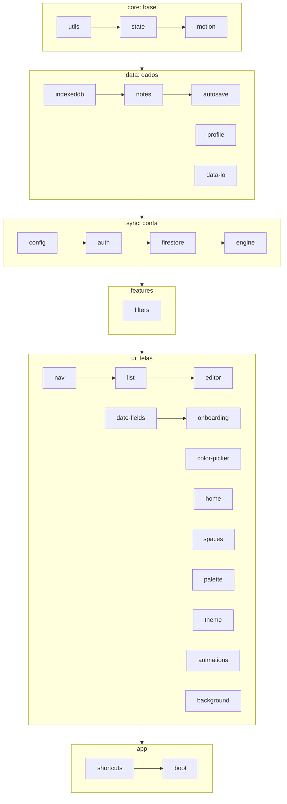
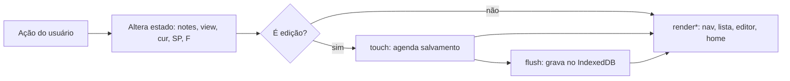

## Arquitetura

**Scripts clássicos, escopo global compartilhado.** Cada `.js` é carregado por `<script src>` na ordem do `index.html`. Declarações de nível superior (`function`, `const`, `let`) ficam visíveis para os arquivos seguintes. Escolhi isso em vez de ES Modules para que o app abra direto do disco (`file://`) e para que o `build` apenas concatene arquivos. A contrapartida é que **a ordem importa**: `scripts/check.mjs` impede nomes duplicados.

**Regras de dependência.** `core` não conhece ninguém. `data` conhece `core`. `ui` chama `data` e `features`, nunca o contrário (a exceção é o `autosave`, que pede à interface para redesenhar depois de gravar). `app/boot.js` é o último: só ele inicia a execução.

**Fluxo de dados (uma direção).** O estado vive em variáveis globais (`notes`, `view`, `cur`...). Uma ação (clique, tecla) altera o estado, chama `touch()` se for edição, e depois as funções `render*` redesenham a parte afetada a partir do estado. Não há cópia do estado dentro do DOM.

