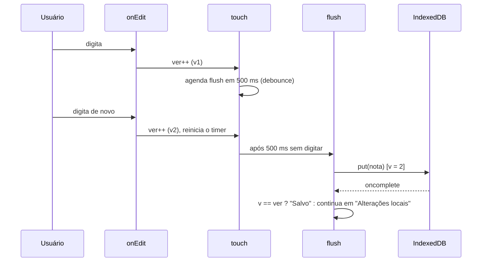

## Salvamento automático

O indicador **nunca mente**: "Salvo" só aparece depois que a transação do IndexedDB termina (`oncomplete`). Estados: *Alterações locais…* → *Salvando…* → *Salvo às HH:MM* (ou *Falha ao salvar*). Cada edição incrementa `ver`; ao terminar de gravar, `flush` compara a versão que gravou (`v`) com a atual. Se o usuário continuou digitando, **não** mostra "Salvo".

Ao trocar de nota, `openN` e `newNote` chamam `flush()` antes, e `beforeunload` tenta gravar a pendência.

<!-- codigo: src/js/data/autosave.js -->
