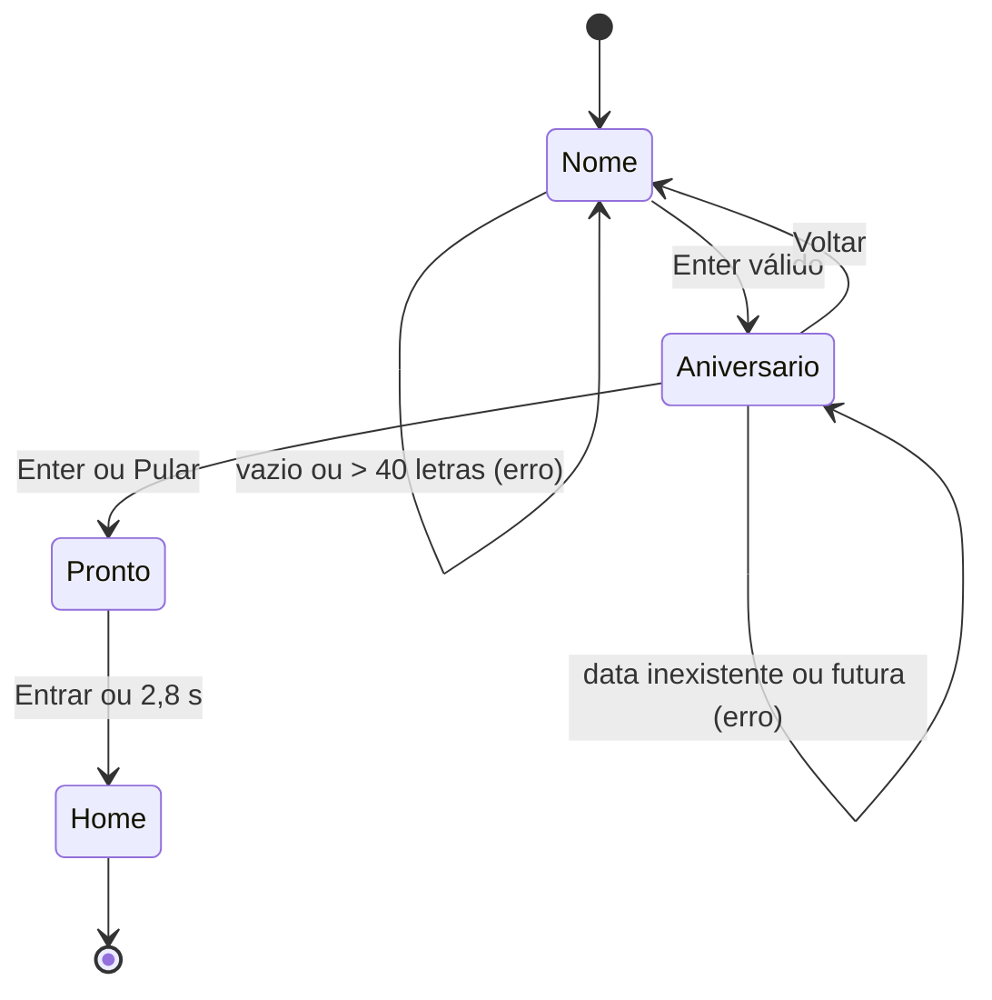

## Criação de perfil (onboarding)

No primeiro acesso, o overlay `#ob` cobre a tela inteira e faz uma pergunta por vez: **nome** e **aniversário** (opcional). O app por trás fica `visibility:hidden` e `inert` até terminar. O fundo de seda continua visível porque o overlay é transparente.

**Texto que cabe em qualquer tela.** A pergunta usa fonte de até 220 px. `fitOb` mede `scrollWidth` contra `clientWidth` e reduz a fonte em passos de 2 px até a palavra mais longa caber (útil para nomes longos em tela estreita). Também roda ao redimensionar e quando as fontes web terminam de carregar.

**Data em três campos.** Em vez do seletor nativo, `dtHTML` cria dia / mês / ano. `dtInit` aceita só dígitos, avança o foco ao completar, volta com Backspace e só grava no `<input hidden id="oi">` um valor ISO (`AAAA-MM-DD`) se a data **existe** (31/02 não existe). Preencher só parte da data gera erro; deixar vazio é permitido.

**Animação.** Cada palavra da pergunta está dentro de uma máscara (`.ow`, `overflow:hidden`) e sobe de `yPercent:115` para 0; a linha do campo se desenha com `scaleX`; ao concluir, `clip-path` sobe como uma cortina (`closeOb`).

<!-- codigo: src/js/ui/onboarding.js -->

<!-- codigo: src/js/ui/date-fields.js -->
