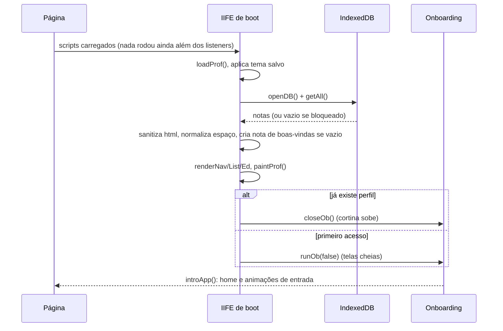

## Inicialização (boot)

Os `<script>` rodam em ordem; quase tudo que executa ao carregar é apenas registrar *listeners*. Só o último arquivo (`boot.js`) inicia o fluxo, quando todas as funções já existem.

<!-- codigo: src/js/app/boot.js -->
