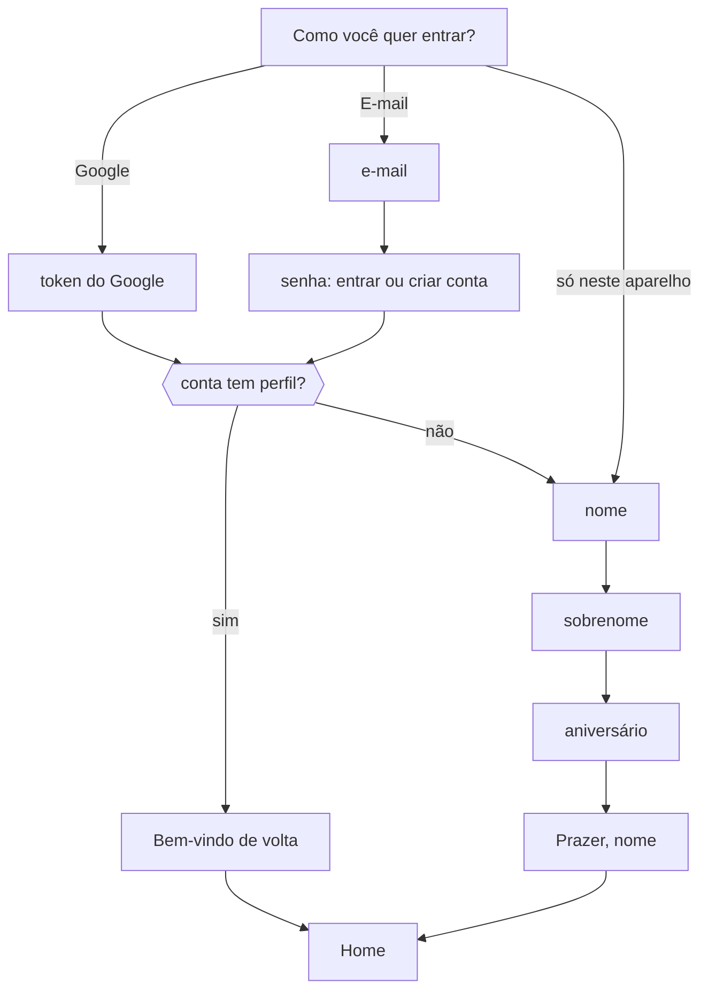

## Conta, login e sincronização

### O que é

Quem quiser pode **entrar com uma conta** (Google ou e-mail e senha) e ter as notas **sincronizadas entre aparelhos** (celular, computador). Sem conta, tudo continua funcionando só no aparelho, como antes. A conta é opcional e só existe se você configurar um projeto Firebase; sem configuração o app não mostra login e diz isso nas Configurações. Não há sincronização de mentira.

Usei **Firebase Authentication + Cloud Firestore** por RESTs simples (`fetch`), **sem o SDK**: menos código para carregar, funciona igual no navegador e no Android, e dá para testar com um servidor de mentira.

### Ativar (uma vez)

1. No [Console do Firebase](https://console.firebase.google.com) crie um projeto.
2. **Authentication → Método de login:** ative **E-mail/senha** e **Google**.
3. **Firestore Database:** crie o banco e publique as regras de `firebase/firestore.rules` (cada pessoa só lê e escreve `users/<seu uid>`).
4. Copie `noema.config.example.json` para `noema.config.json` e preencha `apiKey` e `projectId` (Configurações do projeto). A `apiKey` do Firebase **não é segredo**: a proteção são as regras do passo 3.
5. **Google no navegador:** no Google Cloud (APIs e serviços → Credenciais) crie um *ID do cliente OAuth* do tipo **Web**, registre os endereços do app em *Origens JavaScript autorizadas* e coloque o ID em `googleWebClientId`.
6. `npm run build`. O build injeta a configuração; sem o arquivo, o app fica local. (Para Android veja a seção própria.)

### Telas de entrada

No primeiro acesso, com a conta configurada, a primeira tela pergunta **"Como você quer entrar?"**: *Continuar com Google*, *E-mail e senha* ou *Usar só neste aparelho*. Depois vêm nome, **sobrenome** e aniversário (só quando a conta ainda não tem perfil). Quem já tem conta pula direto para o app ("Bem-vindo de volta").



**Login Google.** No Android, o plugin nativo `@capacitor-firebase/authentication` devolve o `idToken`; no navegador usa-se o *Google Identity Services* (popup) e o `accessToken`. Em ambos os casos o app troca a credencial por uma sessão do Firebase com `accounts:signInWithIdp`. Se nenhum dos dois estiver disponível, o botão do Google nem aparece e o e-mail continua funcionando.

**Sessão.** `idToken` (1 hora) e `refreshToken` ficam no `localStorage`; `freshToken()` renova o `idToken` um minuto antes de vencer. Se o Firebase recusar a renovação (conta desativada, token revogado), a sessão é descartada.

### Como a sincronização funciona

- **Onde fica:** `users/{uid}/notes/{id}` (uma nota por documento) e `users/{uid}/meta/profile` (nome, sobrenome, aniversário, espaços).
- **`dirty`:** toda nota editada fica marcada como "ainda não enviada". Importações e espaços renomeados também marcam. Notas antigas, de antes da conta existir, são tratadas como sujas e **sobem no primeiro login**.
- **Um ciclo (`syncNow`) = trazer, depois enviar.** Trazer: consulta as notas com `updated` maior que o último cursor guardado. Enviar: grava em lotes de 100 as notas sujas, as exclusões e o perfil. Roda 2,5 s depois de cada edição salva, ao voltar a conexão, ao voltar para a aba, a cada 60 s e ao tocar em "Sincronizar agora". Nunca duas ao mesmo tempo.
- **Conflitos.** Vale a edição **mais recente** de cada nota. Se a nota mudou nos dois lados, a versão local não é jogada fora: vira uma nota nova "(cópia local)". Uma nota que você está digitando agora nunca é sobrescrita no meio da digitação.
- **Exclusão definitiva.** Vira uma "lápide" (`deleted: true`) na nuvem para os outros aparelhos também apagarem.
- **Offline.** Tudo funciona; as alterações ficam pendentes e o menu mostra "nuvem: offline". Ao voltar a conexão elas sobem sozinhas.
- **Contas diferentes no mesmo aparelho nunca se misturam.** O app guarda de quem são os dados locais (`noema-owner`); ao entrar com **outra** conta, os dados locais são apagados antes de baixar os da nova.

```mermaid
sequenceDiagram
  participant L as Aparelho (IndexedDB)
  participant S as syncNow
  participant F as Firestore
  S->>F: runQuery: notas com updated > cursor
  F-->>S: notas novas ou alteradas
  S->>L: aplica (mais recente vence; conflito vira cópia local)
  S->>F: commit em lotes: notas sujas, lápides, perfil
  F-->>S: ok
  S->>L: limpa dirty (se a nota não mudou durante o envio)
```

### Sair (logout)

Em Configurações → Conta → **Sair** o app pergunta: *Sair e apagar dados deste aparelho* (útil em aparelho emprestado; as notas continuam na nuvem) ou *Sair e manter dados aqui*. Antes de sair, tenta enviar o que está pendente; se for apagar e não conseguir enviar tudo, **recusa** e avisa.

### Configurações (modal)

Um único modal com: **Tema** (AMOLED/Claro), **Animações** (Sim/Auto/Não), **Conta** (e-mail, status, sincronizar agora, sair), **Perfil** (nome, sobrenome e aniversário editáveis), espaços e backup. Abre pelo botão "Configurações" do menu ou pela paleta (Ctrl+K).

### Testes

`tests/mock-firebase.mjs` é um servidor de mentira com as mesmas respostas do Firebase Auth e do Firestore (inclusive a regra de que só o dono acessa seus dados). `tests/sync.py` abre **dois aparelhos** e confere: criar conta (senha fraca recusada), perfil com sobrenome na conta, segundo aparelho recebendo tudo, edição que viaja, **offline**, **conflito sem perda**, exclusão que se propaga, configurações, logout apagando, login Google (plugin simulado) e **troca de conta sem misturar dados**.

### Limitações

- "Vence a mais recente" usa o relógio do aparelho; relógios muito errados podem decidir mal (a cópia local reduz o risco).
- As lápides de exclusão não são limpas automaticamente.
- Não há verificação de e-mail, nem exclusão de conta pelo app (apague pelo Console do Firebase).
- O login Google no navegador exige endereço HTTPS registrado no OAuth. Na página publicada no claude.ai a rede para outros sites é bloqueada, então lá o app roda sempre em modo local.
- Não consegui testar com um projeto Firebase real nem com o login Google real (sem internet neste ambiente): os testes usam o servidor de mentira e um plugin simulado.

<!-- codigo: src/js/sync/config.js -->

<!-- codigo: src/js/sync/auth.js -->

<!-- codigo: src/js/sync/firestore.js -->

<!-- codigo: src/js/sync/engine.js -->

<!-- codigo: src/js/ui/onboarding.js -->

<!-- codigo: src/js/ui/settings.js -->

<!-- codigo: src/js/data/profile.js -->

<!-- codigo: src/js/ui/theme.js -->

<!-- codigo: firebase/firestore.rules -->

<!-- codigo: noema.config.example.json -->

<!-- codigo: tests/mock-firebase.mjs -->

<!-- codigo: tests/sync.py -->
